# Module 1: IT Service Desk & Incident Management (ServiceNow)

## Scenario
All tickets are simulated scenarios set in **Banksia Aged Care**, a fictional multi-site
residential aged care provider (Main, Northside and Eastwood sites)
operating 24/7. System downtime directly affects resident care
documentation, which shapes priority and communication decisions
throughout.

## Environment
- Platform: ServiceNow Personal Developer Instance
- Data: built-in demo users, plus a custom assignment group
  (Clinical Applications) created for escalation
- Scope: incident logging, prioritisation, escalation, on-hold
  handling, resolution, knowledge management and service requests

## Key terms
| Term | What it means |
|---|---|
| **Incident** | Unplanned interruption to a service or reduction in quality of service (e.g. an app is down) |
| **Service request** | A request for something new, like equipment or access – nothing is broken |
| **Impact** | How many people are affected |
| **Urgency** | How quickly it needs to be fixed |
| **Priority** | Calculated automatically from Impact and Urgency (1 = most critical) |
| **SLA** | The agreed time limit to respond to and resolve a ticket |
| **Escalation** | Passing a ticket to a more specialised team |
| **Parent / child incident** | One main ticket for an outage, with other reports of the same issue linked to it |
| **On hold** | Paused while waiting on someone else, such as the user or a vendor |
| **Work notes** | Internal notes only IT staff can see |
| **Additional comments** | Updates the user can see |
| **Knowledge article** | A written fix others can follow next time |

## Summary of work
| Ticket | Scenario | Priority | Outcome |
|---|---|---|---|
| INC0010014 | Care documentation app down across 3 sites | 1 - Critical | Escalated, vendor fix, resolved |
| INC0010015/16 | Site reports of the same outage | 4 - Low | Linked as child incidents, auto-resolved |
| INC0010017 | New starter can't log in on first shift | 3 - Moderate | Access fixed, user confirmed, closed |
| INC0010018 | Shared nurses' station PC offline | 3 - Moderate | Fixed by phone, knowledge article written |
| INC0010020 → REQ0010001 | Equipment request logged as incident | 4 - Low | Cancelled and re-raised via Service Catalog |

---

## How priority is calculated
Priority isn't chosen manually. ServiceNow calculates it from
**Impact** (how many people are affected) and **Urgency** (how quickly
it's needed) using this lookup table:

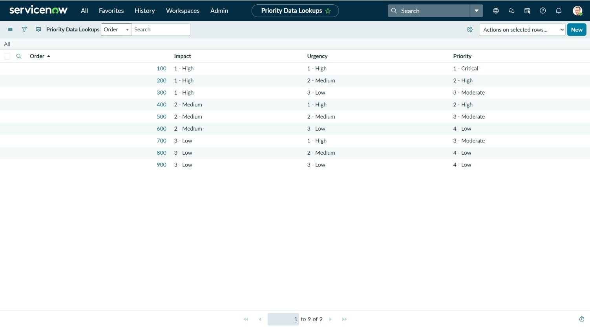

---

## Ticket A – CareNotes outage across all sites (P1)

**Situation:** At 10:40pm the RN in charge at Main site called the
after-hours IT line: the care documentation app (CareNotes) was
showing an error for every user. Night shift could not record
resident care.

**Actions:**
- Logged with Impact High / Urgency High, giving Priority 1 - Critical
- Northside and Eastwood sites reported the same issue, so their
  tickets were linked to the main incident as child incidents
- Because all three sites were affected while other apps and the
  network were working, the fault was isolated to the application
  itself and escalated to the Clinical Applications team
- Advised staff to switch to the paper downtime procedure, with a
  committed time for the next update
- Placed on hold awaiting the vendor, then confirmed the fix with
  staff at two sites before resolving

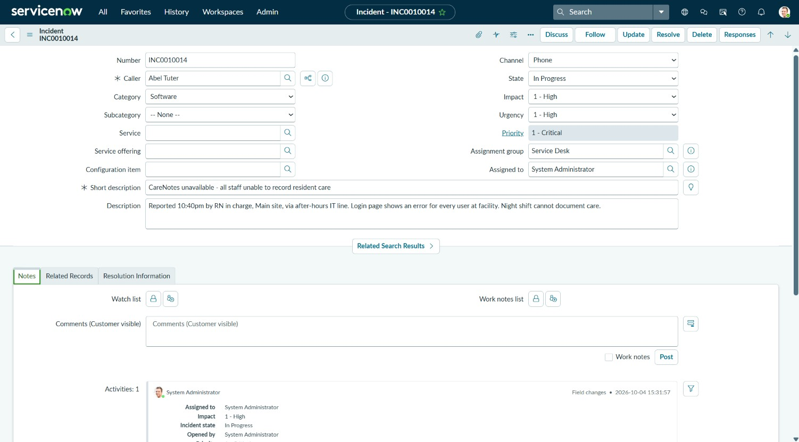

Internal work note (yellow) kept separate from the customer-visible
update, with both site reports linked as child incidents:

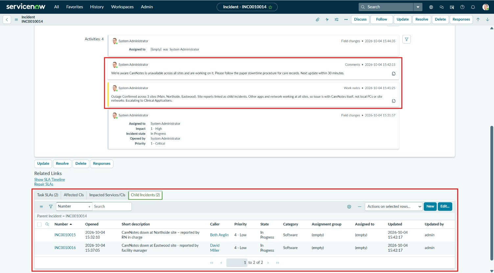

SLA tracking on the P1:

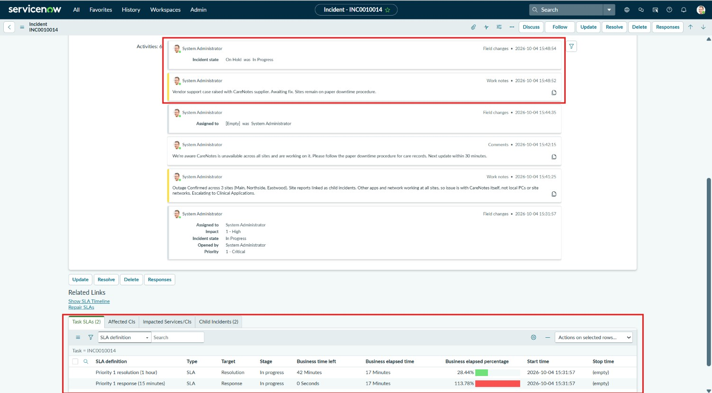

> **Note on SLAs:** The 15-minute P1 response SLA breached while I was
> linking the site reports. In a live P1, the first update to staff
> should go out before tidying up duplicates.

Full timeline, including the escalation to Clinical Applications:

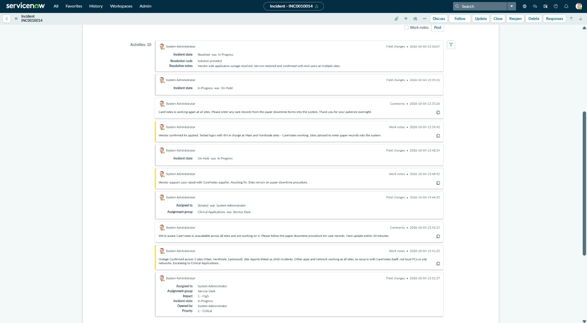

Resolving the parent automatically resolved both child incidents:

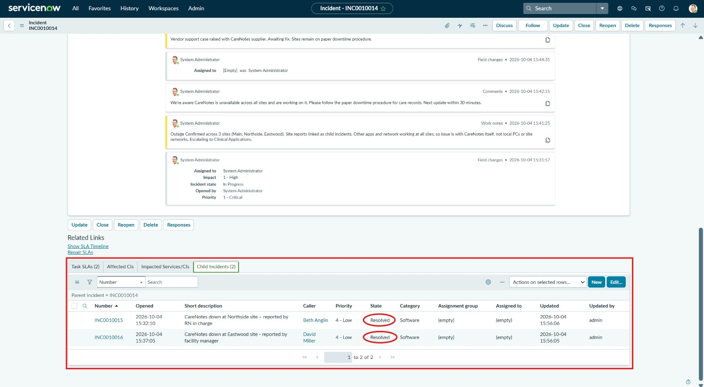

---

## Ticket B – New starter can't log in on first shift (P3)

**Situation:** A new RN starting their first night shift couldn't log
in to the PC or CareNotes. Error: account disabled.

**Actions:**
- Set Impact Low (one person) / Urgency High (on shift now), giving
  Priority 3 - Moderate, lower than the facility-wide outage despite
  the urgency
- Verified the user's identity with the shift manager before making
  any changes
- Found the account had been created by onboarding but left disabled
  and missing its group membership; enabled it, added the group and
  set a temporary password requiring change at next logon
- Gave the temporary password to the shift manager to pass on in
  person rather than writing it in the ticket
- Placed on hold awaiting the user's confirmation, which the user
  provided through the self-service portal
  
Impact, Urgency and Priority are outlined in red: one urgent user
(Impact Low, Urgency High) still calculates to 3 - Moderate, lower
than the facility-wide outage in Ticket A.

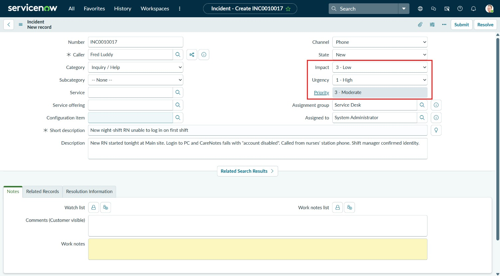

The user's reply from the self-service portal:

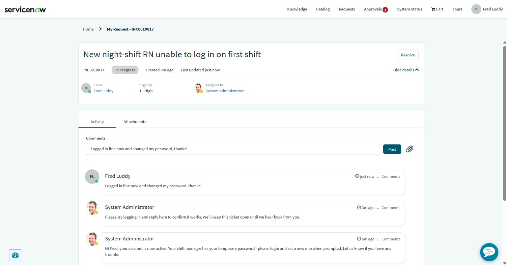

Full Activity Timeline:

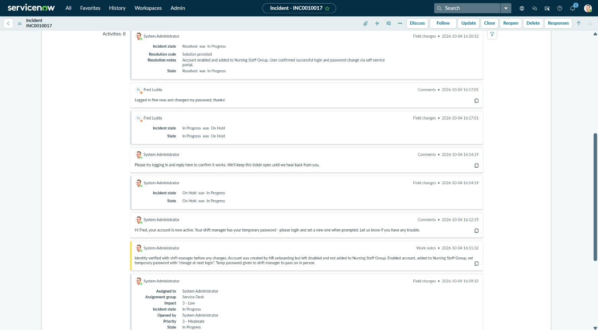

---

## Ticket C – Nurses' station PC has no network (P3)

**Situation:** A shared nurses' station PC at Northside showed "No
Internet" while other PCs on the floor were fine.

**Actions:**
- Remote support via TeamViewer wasn't possible because the PC was
  offline, so I guided the RN through troubleshooting by phone
- `ipconfig` showed a 169.254.x.x (APIPA) address, meaning the PC
  wasn't getting an address from DHCP
- The RN found the network cable loose at the wall port; after
  reseating it, `ipconfig /release` and `/renew` gave a valid address
- Connected via TeamViewer to confirm internet and CareNotes working

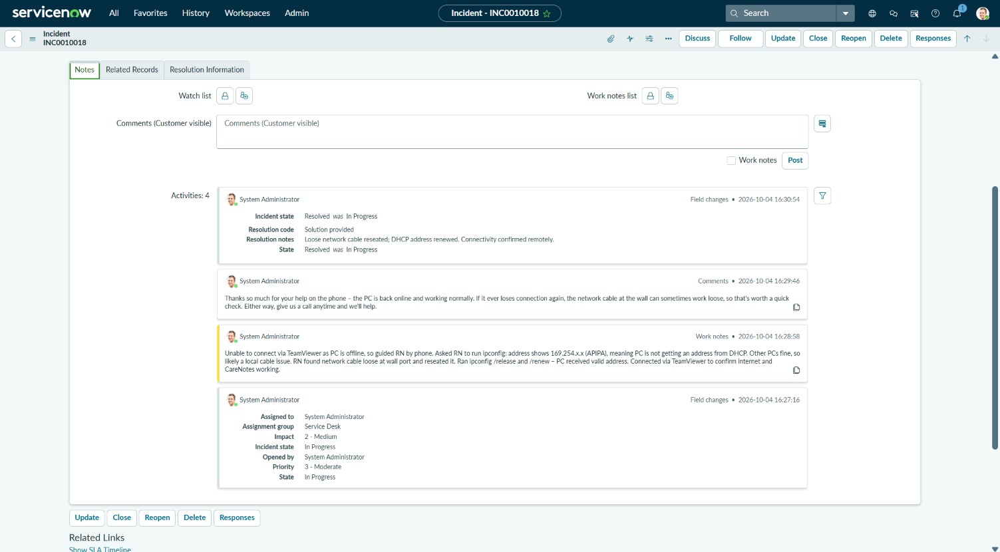

I turned the fix into a knowledge article so staff or the next
technician can resolve it without a call. It went into the review
workflow before getting published:

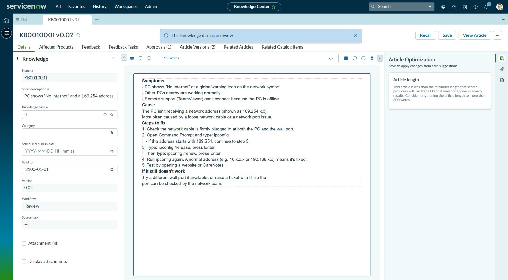

---

## Request D – Incident vs Service Request

**Situation:** A request for a dual monitor stand had been logged as an
incident.

**Actions:**
- Identified that requesting new equipment is a **service request**,
  not an incident (nothing was broken or interrupted)
- Cancelled the incident with a note explaining why, and let the user
  know where their request had gone
- Raised it through the Service Catalog on the user's behalf, noting
  the original incident number (INC0010020) in the request for
  traceability

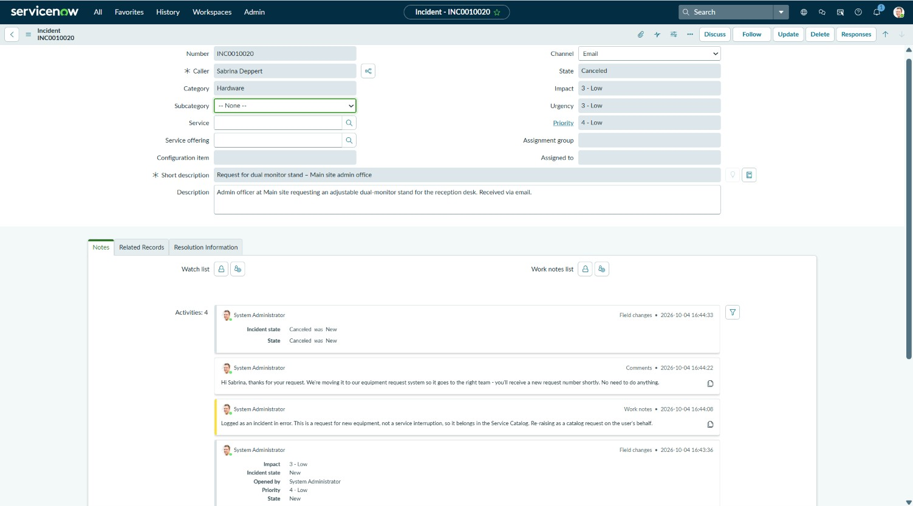

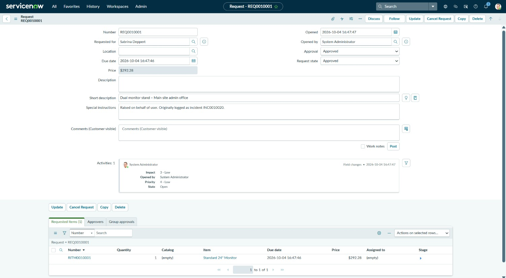

*The catalog has no monitor stand item, so the closest hardware item
was ordered to demonstrate the request process.*

---

## Queue overview

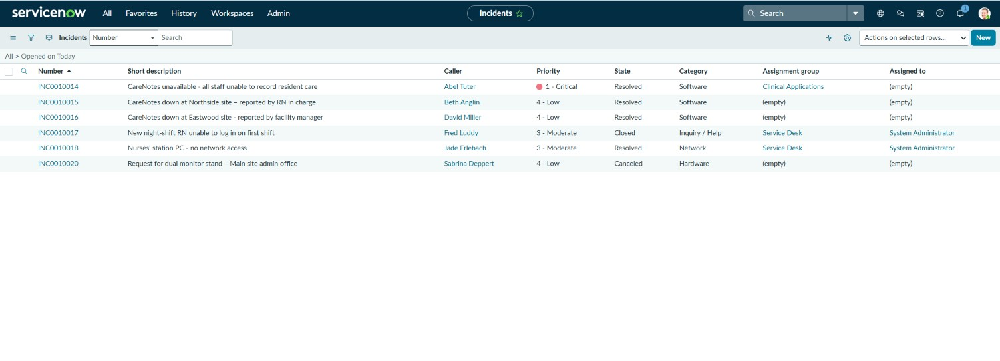

---

## What I learned
- **Impact and urgency are different things.** One locked-out user
  can be urgent, but a facility-wide outage affects far more people
  and gets a higher priority.
- **Linking duplicate reports to one parent incident** keeps the queue
  manageable, and resolving the parent closes them all.
- **Work notes stay internal; additional comments go to the user.**
  Work notes can't be edited once posted because they form the audit
  trail.
- **ServiceNow enforces good practice:** a customer comment is required
  when placing a ticket on hold awaiting the caller, and the ticket
  moves back to In Progress automatically when the caller replies.
- **Remote tools need a working connection.** When a PC is offline,
  troubleshooting has to happen by phone with the user.
- **Not every ticket is an incident.** Requests for new equipment
  belong in the Service Catalog, and the user should be told when
  their ticket is moved.
- **Communication matters as much as the fix:** clear updates,
  realistic next-update times and a friendly tone reduce follow-up
  calls.
