# Module 2: End User Device Support

All tickets are **simulated scenarios** set in **Banksia Aged Care**, a fictional aged care provider.
The ServiceNow tickets and the Windows work are real; the calls and fault stories are role-played.
In a real workplace I'd connect to the user's PC with a remote tool such as TeamViewer; here I worked directly in the VM.

## Environment

| Item | Detail |
|---|---|
| Host | Laptop with 16 GB RAM |
| Hypervisor | VMware Workstation Pro (free for personal use) |
| Guest OS | Windows 11 Enterprise Evaluation (90-day), local account |
| Virtual PC | BANKSIA-PC01: 2 CPUs, 5 GB RAM, 64 GB disk, virtual TPM, NAT network |
| Ticketing | ServiceNow Personal Developer Instance (see Module 1) |

## Setup: building BANKSIA-PC01
VM hardware: 2 CPUs, 5 GB RAM, 64 GB disk and a virtual TPM (required by Windows 11).

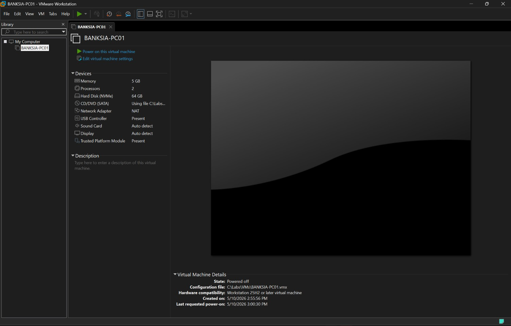

Installing onto the empty virtual disk (Disk 0, unallocated). The laptop's own drive isn't touched.

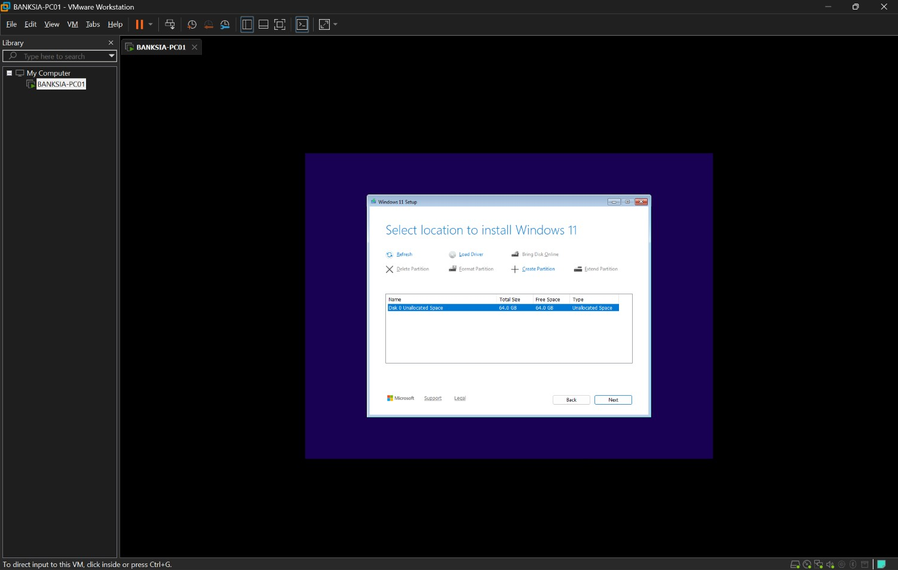

`winver` confirms the installed edition and build.

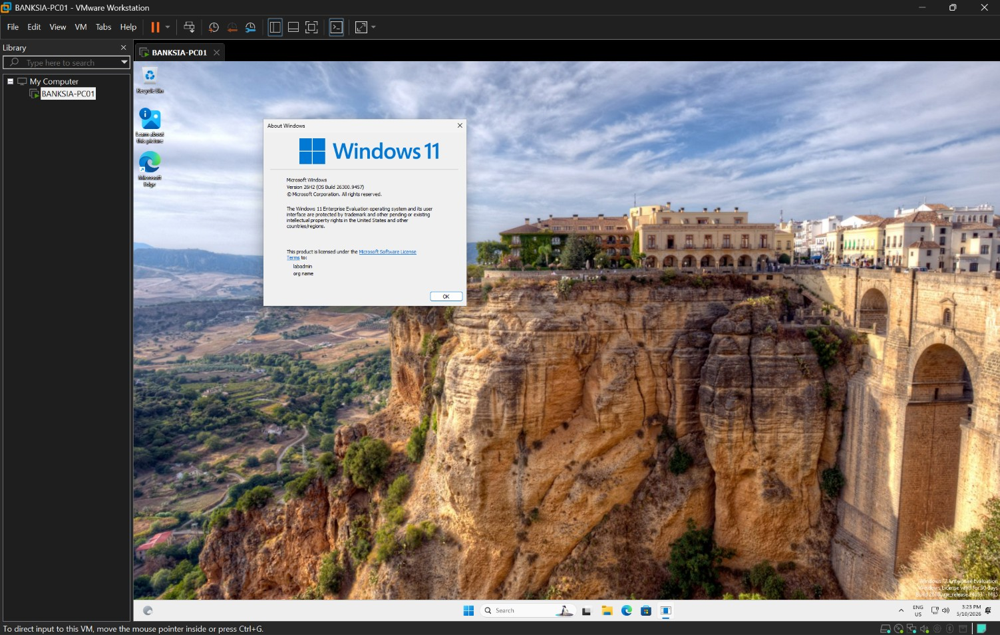

Windows Update run until up to date, so the PC is patched before any other work.

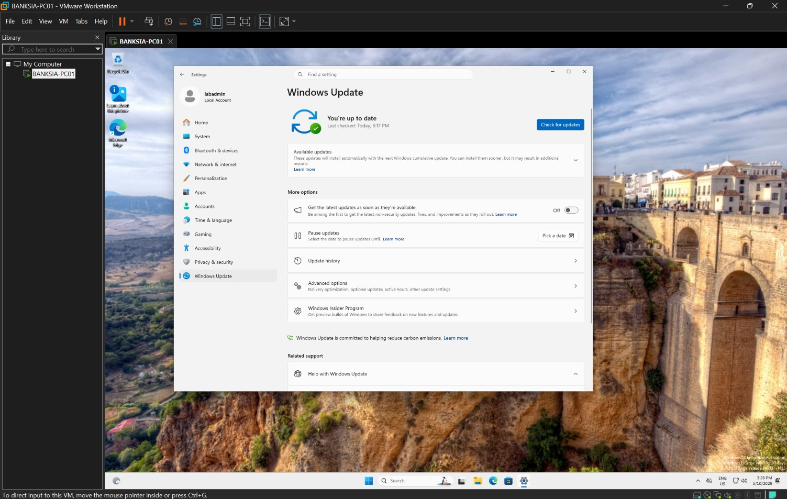

Snapshot of the clean, updated PC, used as a restore point before breaking things on purpose.

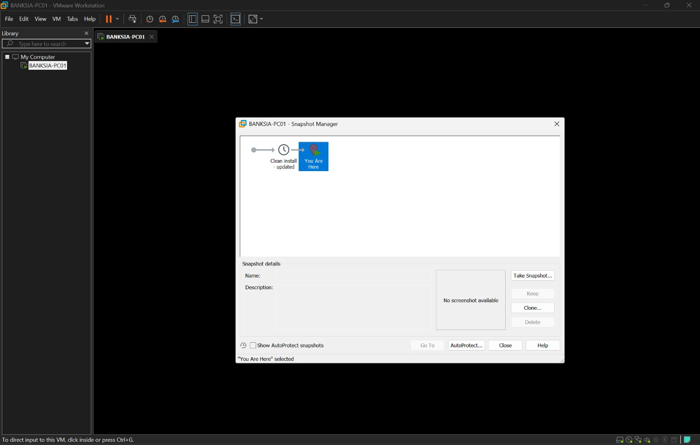

## Part 1: Add a data drive

**Why:** In real workplaces, user data is often kept on a separate drive from Windows. If Windows breaks and the PC has to be rebuilt, the data drive survives. Adding and preparing a new drive is also a routine upgrade task when a PC runs low on storage. In this lab, the Data drive is also the backup destination used in Part 4.

**What I did:** Added a 20 GB virtual disk, then set it up in Disk Management:
- **Initialised it as GPT**: a new disk is blank, and Windows has to prepare it before use. GPT is the modern partition style used on current PCs (MBR is the older one).
- **Created a volume and formatted it NTFS** (label Data): NTFS is the standard Windows file system, supporting permissions and large files.
- **Assigned a drive letter**: it took E: because D: is the DVD drive.

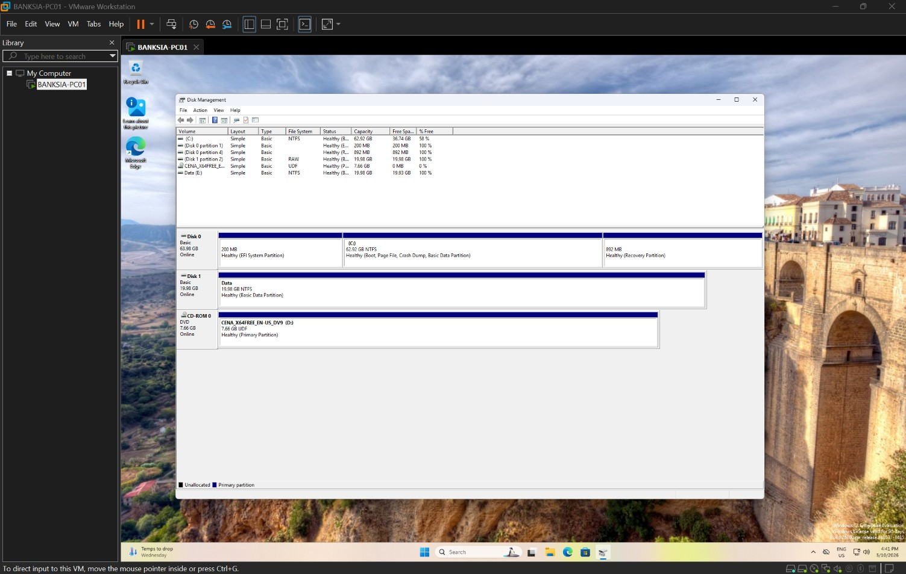

## Part 2: Slow PC (INC0010022)

**Scenario:** the nurses' station PC is extremely slow.

**Why:** "My PC is slow" is one of the most common tickets. The first step is finding what is using the computer's resources, rather than guessing or restarting straight away.

**What I did:** I simulated a stuck program using two PowerShell loops (`while($true){}`), commands that run forever and keep the processor busy, like a frozen app would. In Task Manager, sorted by CPU, total CPU was 99% with two PowerShell processes at about 46% each. I ended both and CPU dropped to 8%. I added a work note and a plain-English comment to the caller, then resolved the ticket.

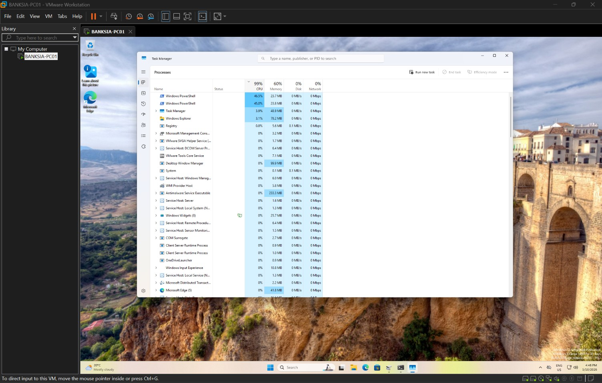
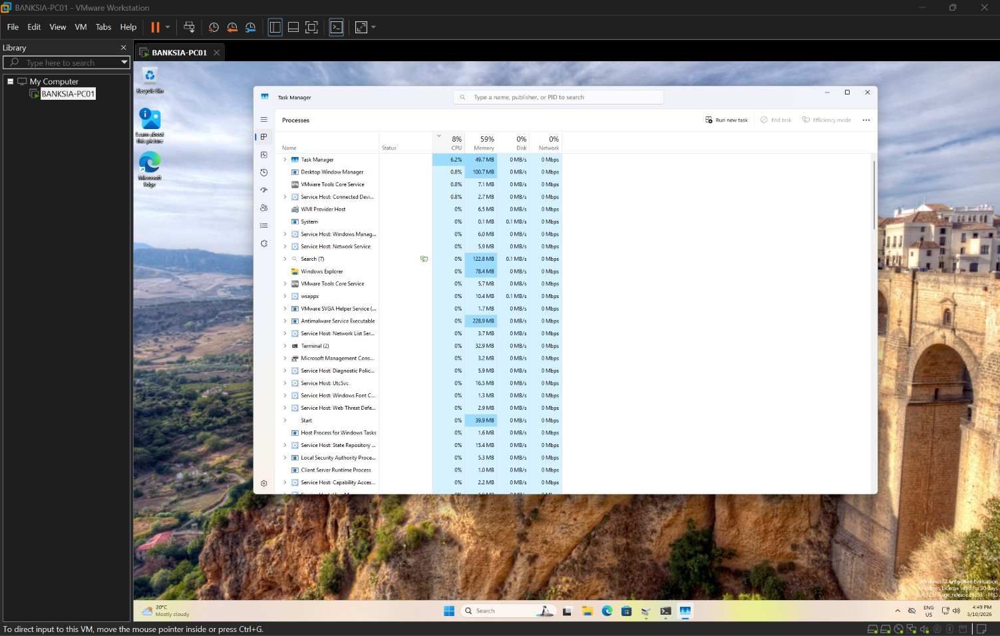
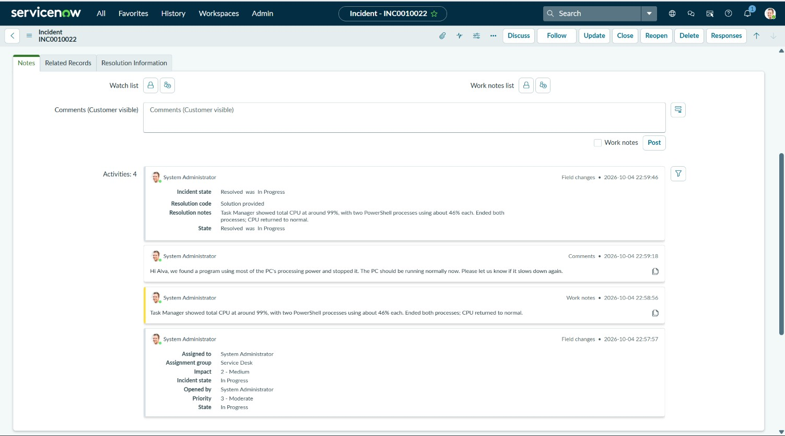

**Real-world note:** a hung process is only one cause. The same check in Task Manager also shows high memory use (too many apps open or not enough RAM) or high disk use (updates, scans or a failing drive), each with a different fix.

## Part 3: PC switching off by itself (INC0010024)

**Scenario:** the PC has turned off twice without warning.

**Why:** staff can't tell whether a PC switched off because of a crash, an update or a power problem, and each needs a different fix. The Windows logs record what actually happened, so I checked the evidence before changing anything.

**What I did:** I simulated power loss with **VM > Power > Power Off** twice, plus one normal restart for comparison. In Event Viewer (System log, filtered to Event IDs 41, 6008 and 1074):

| Event ID | Meaning | What I saw |
|---|---|---|
| 41 (Kernel-Power) | Windows restarted without a clean shutdown | Two entries |
| 6008 | The previous shutdown was unexpected | One within seconds of each 41 |
| 1074 | A planned restart | My normal restart |

This is consistent with a sudden loss of power rather than a normal restart. In a real case I'd also check for crash events and the physical power connection. The ticket recommends checking the power connection and using a UPS for clinical workstations.

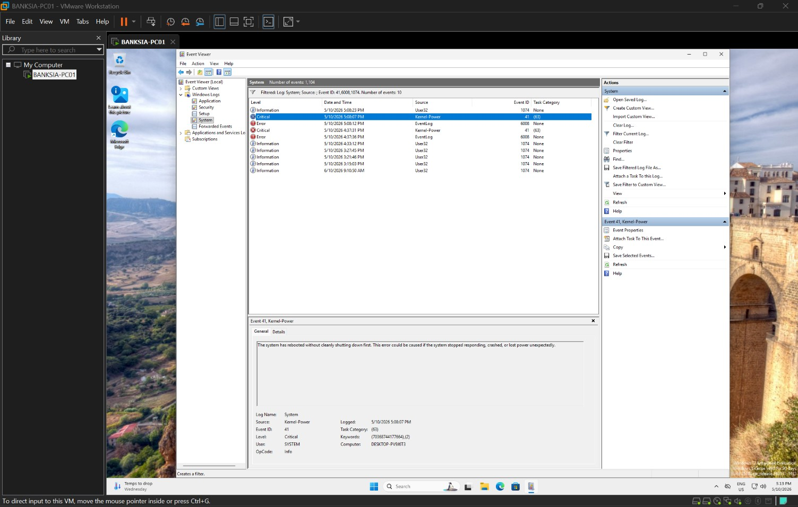
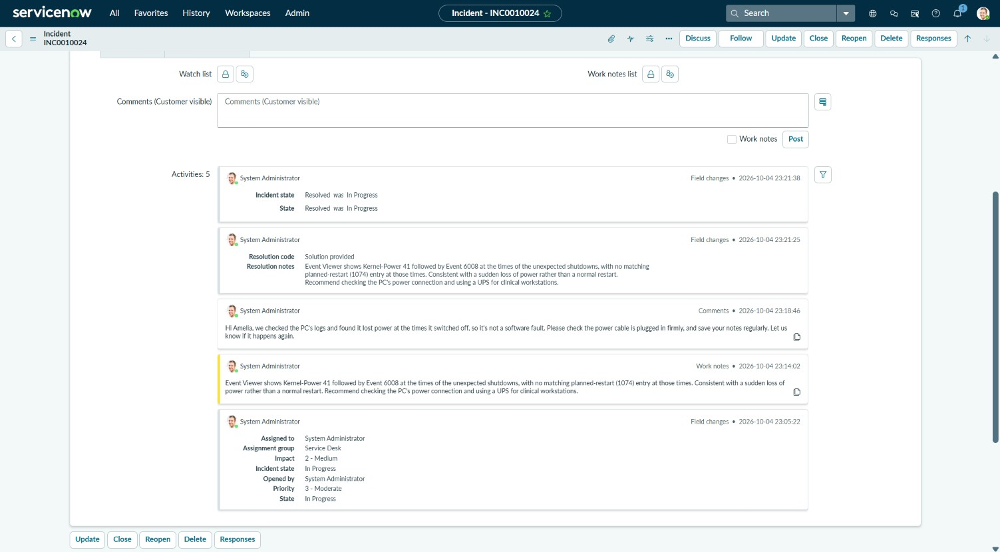

## Part 4: Restore a deleted file (INC0010025)

**Scenario:** a staff roster file was deleted and the Recycle Bin emptied.

**Why:** restoring deleted or overwritten files is one of the most frequent L1 requests. It only works if backups were set up beforehand, so the job covers both configuring a backup and recovering from it.

**What I did:** File History would not accept the second virtual disk ("Reconnect your drive"), so I used **Backup and Restore (Windows 7)** instead. My first run included a system image and failed for lack of space on the 20 GB drive. I unticked it and backed up Documents only. Then I deleted `Staff-roster.txt`, emptied the Recycle Bin and restored it from the backup.

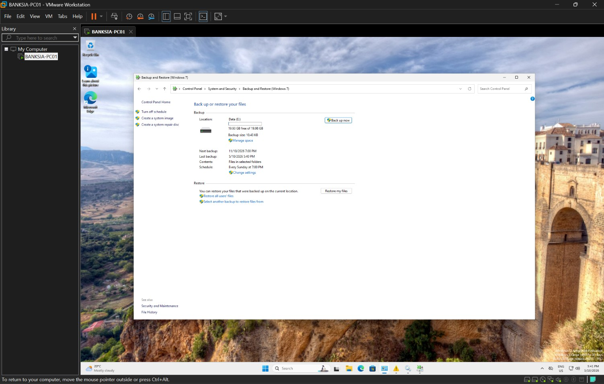

*Staff-roster.txt after restoring from the backup on the Data drive. The file had been deleted and the Recycle Bin emptied beforehand.*

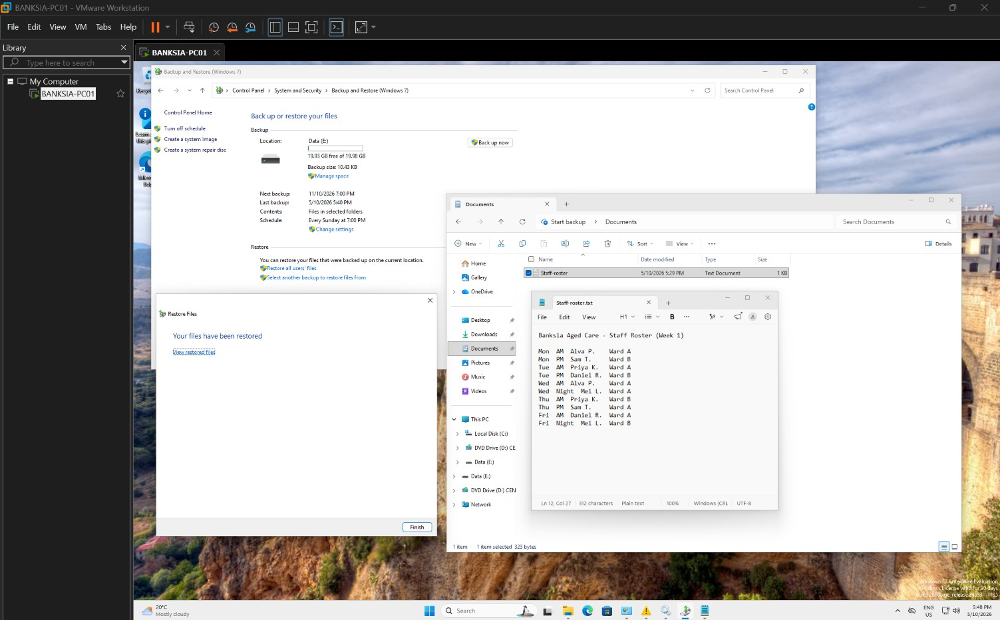
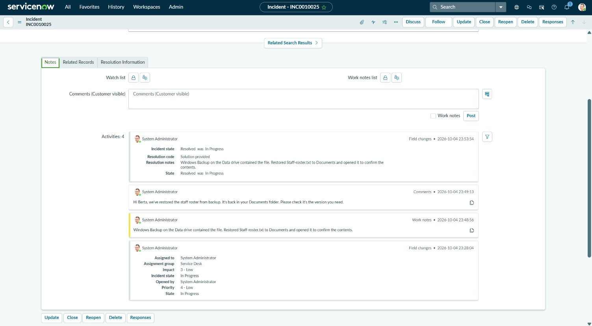

**Real-world note:** a backup on a drive inside the same PC doesn't protect against theft, fire or ransomware. Real backups follow the **3-2-1 rule** (3 copies, 2 types of storage, 1 off-site) and are usually run centrally, for example with OneDrive or SharePoint for user files. This lab shows the idea at small scale.

## Key terms

- **Virtual machine (VM):** a full computer running inside a window on another computer.
- **Snapshot:** a save point for a whole VM that lets you roll back after changes.
- **Local account:** a login that exists only on that PC, not tied to a Microsoft account.
- **TPM:** a security chip that Windows 11 requires; the VM provides a virtual one.
- **GPT / NTFS:** the partition style and file system used to set up the new drive.
- **Hung process:** a program that has stopped responding but keeps using resources.
- **Kernel-Power 41 / Event 6008:** Windows log entries recorded when a PC shuts down without warning.
- **Event 1074:** the log entry for a planned restart.

## What I learned

- "PC is slow": check Task Manager first (CPU, memory, disk) before changing anything.
- "PC keeps turning off": Event Viewer tells you whether it was a planned restart (1074) or a sudden loss of power (41 and 6008).
- A backup on the same PC isn't enough; follow 3-2-1.
- When a tool fails (File History here), say what happened, switch to another that does the job, and document it.
- A snapshot makes it safe to break things and recover quickly.
