# Module 3: Active Directory – Users, Groups, OUs, Group Policy and Auditing

All tickets are **simulated scenarios** set in **Banksia Aged Care**, a fictional aged care provider.
The domain, accounts, policies and logs are real and were built by me in a lab; the user calls and stories are role-played.

## What I built

A small company network: a **domain controller** (the server that stores every user, password, group and policy) and a **staff PC** joined to the domain, so staff log in with company accounts and IT manages everything centrally.

| Item | BANKSIA-DC01 (server) | BANKSIA-PC01 (staff PC) |
|---|---|---|
| OS | Windows Server 2025 Standard Evaluation (Desktop Experience) | Windows 11 Enterprise Evaluation (from Module 2) |
| Role | Domain controller + DNS server | Domain-joined staff workstation |
| IP address | 192.168.126.10 (fixed) | Automatic (DHCP) |
| Subnet mask | 255.255.255.0 | Automatic |
| Default gateway | 192.168.126.2 | Automatic |
| DNS server | 127.0.0.1 (itself) | 192.168.126.10 (DC01) |
| DNS forwarder | 192.168.126.2 | – |
| Domain | banksia.local (NetBIOS: BANKSIA) | Joined to banksia.local |

Hypervisor: VMware Workstation Pro, both VMs on the NAT network. Ticketing: ServiceNow (see Module 1).

## Key terms

| Term | What it means |
|---|---|
| **Active Directory (AD)** | Microsoft's central directory of users, computers, groups and permissions for an organisation |
| **Domain** | The group of users and computers managed together by AD (here: banksia.local) |
| **Domain controller (DC)** | The server that runs AD and checks every login |
| **DNS** | Translates names (like banksia.local) into IP addresses; domain PCs use it to find the DC |
| **OU (Organisational Unit)** | A folder for organising accounts; policies and permissions can be applied to it |
| **Security group** | A collection of users given access together |
| **Delegation** | Giving a group specific admin powers over part of AD, without full admin rights |
| **Least privilege** | Giving people only the access their job needs |
| **GPO (Group Policy Object)** | A set of settings pushed from the DC to computers or users |
| **RSAT** | Remote Server Administration Tools, which let an IT PC run AD tools without logging in to the server |
| **Audit log** | The Windows Security log recording who did what, and when |

---

## Part 1: Building the domain controller

**What I did:** installed Windows Server 2025 (Desktop Experience) in a new VM and renamed it **DC01**.

**Why Desktop Experience:** the other installation options have no desktop, only a command line.

### Fixed IP address
**What:** set DC01's IP to **192.168.126.10**, with the gateway **192.168.126.2** and DNS pointing to itself (**127.0.0.1**).
**Why:** every PC finds the domain by contacting the DC. If its address changed, PCs couldn't find it, so servers get a **static IP**. I chose .10 because it sits outside VMware's automatic address range, so nothing else will be given the same address.
**If skipped:** the DC could receive a new address after a restart, and every PC would fail to log in.

DC01 named and given its fixed IP. *(Taken before the domain was created, so it still shows WORKGROUP. The time zone was set to US Pacific at this point and was corrected to Sydney before the audit work; see Part 9.)*

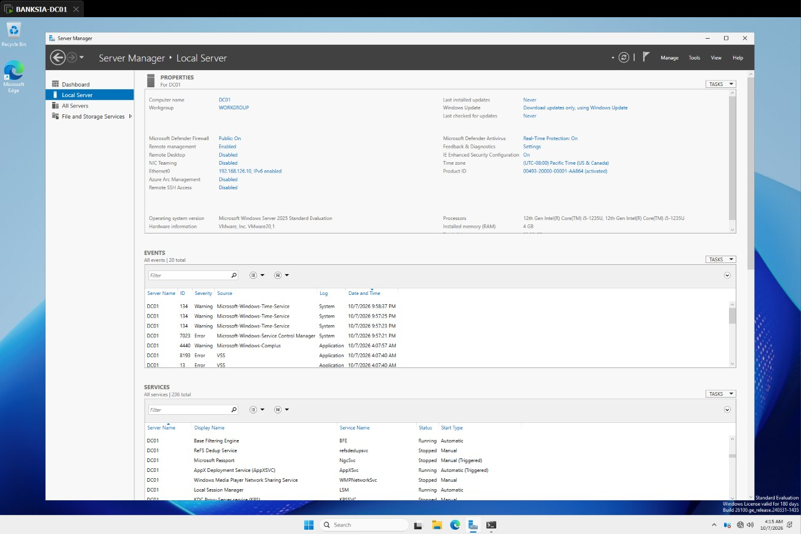

### Installing Active Directory and creating the domain
**What:** added the **Active Directory Domain Services** role, then promoted DC01 to a domain controller in a **new forest** called **banksia.local**. This also installed the DNS server role.
**Why:** this is what turns an ordinary server into the central login and management server for the organisation.
**Real world:** Microsoft recommends using a subdomain of a domain the organisation owns (e.g. ad.banksiacare.com.au). `.local` is common in labs but avoided in production.

The banksia.local domain in Active Directory Users and Computers.

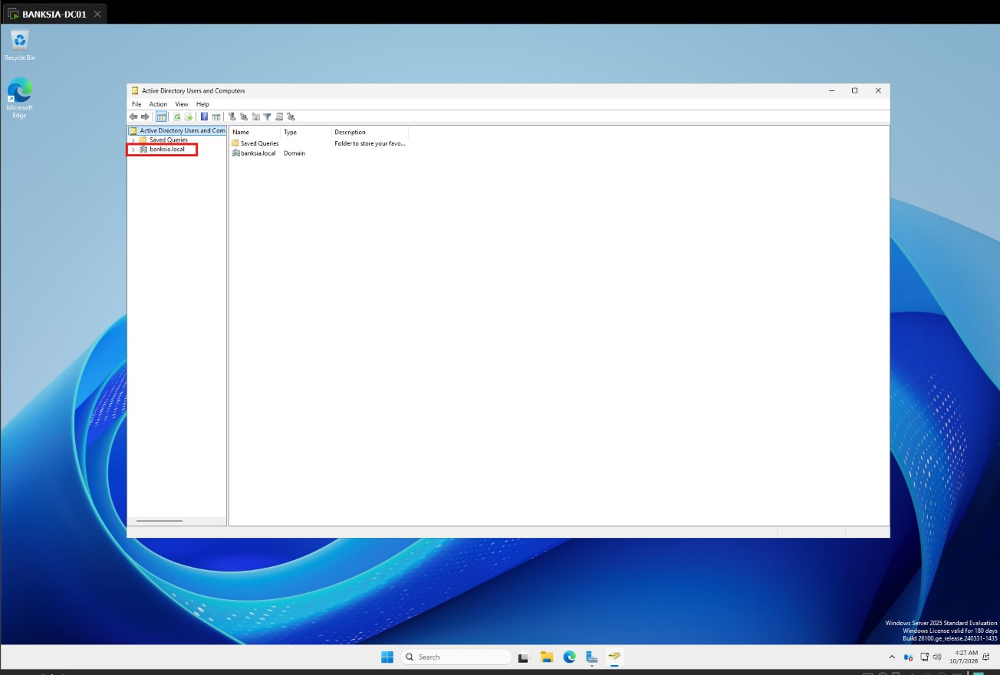

### DNS forwarder
**What:** set DC01 to forward outside name lookups to **192.168.126.2** (the network gateway).
**Why:** staff PCs use DC01 for DNS. DC01 knows the names inside banksia.local, but needs to know where to send questions about outside websites.
**If skipped:** PCs could log in to the domain but couldn't open any website.

---

## Part 2: Joining PC01 to the domain

**What I did:**
1. Pointed PC01's DNS at **DC01 (192.168.126.10)**.
2. Tested with `nslookup banksia.local`.
3. Renamed the PC to **BANKSIA-PC01** and joined it to **banksia.local** using a domain admin account.

**Why the DNS change comes first:** a PC finds the domain controller by asking DNS. If PC01 asked an internet DNS server, it would never find banksia.local. Domain PCs **must** use the DC for DNS. (This is the opposite of Module 2's DNS fault, where a wrong manual DNS setting broke the PC.)
**If skipped:** the join fails with "An Active Directory domain controller could not be contacted."

PC01 successfully joined to the domain.

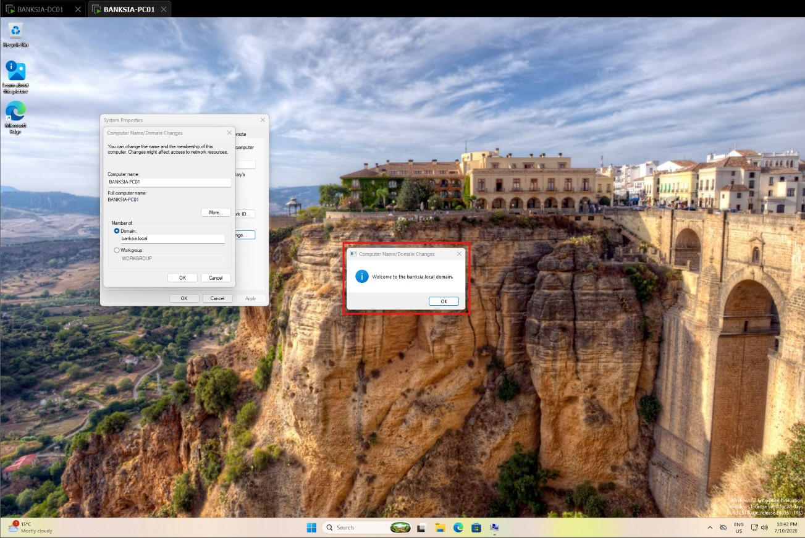

### Local vs domain accounts
After joining, PC01 has two kinds of accounts:

| Account | Type | Sign in as |
|---|---|---|
| labadmin (from Module 2) | **Local**: exists only on PC01 | `.\labadmin` |
| Administrator, staff accounts | **Domain**: stored on DC01, work on any domain PC | `BANKSIA\username` |

I kept **labadmin** as a backup. If PC01 ever loses its connection to the domain, a local admin account still lets IT log in to fix it. Real organisations manage these local admin passwords with **LAPS**, so every PC has a different, rotating password.

---

## Part 3: OU structure

**What I did:** built this structure and moved BANKSIA-PC01 from the built-in Computers folder into **Banksia\Computers**:
banksia.local
└── Banksia
├── Computers (BANKSIA-PC01)
├── Disabled Users (leavers)
├── Groups (security groups)
├── IT (IT staff accounts)
└── Staff
├── Admin
├── Clinical
└── Management

**Why:**
- OUs let different **policies** apply to different things (e.g. the logon notice applies only to Banksia\Computers).
- OUs let **permissions** be delegated by area (the Service Desk manages Staff only).
- **IT** sits outside **Staff** on purpose, so the Service Desk can't reset IT accounts.
- The built-in "Users" and "Computers" folders are **containers**, not OUs, and Group Policy can't be linked to them. That's why PC01 was moved.

**If skipped:** every policy would have to apply to everyone, and the Service Desk would need much wider permissions.

The Banksia OU structure, with PC01 moved into Banksia\Computers.

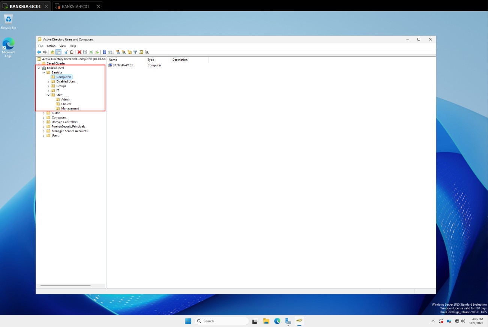

---

## Part 4: Users and groups

**What I did:** created four **global security groups** in Banksia\Groups and placed users in the matching OUs and groups. Each user was set to **change their password at next logon**.

| User | Logon | OU | Group |
|---|---|---|---|
| Fred Luddy (RN) | fluddy | Staff\Clinical | Clinical Staff |
| Jade Erlebach (RN, new starter) | jerlebach | Staff\Clinical | Clinical Staff |
| Agency RN (temporary) | agencyrn | Staff\Clinical | Clinical Staff (later removed) |
| Beth Anglin (Care Manager) | banglin | Staff\Management | Care Managers |
| Sabrina Deppert (Admin Officer) | sdeppert | Staff\Admin | Admin Office |
| Shristi Tuladhar (Service Desk) | stuladhar | IT | Service Desk |

**Why groups:** access is given to **groups, not individuals**. A new nurse added to Clinical Staff instantly gets everything nurses need; removing them takes it all away. This is faster and far less error-prone than setting access person by person.
**Why "change password at next logon":** IT sets a temporary password, and the user replaces it on first login, so **only the user** knows their real password.
**Naming convention:** first initial + surname (e.g. fluddy), so usernames are predictable.

Fred's group membership: Clinical Staff plus the default Domain Users group.

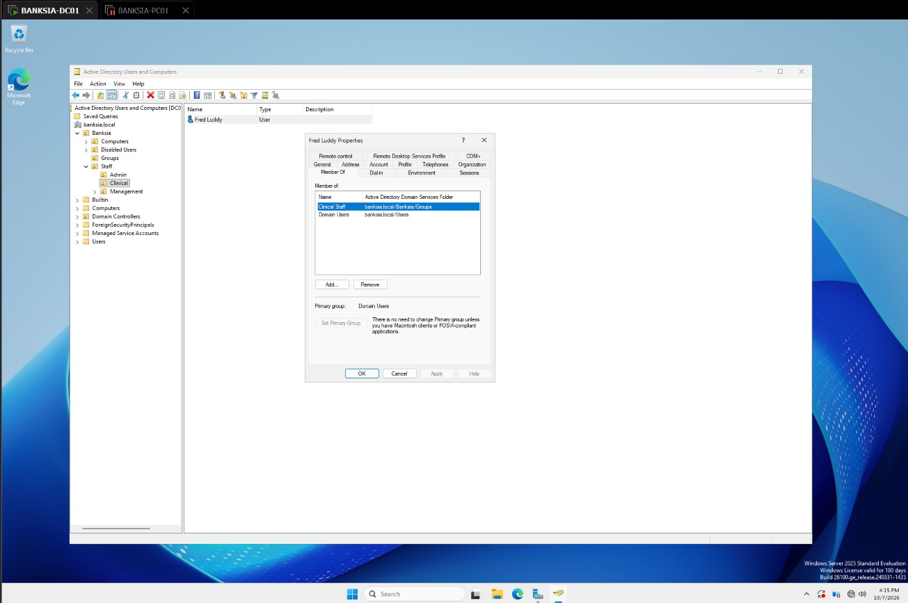

---

## Part 5: New starter request

**Scenario:** Beth Anglin (Care Manager) requests an account for a new RN, Jade Erlebach. These are the same people as in my Module 1 tickets; this time the account work is done for real.

**What I did:**
1. Logged a **service request** in ServiceNow. A new account is a planned task, not something broken, so it's a request rather than an incident.
2. Created Jade's account in Staff\Clinical, added her to Clinical Staff, and set a temporary password with change at next logon.
3. Added a work note, sent Beth a plain-English update, and closed the request.

**Why the password went to the manager in person:** passwords are never written in tickets, which many people can read and which are kept permanently.

Jade's new account in Staff\Clinical.

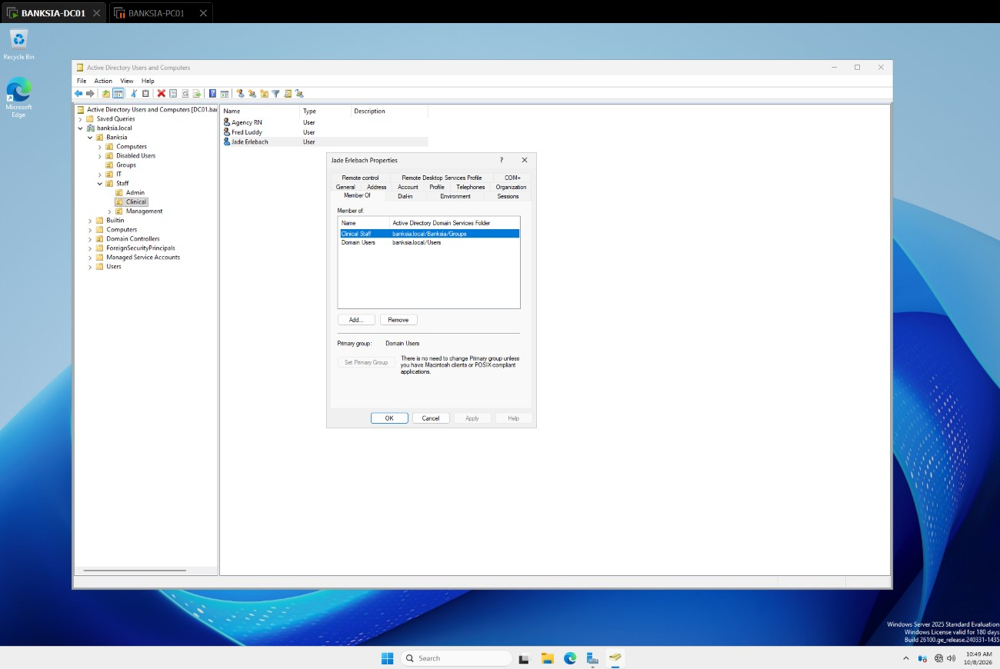

The new starter request: work note, update to the manager, and Closed Complete.

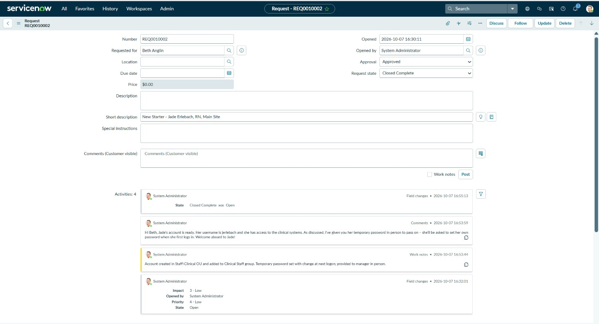

---

## Part 6: Delegating password resets to the Service Desk

**What I did:** used the **Delegate Control** wizard on the **Staff** OU to give the **Service Desk** group:
1. **Reset user passwords and force password change at next logon**
2. **Read and write lockoutTime**, which allows unlocking accounts

**What lockoutTime is:** every account has a lockoutTime field. When a user is locked out, AD writes the time into it; unlocking sets it back to 0. "Read" lets the Service Desk see whether an account is locked; "Write" lets them unlock it.

**Why:** the Service Desk resets passwords and unlocks accounts all day, but making them **Domain Admins** would let them delete accounts or change anything in the domain. Delegation gives them exactly what the job needs, only over staff accounts. This is **least privilege**: if a Service Desk account were misused or hacked, the damage would be limited.
**If skipped:** either the Service Desk couldn't do their job, or they'd need full admin rights.

The delegation wizard summary for the Service Desk group.

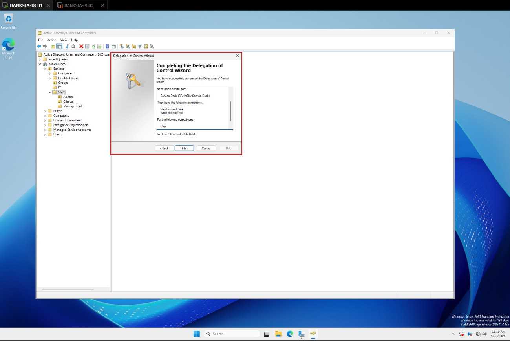

### Testing the delegation
**What I did:** installed **RSAT** on PC01, then logged in as my Service Desk account (stuladhar) and tested what it could and couldn't do.

- RSAT was installed while signed in as **Administrator**, because installing Windows features needs admin rights. Once installed, any user on the PC can open the tools.
- The Settings app didn't list RSAT, so I installed it with PowerShell:
  `Add-WindowsCapability -Online -Name Rsat.ActiveDirectory.DS-LDS.Tools~~~~0.0.1.0`
- I tested from PC01 because normal accounts, including Service Desk accounts, aren't allowed to log in to a domain controller directly.

**Real world:** Service Desk staff never log in to the DC. They use RSAT on their own PC, and it's deployed only to IT staff devices (usually through Intune or SCCM). Having the tool doesn't grant any power; **permissions live in AD**, as the test below shows.

As stuladhar: resetting Fred's password **worked**, because password resets were delegated.

As stuladhar: deleting Fred was **blocked** ("insufficient privileges"), because deletion was never delegated.

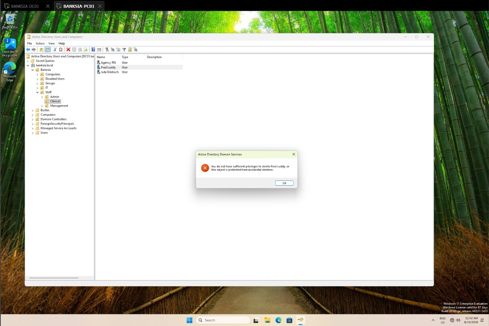

---

## Part 7: Account lockout policy

**What I did:** edited the **Default Domain Policy** (applies to the whole domain):

| Setting | Value |
|---|---|
| Account lockout threshold | 5 invalid logon attempts |
| Account lockout duration | 10 minutes |
| Reset account lockout counter after | 10 minutes |
| Allow Administrator account lockout | Enabled |

**Why:** locking an account after repeated wrong passwords stops attackers guessing passwords. The 10-minute duration means a locked user is let back in automatically if they can't reach the Service Desk.
**If skipped:** unlimited password guesses would be allowed.
**Side effect:** "I'm locked out" becomes one of the most common Service Desk calls. Part 9 handles one.

The lockout settings in the Default Domain Policy.

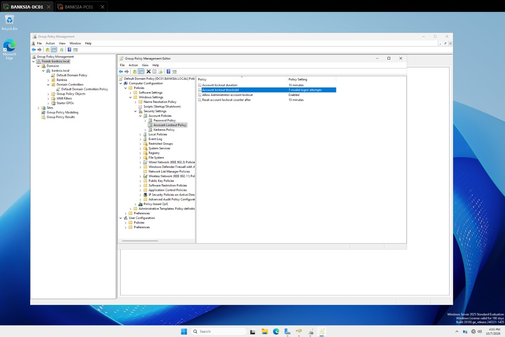

---

## Part 8: Logon notice GPO

**What I did:** created a GPO called **Clinical PCs - Logon Notice**, linked to **Banksia\Computers**, under Computer Configuration → Security Options:
- **Title:** Banksia Aged Care – Authorised Use Only
- **Text:** This system contains confidential resident information. Access is monitored. Lock the screen or log out when leaving the workstation.

**Why:** healthcare organisations remind staff before every login that the system holds confidential information and is monitored. It also gives visible proof that a policy set on the DC actually reached the PC.

The two logon message settings in the GPO.

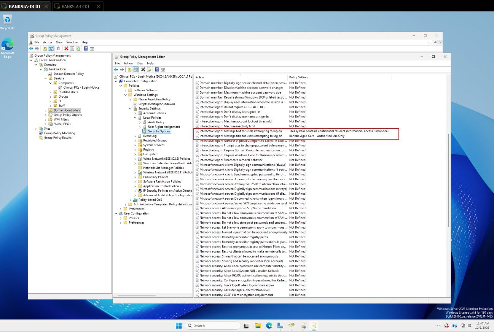

### Applying and checking the policy
**`gpupdate /force`:** PCs check for new policies at startup and then about every 90 minutes. This command applies all policies **immediately**.
**Restart:** the notice appears **before login**, so I restarted PC01 to get back to the login screen.
**If skipped:** nothing breaks; PC01 would pick up the policy at its next restart or within about 90 minutes. In a real job, `gpupdate /force` is used when testing a policy or when a user needs a change straight away.

The notice on PC01 before login.

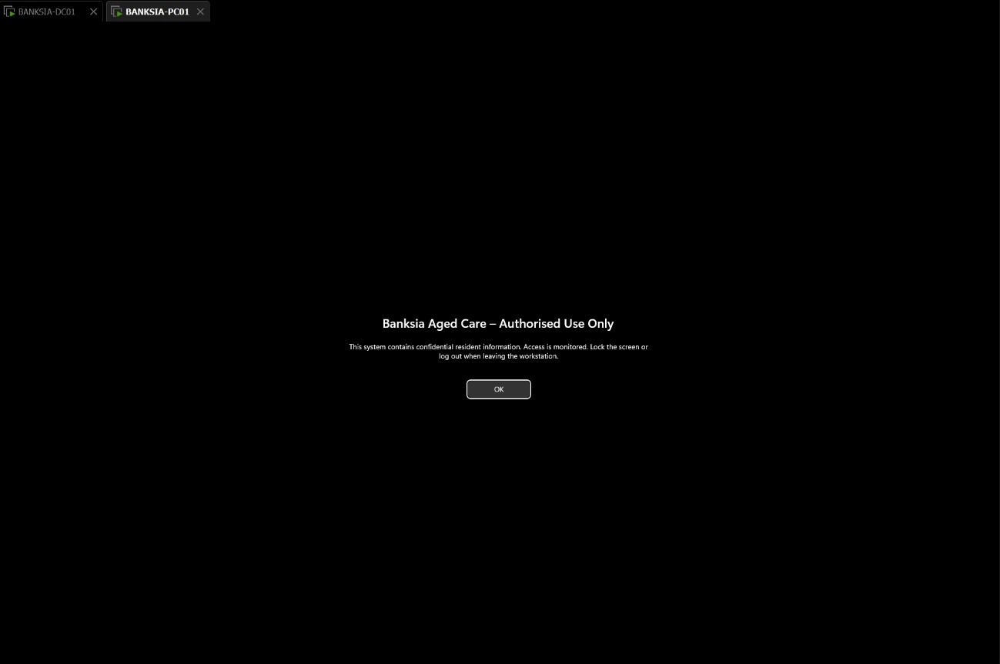

**`gpresult /r /scope computer`:** lists the policies actually applied to the PC. It's the first thing to check when someone says "the policy isn't working." It needs an administrator prompt.

gpresult on PC01 showing Clinical PCs - Logon Notice under Applied Group Policy Objects.

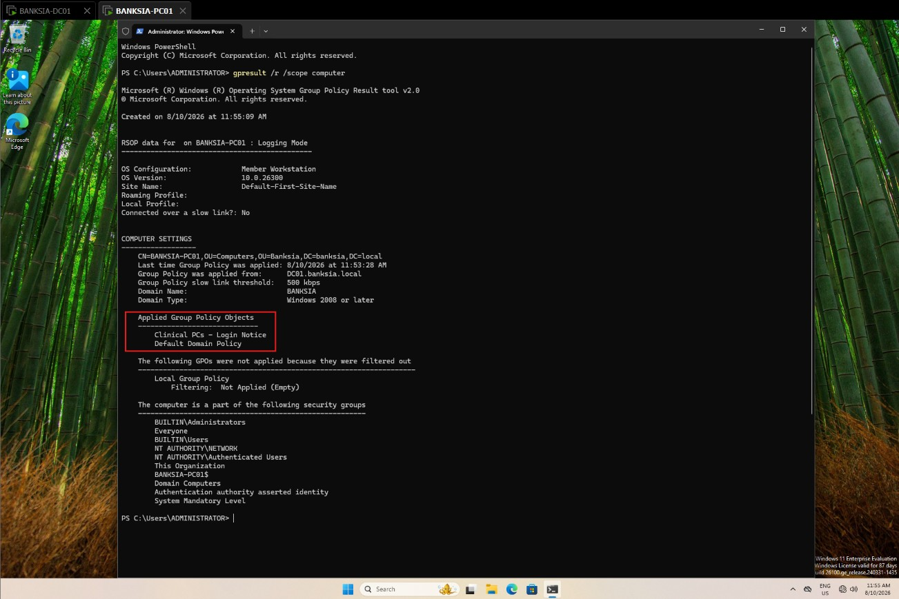

---

## Part 9: Auditing and the locked-out user

### Turning on auditing
**What I did:** edited the **Default Domain Controllers Policy** → Advanced Audit Policy Configuration:

| Category | Setting | Records |
|---|---|---|
| Account Logon | Audit Kerberos Authentication Service: Success, Failure | Wrong passwords at the DC (4771) |
| Account Logon | Audit Kerberos Service Ticket Operations: Success, Failure | Access to services after login |
| Account Management | Audit User Account Management: Success, Failure | Accounts created, reset, disabled, locked (4720, 4724, 4725, 4740) |
| Logon/Logoff | Audit Logon: Success, Failure | Logons to the DC |

**Why:** audit logs record who did what and when. They're how IT investigates problems and security incidents, and how healthcare organisations show they protect resident information.
**If skipped:** nobody could prove who changed an account or where failed logins came from.

**Time zone fix:** DC01 was still on US Pacific time from installation. I changed it to **(UTC+10:00) Canberra, Melbourne, Sydney** before this part, so log entries show the correct local time.

The audit settings in the Default Domain Controllers Policy.

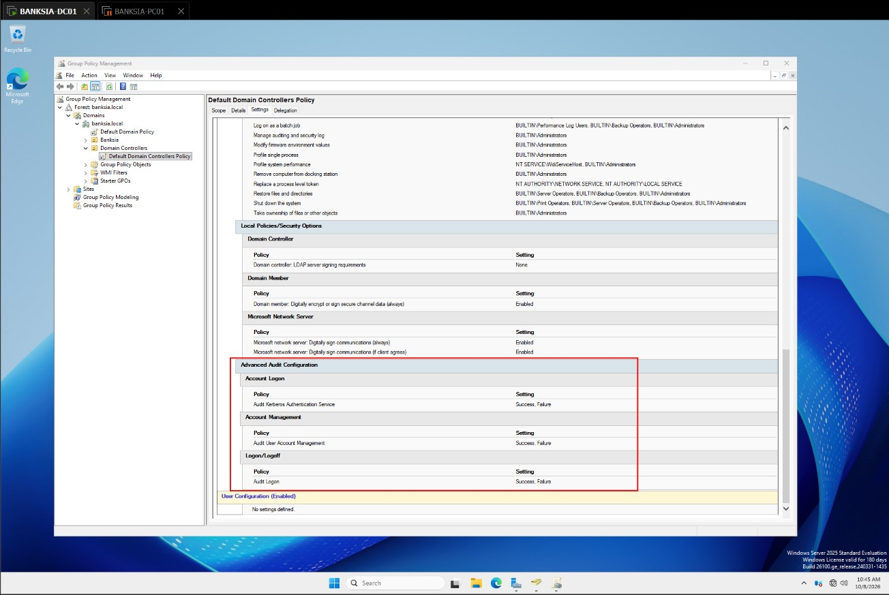

### Locked-out user

**Scenario:** Fred calls saying he can't log in.

**What I did:**
1. Entered a wrong password for `BANKSIA\fluddy` five times on PC01. The account locked, as set by the lockout policy.
2. Logged an incident: Impact 3 (one person), Urgency 1 (can't work at all).
3. Checked Fred's account in ADUC: "This account is currently locked out."
4. Filtered the DC's **Security log** for **Event 4740** (account locked out). **Caller Computer Name** showed **BANKSIA-PC01**, where the failed attempts came from.
5. Verified identity, **unlocked** the account, and **reset** the password with change at next logon.
6. Resolved the ticket with a work note and a plain-English update to Fred.

**Why check 4740:** it shows **where** the bad attempts came from. In real life, a source device the user isn't using (like a phone with an old saved password) means unlocking alone won't help; they'll be locked out again until that device is updated.
**Why reset as well as unlock:** if Fred has forgotten his password, unlocking isn't enough. Forcing a change means only Fred knows his final password.
**Why verify identity first:** otherwise anyone could phone pretending to be Fred and take over his account.

PC01 showing the account as locked after five wrong passwords.

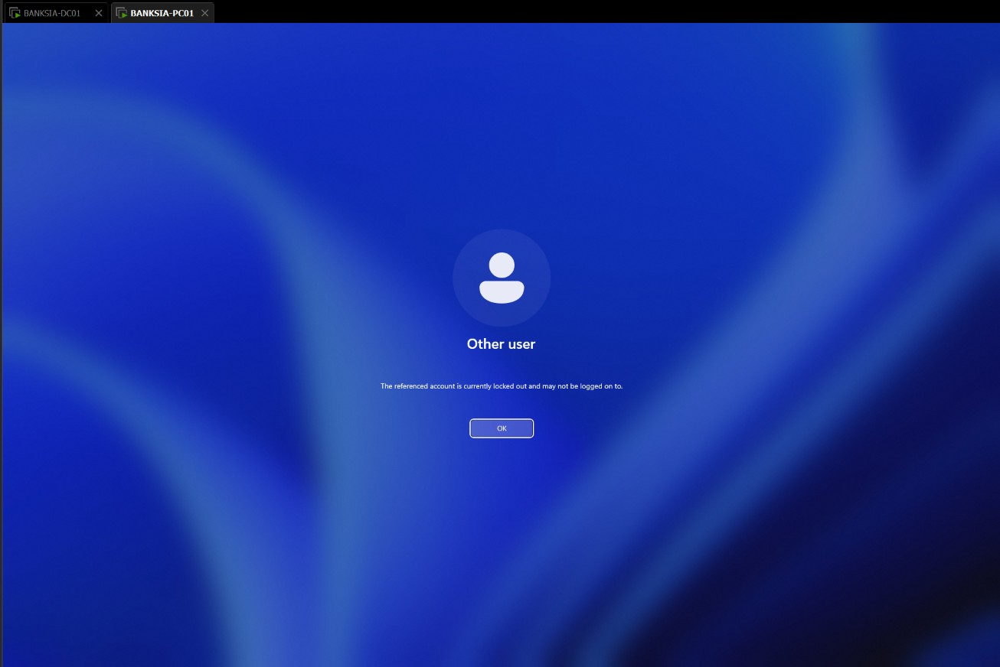

Fred's Account tab in ADUC showing the lockout.

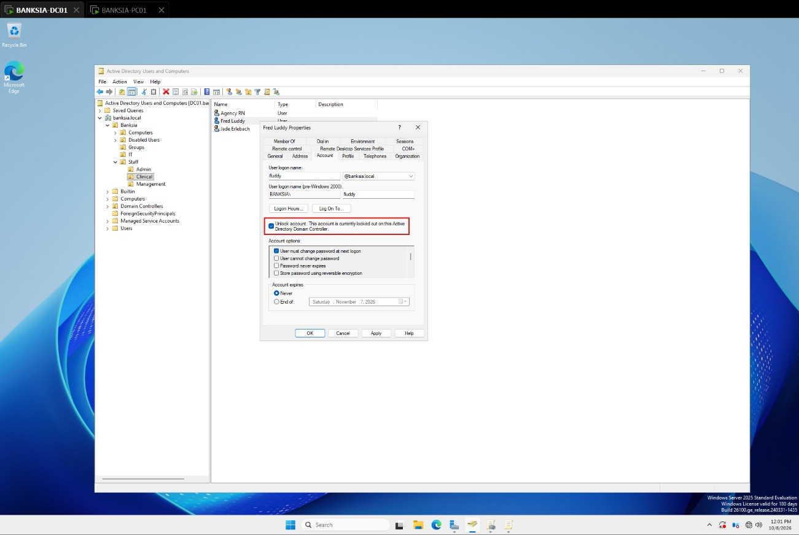

Event 4740 on DC01, showing fluddy locked out and BANKSIA-PC01 as the source.

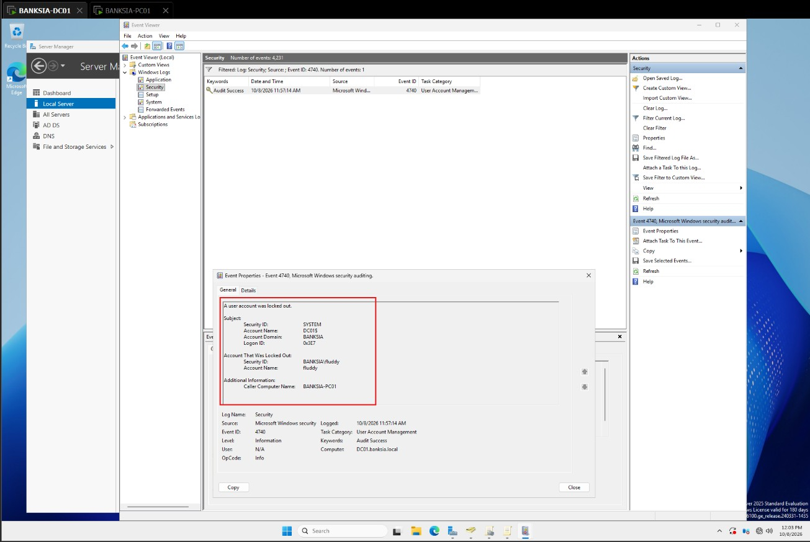

The lockout incident resolved with the findings and fix.

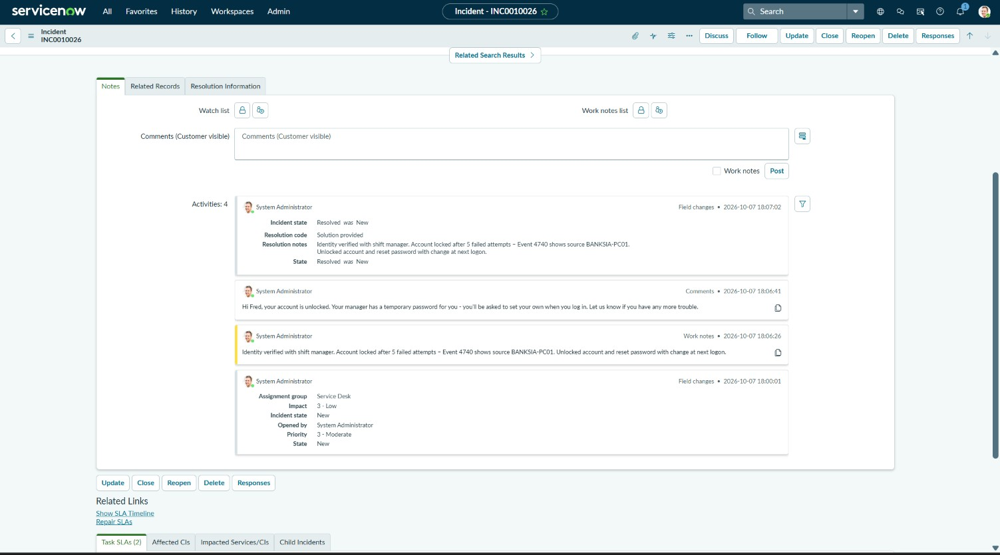

---

## Part 10: Leaver

**Scenario:** the agency RN's contract has ended.

**What I did:**

| Action | Why | If skipped |
|---|---|---|
| Logged a service request | A planned task, not a fault | No record of who approved the removal |
| **Disabled** the account (not deleted) | Keeps its history and allows restoring if needed | Deleting loses the audit trail; leaving it enabled lets the ex-staff member still log in |
| Removed from Clinical Staff | Removes access to systems straight away | If re-enabled by mistake, all their old access returns |
| Added a description with the request number | Anyone looking later knows why and when | Others waste time working out whether it's safe to delete |
| Moved to Disabled Users | Keeps active OUs clean and leavers easy to review | Leavers mixed in with active staff, easy to miss in audits |

**Real world:** disabled accounts are usually deleted after a set **retention period** (e.g. 30–90 days), following company policy.

The disabled Agency RN account in Banksia\Disabled Users.

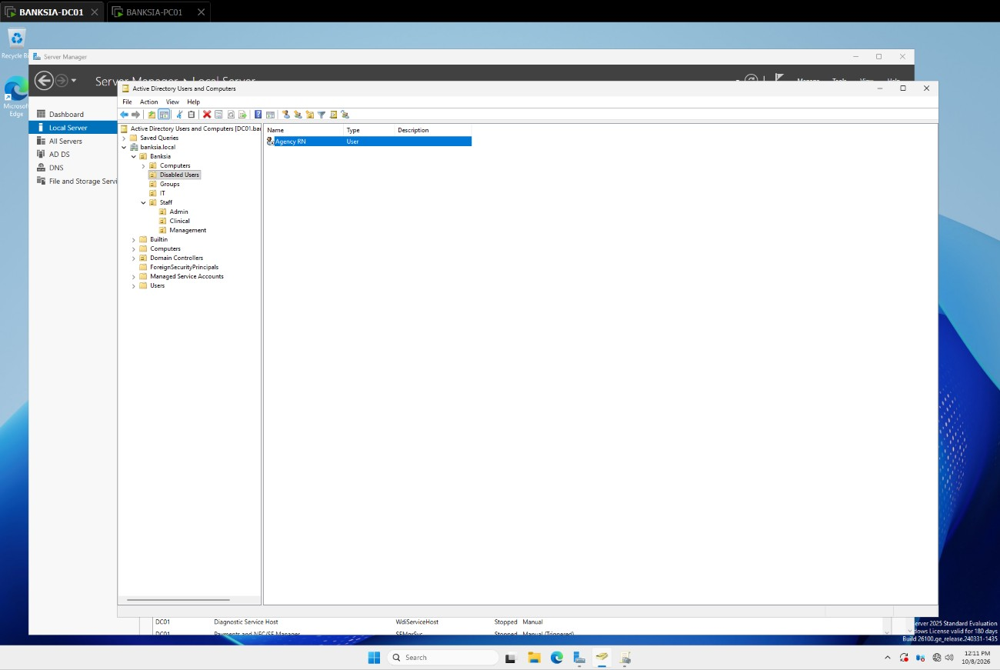

### Audit check
I filtered the Security log for Event IDs **4720, 4724, 4725, 4740, 4771**. It shows the whole lab in order:

| Time | Event | What happened |
|---|---|---|
| 10:48 | 4720 | Jade's account created |
| 11:41 | 4724 | Fred's password reset by **stuladhar** (delegation test) |
| 11:57 | 4771 ×5 | Fred's five wrong passwords at the DC |
| 11:57 | 4740 | Fred's account locked |
| 12:05 | 4724 (failure) ×2 | Two reset attempts refused, most likely because the new password didn't meet the complexity rules |
| 12:05 | 4724 | Fred's password reset by Administrator (lockout fix) |
| 12:10 | 4725 | Agency RN disabled |

Each event's **Subject** shows **who** made the change. That's the point of auditing: every change can be traced to a person, and failed attempts are recorded too.

The filtered Security log, with an event open showing who performed the action.

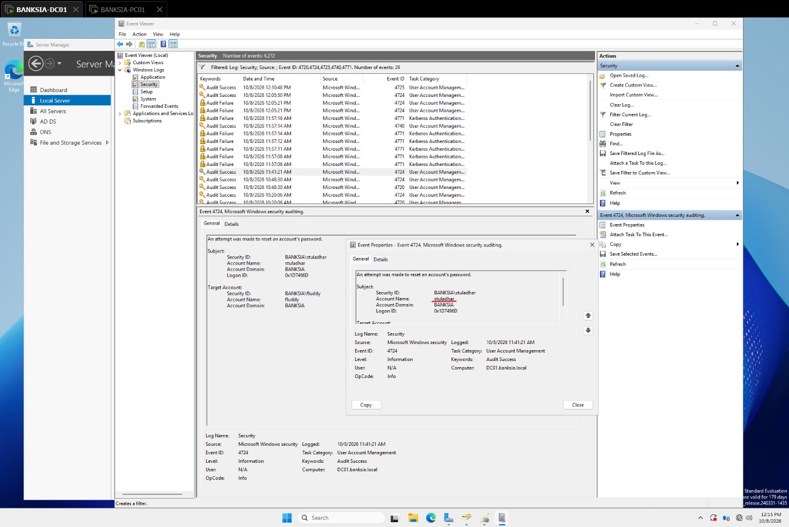

The leaver request closed with a full work note.

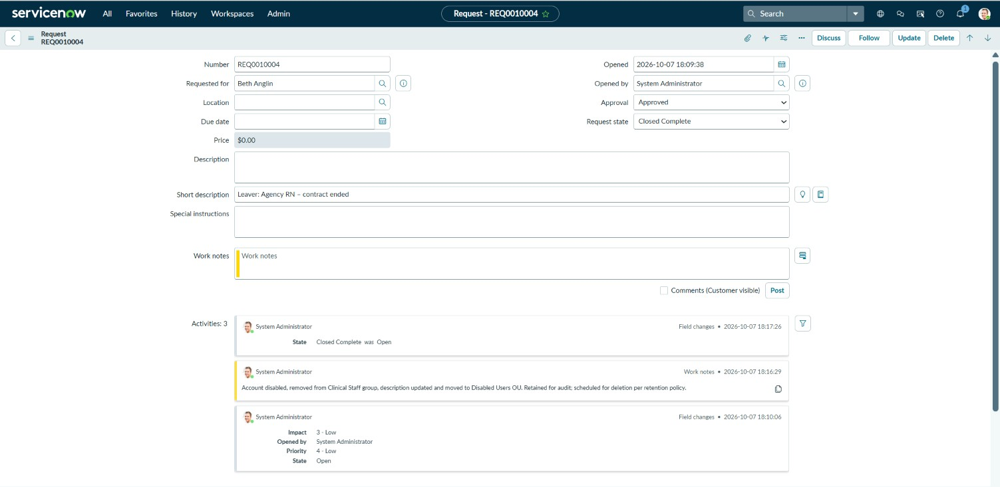

---

## What I learned

- **DNS is the foundation of a domain.** The DC needs a fixed IP and must be the PCs' DNS server, or nothing can find it.
- **OUs organise, groups grant access.** Policies and delegation apply to OUs; access to resources is given to groups.
- **Least privilege works in practice.** The Service Desk could reset a password but was blocked from deleting the same account.
- **Tools don't give power, permissions do.** RSAT on a PC is harmless without delegated rights in AD.
- **Group Policy isn't instant.** `gpupdate /force` applies it immediately, and `gpresult` confirms what was applied.
- **Lockouts need investigating, not just unlocking.** Event 4740 shows where the failed attempts came from.
- **Leavers are disabled, not deleted,** so the history stays and access is removed straight away.
- **Audit logs make every change traceable,** including failures, which matters in healthcare.
