# Module 4: Microsoft 365 and Cloud Support

**Simulated home lab.** In Modules 1-3, Banksia Aged Care ran its own systems (the `banksia.local` domain). In this module, Banksia moves email, Teams and shared files to Microsoft 365, and I handle the day-to-day admin and support tasks in the cloud: new starter, leaver, shared mailboxes, sign-in problems, MFA, permissions, and a small Azure setup.

In a real service desk these tasks arrive as tickets. Ticket handling is covered in [Module 1](../module-01-servicenow-itsm/), so this module focuses on the Microsoft 365 work itself.

**Skills shown:** Microsoft 365 admin centre · Entra ID · group-based licensing · Exchange Online (shared mailboxes, distribution lists, aliases) · leaver process · sign-in log troubleshooting · MFA reset · Helpdesk Administrator role · Teams · SharePoint permissions · Azure RBAC and budgets · Service health

## Real-world context

In a real company, staff usually already have accounts in Active Directory. Instead of recreating them, the company installs Microsoft Entra Connect, which copies (syncs) the AD users and groups to Entra ID, so each person keeps one identity and one password. Changes are made in AD, such as disabling a leaver, and reach Microsoft 365 after the next sync. This is called a hybrid setup. Staff also sign in with the company's own domain (for example `banksiacare.com.au`), not `onmicrosoft.com`.

In this lab, the cloud tenant is separate from `banksia.local`, so I recreated the users by hand and used the default `onmicrosoft.com` domain. This module covers the cloud administration side.

## Environment

| Item | Detail |
|---|---|
| Platform | Microsoft 365 Business Premium (30-day trial) |
| Tenant | `banksiacare.onmicrosoft.com` (organisation name: Banksia Care Lab) |
| Domain | Default `banksiacare.onmicrosoft.com`. A real company adds its own domain (for example `banksiacare.com.au`) so staff sign in with their normal work address. That needs a registered domain, so it wasn't done here. |
| Azure | Azure free account, same tenant |
| MFA | Security Defaults, Microsoft Authenticator |
| Test users | Fred Luddy, Jade Erlebach, Beth Anglin, Sabrina Deppert, Agency RN, plus `stuladhar` (service desk) |
| Testing method | Admin tasks in one browser, each test user in a separate InPrivate window |

## Key terms

| Term | Meaning |
|---|---|
| Tenant | Banksia's private space in Microsoft 365 |
| Entra ID | Microsoft's cloud identity service (users, groups, sign-in logs, MFA) |
| Group-based licensing | A licence assigned to a group, so members receive it automatically |
| Shared mailbox | A mailbox several people use, with no licence of its own (under the size limit) |
| Distribution list | A group email address that delivers to all its members |
| Security Defaults | Microsoft's baseline settings: MFA for everyone and legacy sign-in blocked |
| MFA | Multi-factor authentication: a password plus a second proof, such as an Authenticator approval |
| Helpdesk Administrator | An Entra role that can reset passwords for standard users only |
| RBAC | Role-based access control in Azure: users get only the role they need |
| Reader | Azure role that can view resources but not change them |

## How the pieces fit together

Microsoft 365 is several services behind one sign-in. Each has its own job:

| Piece | What it does | In this lab |
|---|---|---|
| Entra ID | Who people are: accounts, groups, sign-in, MFA, admin roles | Creating users, sign-in log, MFA reset |
| Exchange Online | Email | Shared mailbox, All Staff list, alias |
| SharePoint Online | Where files and documents are kept, as sites with permissions | Policies and Procedures site |
| Teams | Chat, channels and meetings. Its files are stored in SharePoint | Clinical Team |
| Intune | Managing devices such as laptops and phones | Not covered |
| Azure | Cloud servers, storage and networks, with their own access roles | Resource group, budget, Reader role |

When Jade joins Banksia: an Entra account is created, a licence gives her a mailbox (Exchange) and Teams, and group membership gives her access to files (SharePoint). A device would be managed by Intune.

Admin tasks are done in different portals:

| Portal | Used for |
|---|---|
| Microsoft 365 admin centre | Day-to-day users, licences, shared mailboxes, service health |
| Exchange admin centre | Mailboxes and mail settings |
| SharePoint admin centre | Sites |
| Entra admin centre | Sign-in logs, MFA methods, groups, admin roles |
| Azure portal | Resource groups, budgets, access to resources |

## People and names in this lab

| Person | Role in the Banksia story |
|---|---|
| Fred Luddy | Registered nurse |
| Jade Erlebach | New starter (nurse) |
| Beth Anglin | Care Manager |
| Sabrina Deppert | Admin Officer |
| Agency RN | Temporary agency nurse (the leaver) |
| `stuladhar` | Service desk (me) |

Several names look alike but do different jobs. A group is a list of people, a team or site is a place, a licence lets you use a service, and a role lets you administer.

| Name | Type | What it is |
|---|---|---|
| Clinical Staff | Security group | A list of people (Fred, Jade). Used to hand out the Microsoft 365 licence. |
| Clinical Team | Team in Teams | A chat and files workspace for clinical staff. Creating it also creates a Microsoft 365 group and a SharePoint site behind it. |
| Policy Readers | Security group | A list of people (Fred, Jade) allowed to read the Policies site. |
| Policies and Procedures | SharePoint site | The place where policy documents are kept. Beth owns it. |
| All Staff | Distribution list | An email address that delivers to everyone on it. It gives no access to files. |
| Clinical Applications | Shared mailbox | A mailbox several people use. |

Licences and site access use separate groups on purpose, so changing one doesn't affect the other.

## Roles and licences

| | Licence | Role |
|---|---|---|
| What it gives | The right to use a service (mailbox, Teams, Office apps) | The right to administer (reset passwords, manage users) |
| In this lab | Business Premium, given through Clinical Staff | Helpdesk Administrator, given to `stuladhar` |
| Set in | Microsoft 365 admin centre | Entra admin centre (Entra roles) or Azure portal (Azure roles) |

`stuladhar` was created without a licence because the admin centres don't require one and the lab only tested the role. In a real company a service desk analyst would also have a licence for their own email and Teams, often with a separate admin account for admin work.

---

## Part 1: Tenant, users and group licensing

**Scenario:** Banksia is moving to Microsoft 365. I set up the tenant, created the staff accounts and onboarded a new starter.

**What I did**
- Started the Business Premium trial. Security Defaults forced MFA registration on the admin account.
- Created a `Clinical Staff` security group and assigned the Business Premium licence to the group (shown on the licence page below).
- Beth and Sabrina were licensed directly. Fred, Jade (new starter) and Agency RN were added to the group.
- Signed in as Jade to confirm the new starter could reach Microsoft 365.

**Why:** with a group licence, a new starter needs one change (add to the group) instead of separate licence steps. Each user also needs a **usage location** set, or group licensing fails.

*Active users in the new tenant. Jade shows Unlicensed at the time of this capture.*

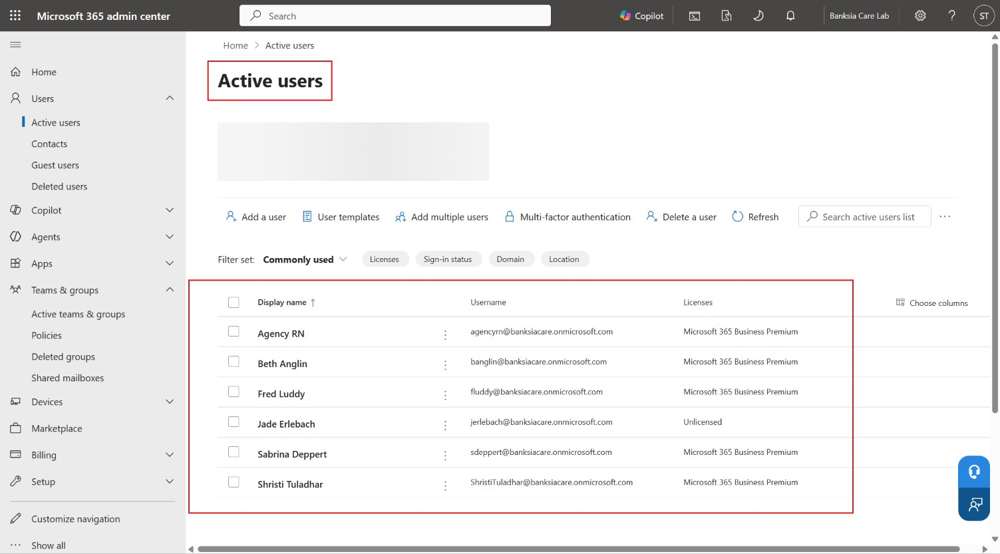

*Licence page showing Business Premium assigned to the Clinical Staff group.*

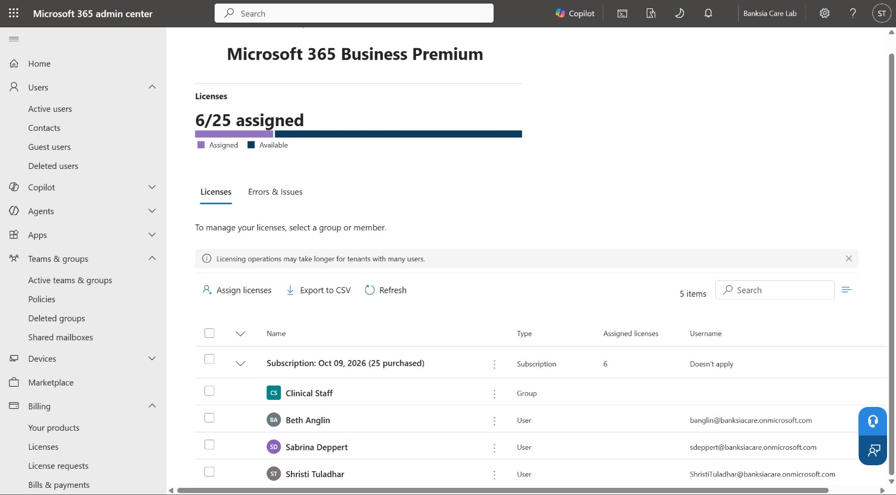

*Jade's first sign-in as the new starter.*

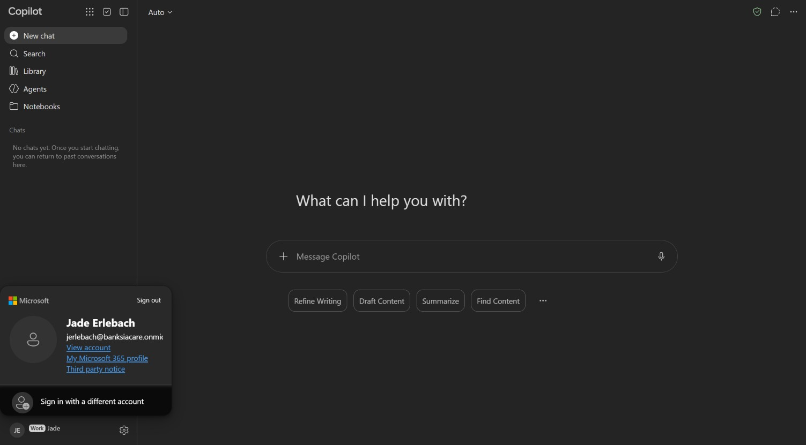

---

## Part 2: Exchange Online

**Scenario:** the Clinical Applications team needs a shared mailbox, staff need an all-staff email list and an alternate address, and an email "never arrived".

**What I did**
- Created the `Clinical Applications` shared mailbox and gave Fred **Full Access** and **Send As**. Fred's Outlook did not show the mailbox automatically, so I added it manually and sent a test message.
- Sent two emails from Jade, one to Fred and one to an address that doesn't exist. The second bounced with "Unknown To address".
- Created an `All Staff` distribution list and confirmed Fred received a message sent to it.
- Added the alias `jade.e` to Jade's mailbox.

**Why:** a shared mailbox survives staff changes and needs no licence. For "my email never arrived", the bounce message tells the user what happened. Here, the address doesn't exist.

*Fred granted Send As and Full Access on the shared mailbox.*

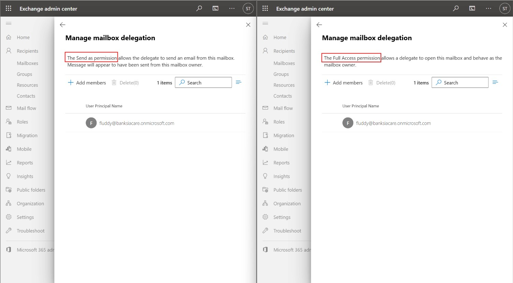

*Jade's Outlook showing the bounce for the address that doesn't exist.*

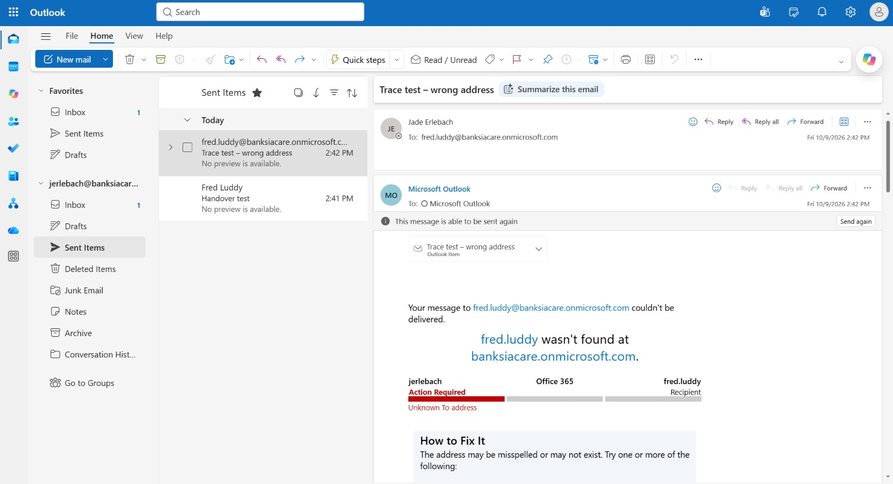

*Email sent to the All Staff list, received in Fred's inbox.*

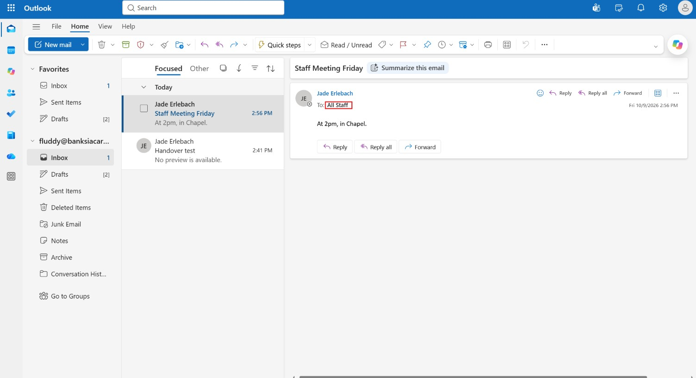

*Alternate address `jade.e` added to Jade's mailbox.*

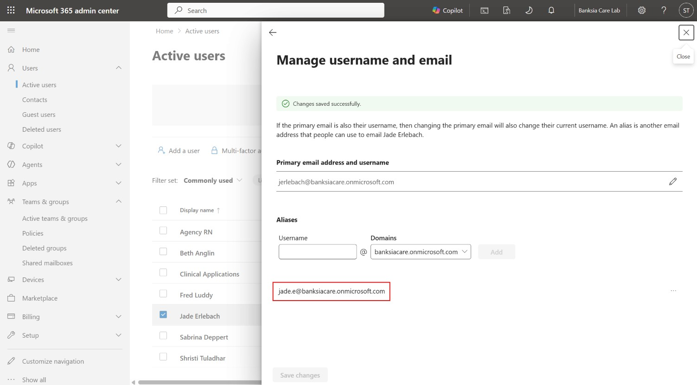

---

## Part 3: Leaver (Agency RN)

**Scenario:** Agency RN's contract has ended. Their mail must stay available to Beth, and the account must be locked down.

**What I did, in this order**
1. Set **forwarding** to Beth (internal address, keeping a copy in the mailbox) and an **auto-reply** (internal and external).
2. **Converted the mailbox to a shared mailbox** and gave Beth **Full Access**.
3. **Blocked sign-in.**
4. Removed Agency RN from `Clinical Staff`, which removed the licence.

**Why this order:** the licence comes from the group, so removing the group removes the licence, and removing a licence eventually deletes the mailbox. Converting to shared first keeps the mail. Forwarding and shared access overlap in real life (you would usually choose one); I set up both to show each option.

**Note:** in the current admin centre, blocking sign-in prevents new sign-ins, and existing sessions are signed out automatically within about 60 minutes.

*Forwarding to Beth configured on the leaver's mailbox.*

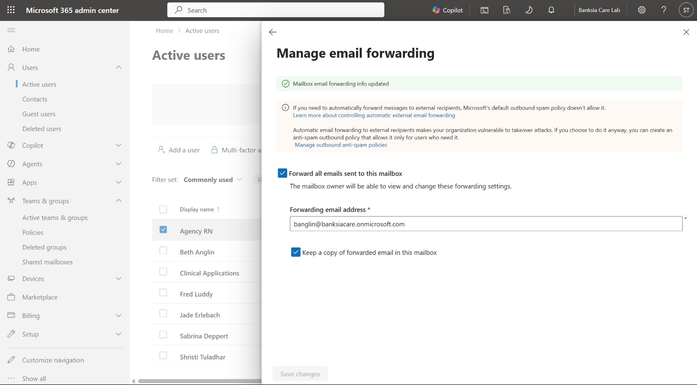

*Leaver's mailbox listed as a shared mailbox, with Beth granted Full Access.*

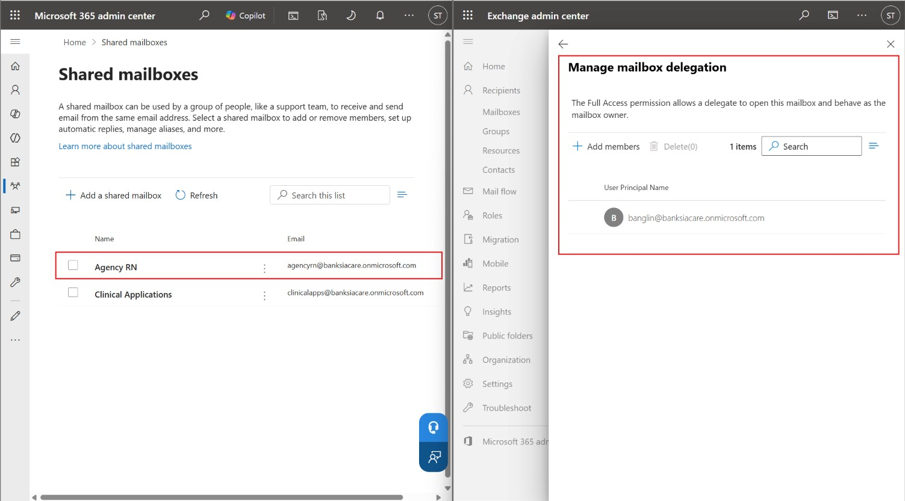

*Leaver's account showing sign-in blocked and no licences assigned.*

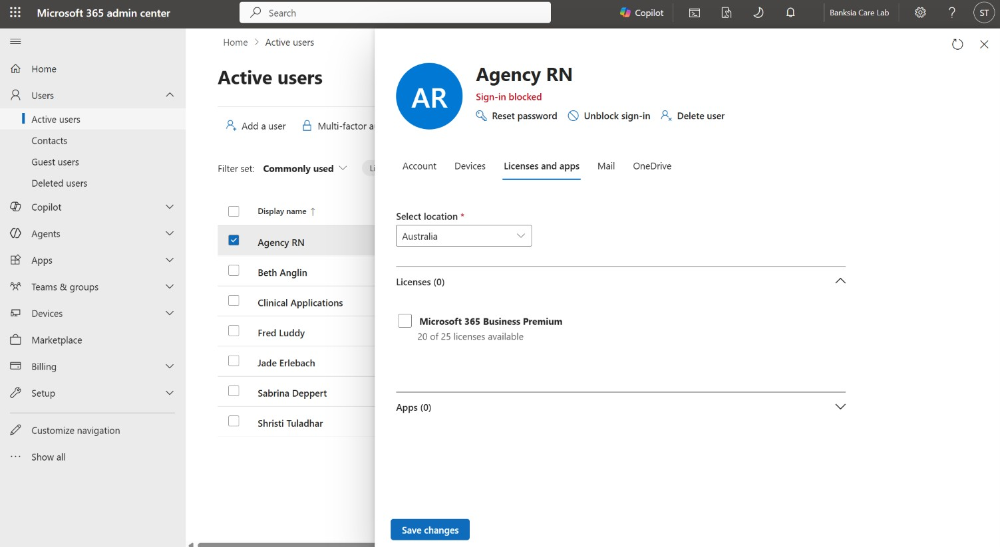

---

## Part 4: Sign-in problem

**Scenario:** Fred says he can't sign in.

**What I did**
- Entered a wrong password for Fred several times.
- Opened the Entra **sign-in logs** and found the failed entry: error **50126**, invalid username or password.
- Reset his password in the admin centre and confirmed he could sign in.

**Why:** the sign-in log gives a reason instead of a guess. 50126 means a wrong password, so the fix is a reset. A blocked or disabled account shows a different error and needs a different fix.

*Sign-in log entry for Fred showing error 50126 (wrong password).*

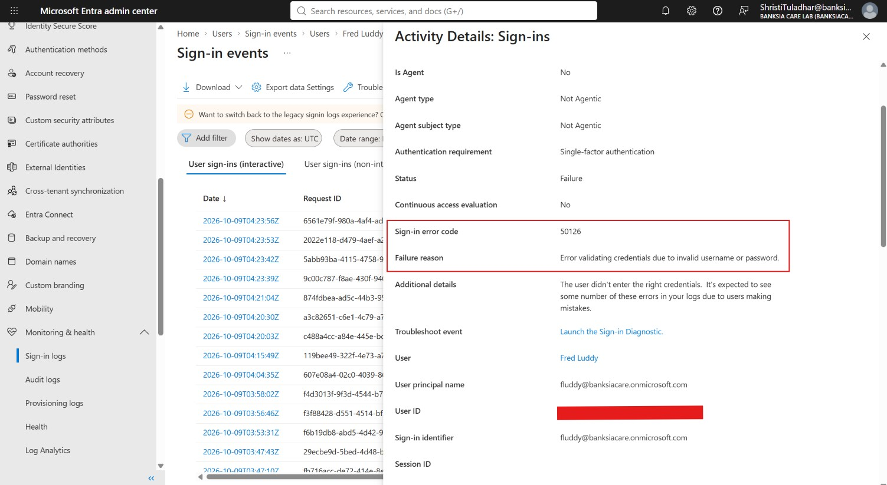

---

## Part 5: MFA and Helpdesk Administrator

**Scenario:** Banksia holds resident care records, so accounts need MFA. A user gets a new phone, and the service desk needs limited admin rights.

**What I did**
- Confirmed **Security Defaults** was enabled.
- Registered Fred's Authenticator manually through Security info (he had skipped the first prompt). Then reset his MFA by removing the method, so his authentication methods went from Authenticator to "No usable methods".
- Created `stuladhar` and assigned the **Helpdesk Administrator** role. As `stuladhar`, I could reset Fred's password, but resetting the admin account's password failed.

**What the role can and can't do:** as `stuladhar` I reset Fred's password (a standard user), and it worked. I then tried to reset the admin account's password, and it failed. By Microsoft's role description, Helpdesk Administrator can reset passwords for standard users and some limited roles, but not for higher-privilege accounts such as the Global Administrator.

**Why:** an MFA reset after a lost or replaced phone is a very common request, and it stops the old phone from being used as a second factor. Helpdesk Administrator follows least privilege, the cloud equivalent of the Module 3 delegation: the service desk can reset standard users without being a full admin.

**Notes:** the failed reset showed a vague message ("We could not reset the password... null"). Both accounts have the display name "Shristi Tuladhar", so the username (`stuladhar`) tells them apart. The role was assigned directly to the user to keep the lab short.

*Security Defaults enabled for the tenant.*

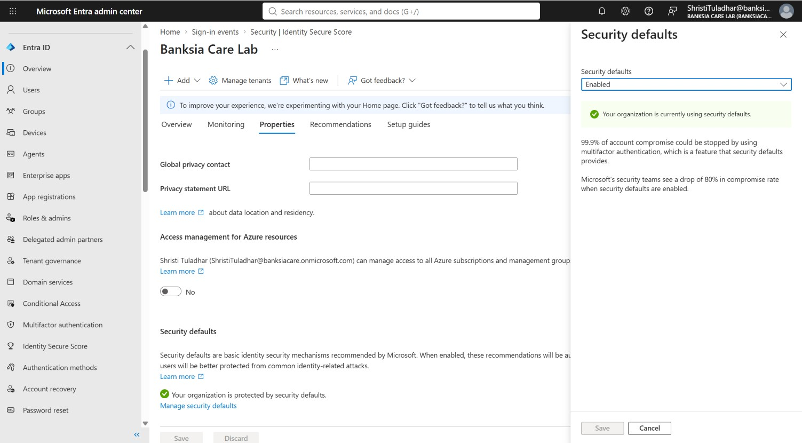

*Fred's authentication methods with Authenticator registered.*

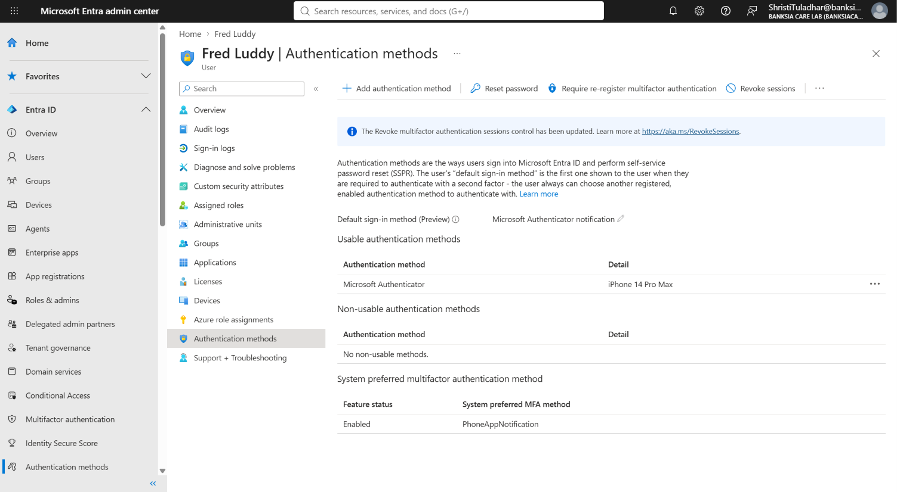

*Fred's authentication methods after the reset, showing no usable methods.*

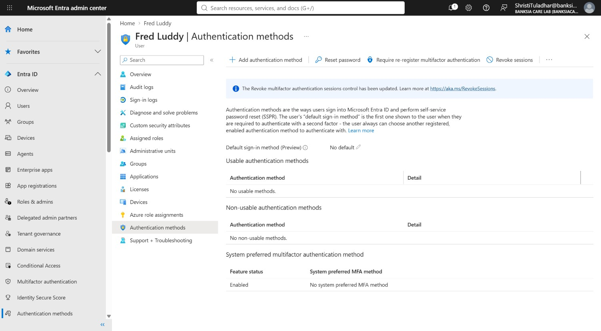

*Helpdesk Administrator role assigned to `stuladhar`.*

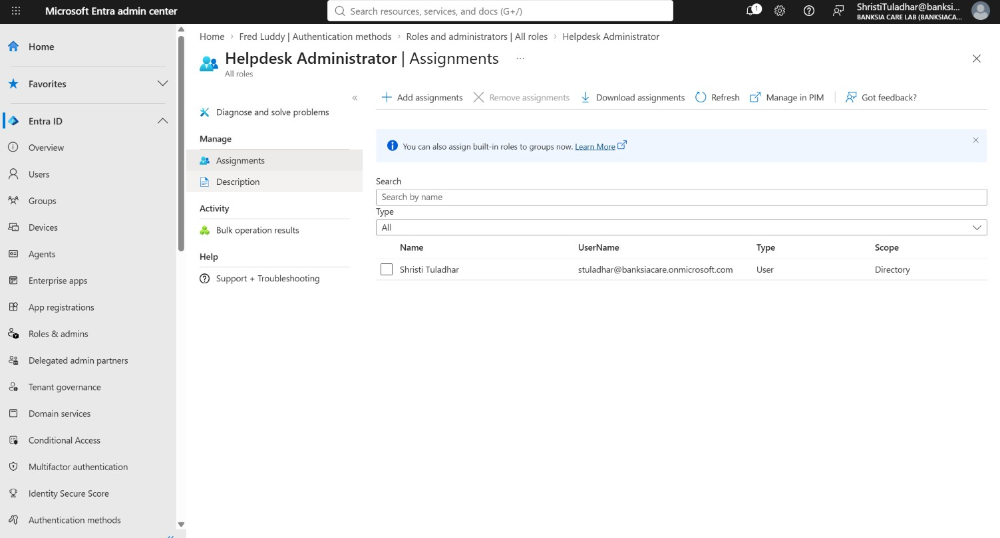

*Password reset on the admin account failing for the service desk account.*

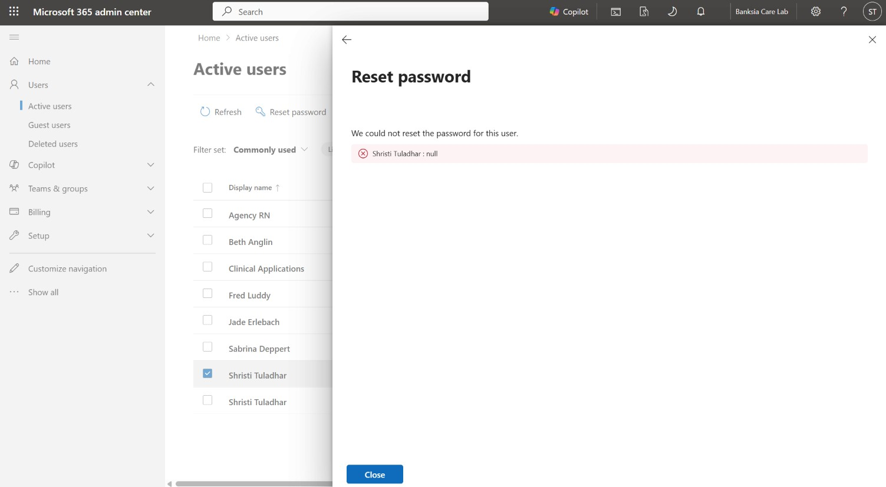

---

## Part 6: Teams and SharePoint

**Scenario:** Beth sets up a team and a read-only policies site, and Jade can't open the site.

**What I did**
- As Beth, created the private team `Clinical Team` with **General**, **Handovers** and a private **Management** channel. The current Teams puts team creation inside Chat. Each private channel also gets its own SharePoint site.
- Created a `Policy Readers` security group (Fred and Jade).
- Created the `Policies and Procedures` site, set it to **Private**, and added `Policy Readers` as **Visitors** (read-only).
- Removed Jade from `Policy Readers`. She got **You need access**, and **Check Permissions** showed her access as **None**. I re-added her and she regained access.

**Example:** Beth, the Care Manager, asks IT for a place to keep policy documents such as the medication handover policy. IT creates the Policies and Procedures site and makes Beth the owner. Instead of adding every nurse by hand, IT adds the Policy Readers group as read-only. Anyone added to Policy Readers can read the policies but not edit them, and anyone removed loses access, which is what happened to Jade. The Clinical Team has its own SharePoint site for its channel files, separate from this one.

**Why:** a Team creates a Microsoft 365 group and a SharePoint site behind it, which is the first place to look when files are inaccessible. Access has its own group (`Policy Readers`) because `Clinical Staff` controls licences, and removing someone from it would also remove their licence. The site is Private so that removing Jade actually removes her access. On a public site she could still open it.

*Clinical Team with General, Handovers and the private Management channel (lock icon).*

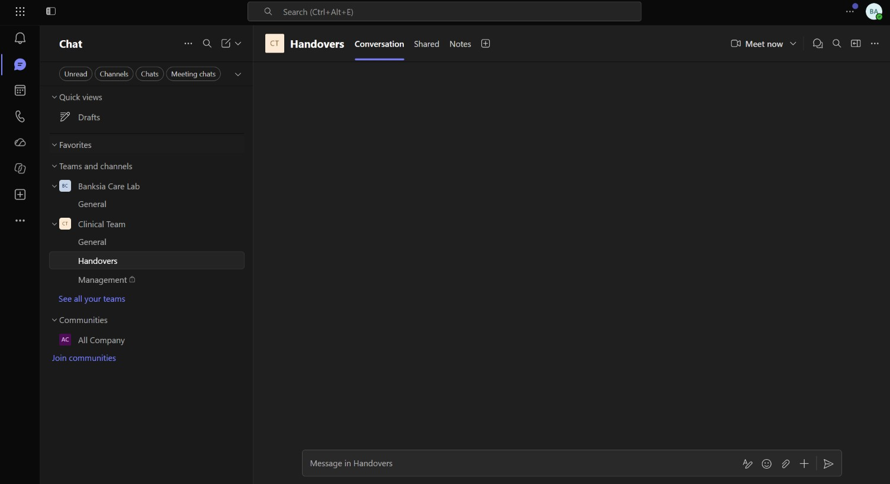

*Policy Readers as the only entry in the site's Visitors group.*

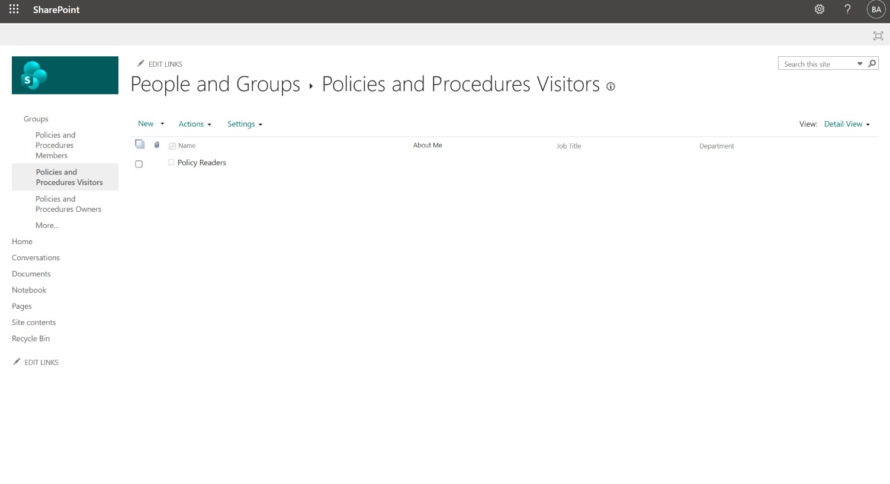

*Jade denied access after removal from Policy Readers.*

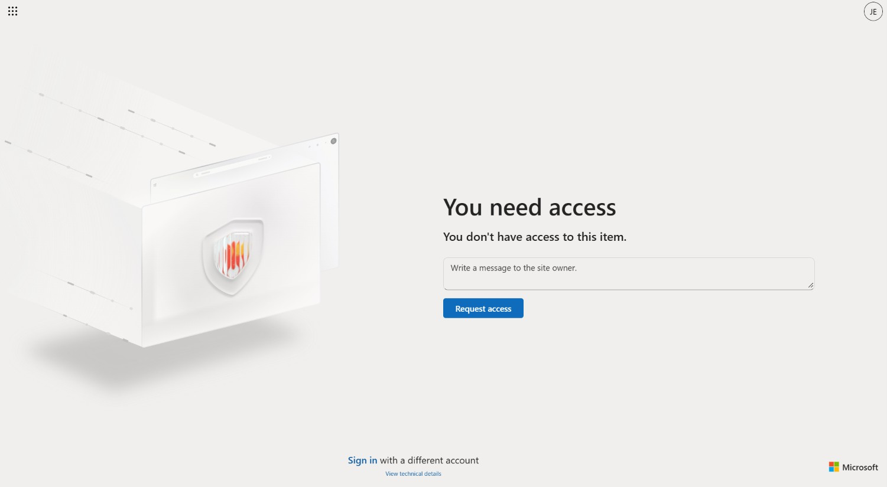

*Check Permissions confirming Jade has no access.*

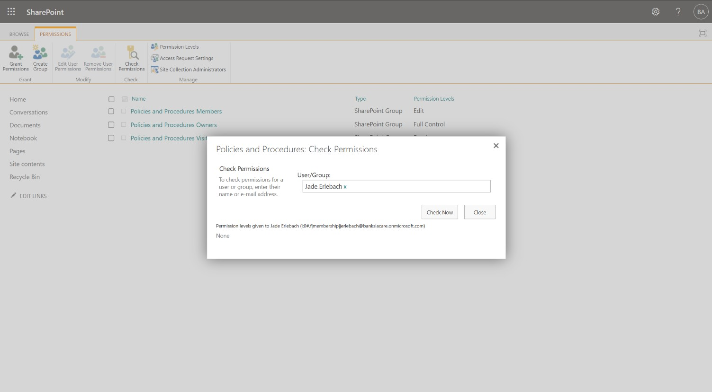

---

## Part 7: Azure resource group, budget and role-based access

**Scenario:** the IT lead wants a cost limit on the lab and wants Beth to view resources without changing them.

**What I did**
- Created an Azure free account and a resource group `rg-banksia-lab` in Australia East.
- Created a budget of 10 USD per month with alerts at 50%, 90% and 100% of actual cost, sent by email. The budget is scoped to the billing account and set in USD.
- Gave Beth the **Reader** role on the resource group.
- Signed in as Beth and tried to create a storage account. It was blocked on the first screen: she has no permission to register the storage resource provider on the subscription.
- No virtual machines or other billable resources were created.

**Why:** a budget sends alerts but does not stop spending, so it is the first control an admin sets. Reader is least privilege: Beth can see the resources but can't change anything.

**Entra roles and Azure roles are separate:** Helpdesk Administrator (Part 5) controls what someone can do to users. Reader controls what someone can do to Azure resources. Both follow least privilege.

**Note:** the storage error is about registering a provider at subscription level, so it shows Beth cannot make changes, but it is not a precise test of the Reader role.

*Budget of 10 USD per month with alerts at 50%, 90% and 100%.*

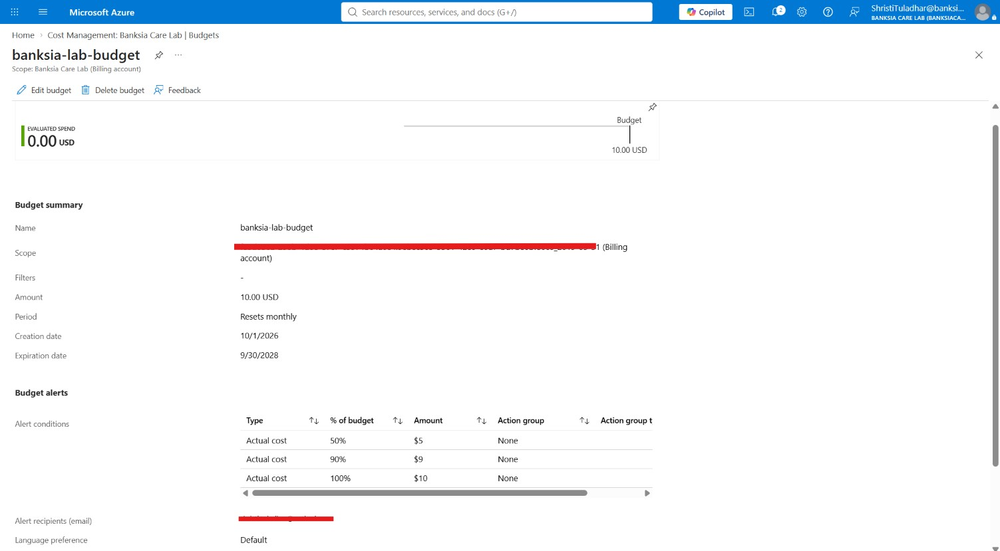

*Beth assigned the Reader role on the lab resource group.*

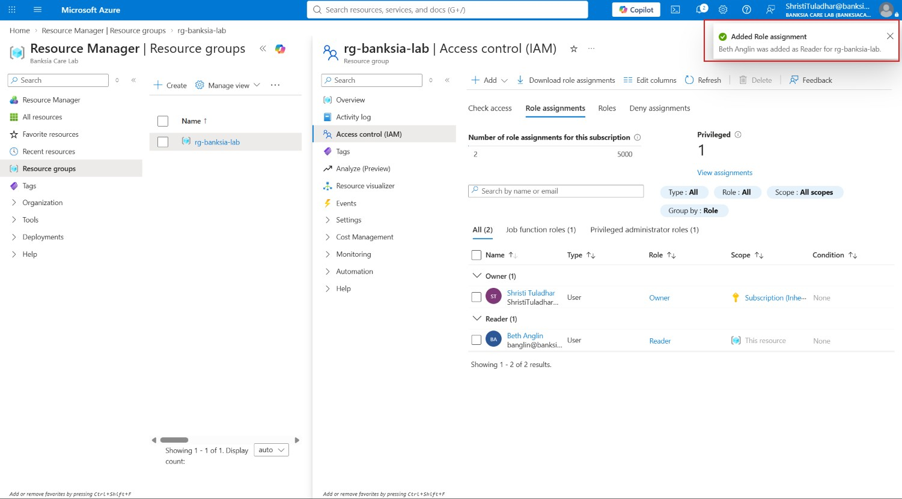

*Beth blocked when trying to create a storage account.*

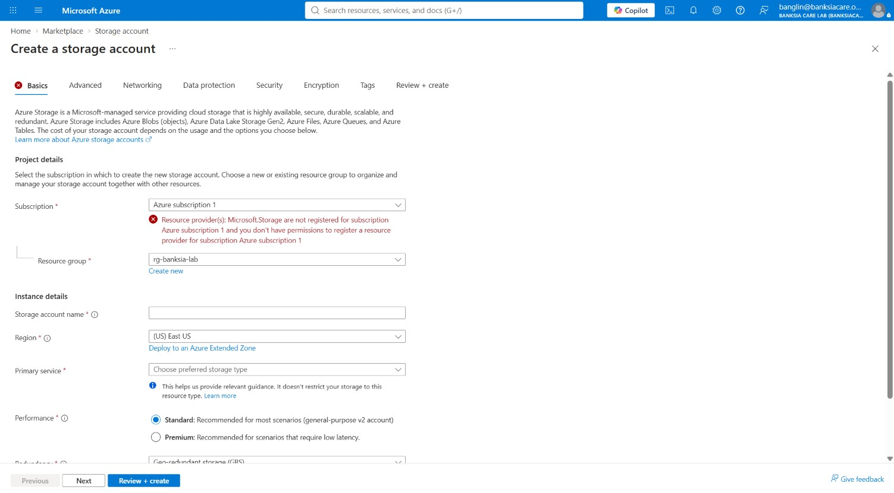

---

## Part 8: Monitoring

**Scenario:** Teams is slow for several users. Before changing anything, check whether Microsoft has a known issue.

**What I did:** reviewed **Service health** in the admin centre, which lists current advisories and incidents.

**What I would check in a Teams slowdown:** Service health first, then whether it affects one user or everyone, then the web client versus the desktop app, then the client cache.

*Service health overview listing active advisories and incidents.*

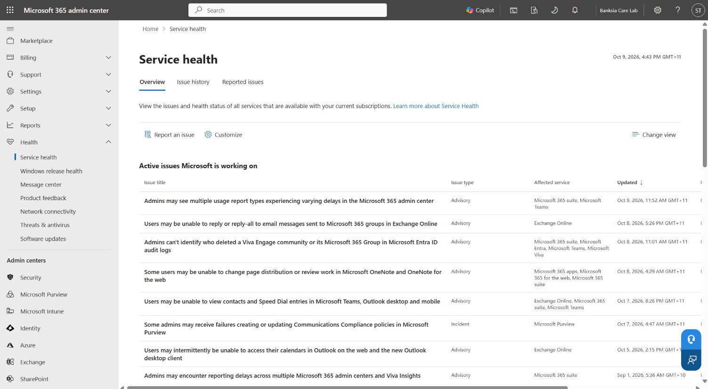

---

## What I learned

- **Order matters in a leaver process.** Convert the mailbox to shared before the licence is removed, and block sign-in, because a block stops new sign-ins straight away while existing sessions can last up to about 60 minutes.
- **Group licensing needs a usage location,** and licences and mailboxes can take 10-30 minutes to appear. Waiting is part of the job.
- **Error codes tell you the fix.** 50126 is a wrong password, which needs a reset.
- **Keep access groups separate from licence groups,** and check group membership first when someone can't open a site. A Public site would have hidden the problem.
- **Least privilege shows up in three places:** Helpdesk Administrator, Reader, and Full Access only for the person who needs it.
- **Security Defaults applies to the whole tenant.** Every account is prompted to register MFA, though users can skip for a limited time, as Fred did at first.
