# Module 5: Network and Internet Connection Support

Banksia Aged Care is a fictional aged care provider with three sites. In this module I build its network side: DHCP and DNS on a Windows domain controller, six fault-finding scenarios from a full DHCP scope to a cable pulled out, VLANs and a router in Packet Tracer, a small-office Wi-Fi router, a WAN link between two sites, and a VPN tunnel.

The skills come from my studies, and I built every part of this myself for Banksia. Some parts run on real virtual machines and some are simulated in Cisco Packet Tracer. The table below says which is which.

| Part | Where it ran | Real or simulated |
|---|---|---|
| 1. Fundamentals | None | Notes |
| 2. DHCP and DNS | VMware (DC01, PC01) | Real VMs |
| 3. Troubleshooting: gateway, DNS, IP conflict | VMware (DC01, PC01) | Real VMs |
| 4. SOHO Wi-Fi router and WAN | Packet Tracer | Simulated |
| 5. VLANs, router and backup | Packet Tracer | Simulated |
| 6. VLAN mismatch and cable down | Packet Tracer | Simulated |
| 7. WireGuard VPN | My laptop and PC01 | Real, both ends on one machine |
| 8. Extra notes | None | Reference notes |

## Subnet plan

| Network | Range | Where |
|---|---|---|
| Lab LAN (DC01, PC01) | 192.168.126.0/24 | VMware |
| SOHO router LAN | 192.168.20.0/24 | Packet Tracer, part 4 |
| MAIN LAN / NORTHSIDE LAN | 192.168.10.0/24 / 192.168.30.0/24 | Packet Tracer, part 4 |
| WAN link | 10.0.0.0/30 | Packet Tracer, part 4 |
| Clinical VLAN 10 / Admin VLAN 20 / Guest VLAN 30 | 10.10.10.0/24 / 10.10.20.0/24 / 10.10.30.0/24 | Packet Tracer, part 5 |
| WireGuard tunnel | 10.8.0.0/24 | Part 7 |

## Environment

| Item | Detail |
|---|---|
| Hypervisor | VMware Workstation, network VMnet8 (NAT) |
| DC01 | Windows Server 2025 Standard (evaluation), domain `banksia.local`, 192.168.126.10 |
| PC01 | Windows 11 Enterprise (evaluation), on `banksia.local` |
| Network simulator | Cisco Packet Tracer (files: [part3-soho-wan.pkt](packet-tracer/part3-soho-wan.pkt), [part4-vlans.pkt](packet-tracer/part4-vlans.pkt)) |
| VPN | WireGuard for Windows |

**Setup notes**
- I turned off VMware's own DHCP on VMnet8 so DC01 is the only DHCP server on the lab network. The VMnet8 subnet is 192.168.126.0/24 and the NAT gateway is 192.168.126.2.
- Windows Server blocks ping by default, so I enabled the rule "File and Printer Sharing (Echo Request - ICMPv4-In)" on DC01. Without it, the "can I ping the server?" test would fail for the wrong reason.
- I took a snapshot of both VMs before starting, and another before the troubleshooting scenarios.

## Key terms

| Term | Meaning |
|---|---|
| DHCP | Gives devices an IP address, gateway and DNS server automatically |
| Scope | The range of addresses a DHCP server can hand out |
| Lease | How long a device keeps its address before it has to renew |
| Reservation | A fixed address that DHCP always gives to one specific device (by MAC) |
| DNS | Turns names into IP addresses |
| Gateway | The router address a device sends traffic to when it needs to leave its own network |
| APIPA (169.254.x.x) | The address Windows gives itself when no DHCP server answers |
| MAC address | The hardware ID of a network card |
| ARP | How a device finds the MAC address that belongs to an IP on its network |
| VLAN | A virtual network on a switch that keeps groups of ports separate |
| Trunk | One switch port that carries several VLANs |
| Router-on-a-stick | One router port with a subinterface for each VLAN, used to route between them |
| Static route | A route typed in by hand |
| WAN | A link between sites, as opposed to a LAN inside one site |
| SSID / WPA2 | The Wi-Fi name, and the encryption used to protect it |
| VPN | An encrypted tunnel between two devices |

---

## 1. Fundamentals

These are my notes on the basics behind everything else in this module.

**Private IP ranges.** Three ranges are set aside for use inside networks and are never routed on the internet: 10.0.0.0/8, 172.16.0.0/12 and 192.168.0.0/16. Every home and office can reuse them, so we don't run out of public addresses. A router doing NAT lets all the private devices share one public address. Banksia's lab uses 192.168.x.x ranges and 10.x.x.x ranges.

**The /24 mask.** 255.255.255.0 means the first 24 bits are the network and the last 8 bits are the host. That gives 256 addresses, minus the network address and the broadcast address, so 254 usable hosts. Banksia's lab LAN is 192.168.126.0/24, so hosts run from .1 to .254.

**Gateway, DNS and DHCP**
- **Gateway:** the router address a device uses to reach anything outside its own network.
- **DNS:** looks up a name like `google.com` and returns the IP address.
- **DHCP:** hands out an IP address, gateway and DNS server automatically. It works in four steps, known as DORA: the device sends a **Discover**, the server sends an **Offer**, the device sends a **Request** for that address, and the server sends an **Acknowledge**.

**LAN vs WAN**
- **LAN:** the network inside one site. At Banksia's main site that is the Clinical, Admin and Guest VLANs on one switch.
- **WAN:** the link between sites. At Banksia that is the link between the main site and Northside, joined by routers.

**OSI model**

| Layer | Job | Banksia example |
|---|---|---|
| 7 Application | The service the user or program talks to | A browser or DNS lookup on a nurses' PC |
| 6 Presentation | Data format and encryption | Encryption on the Wi-Fi and the VPN |
| 5 Session | Opening, keeping and closing a conversation | A user's VPN session staying up |
| 4 Transport | Ports, and reliable (TCP) or fast (UDP) delivery | WireGuard using UDP port 51820 |
| 3 Network | IP addressing and routing between networks | The router and the IP addresses, like 10.10.20.1 |
| 2 Data link | MAC addresses, switching and VLANs | The switch and the VLANs on BANKSIA-SW1 |
| 1 Physical | Cables, ports and signals | The cable on Fa0/2 that I unplugged in Scenario 5 |

---

## 2. DHCP and DNS

DC01 hands out addresses on the Banksia lab network. I installed the DHCP role, authorised it in Active Directory, and created a small scope on purpose, so I could run it out of addresses later.

**Scope `Banksia LAN`:** 192.168.126.100 to .103, /24, 8-hour lease. Options: router 192.168.126.2, DNS 192.168.126.10, domain `banksia.local`. A reservation called `Nurses-Printer` gives 192.168.126.103 to a made-up printer MAC.

*The scope options (003 router, 006 DNS, 015 domain) on the left and the reservation on the right.*

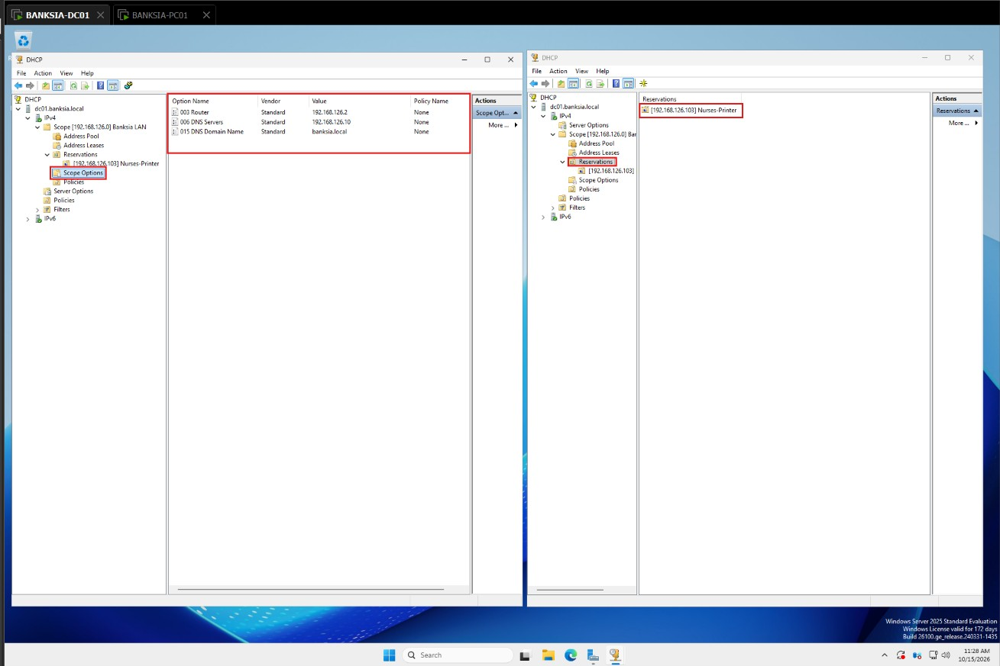

PC01 is set to get its IP and DNS automatically. After a release and renew it has 192.168.126.100, gateway .2, DHCP server .10 and DNS .10. The DNS line is the proof that option 006 works.

*PC01's lease, with the address, gateway, DHCP server and DNS server highlighted.*

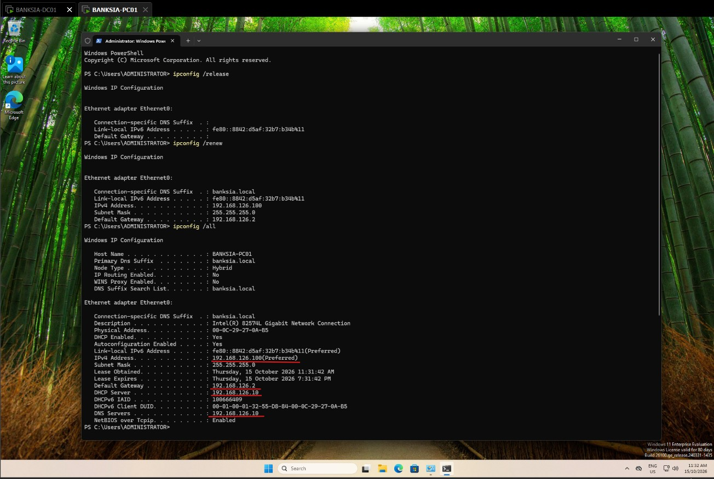

I added an A record `printer01` pointing to 192.168.126.103, then looked it up from PC01.

*The `printer01` record in DNS Manager on DC01.*

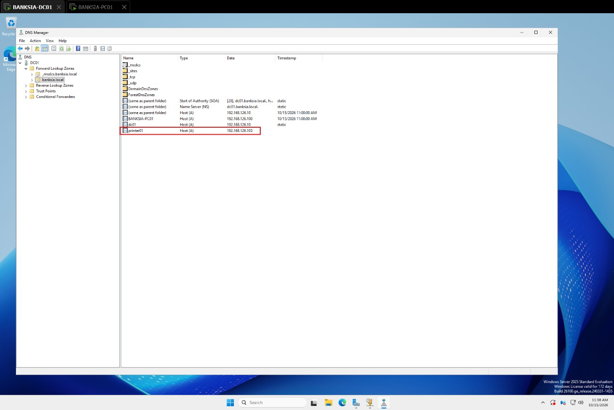

*`nslookup printer01` on PC01 returning 192.168.126.103.*

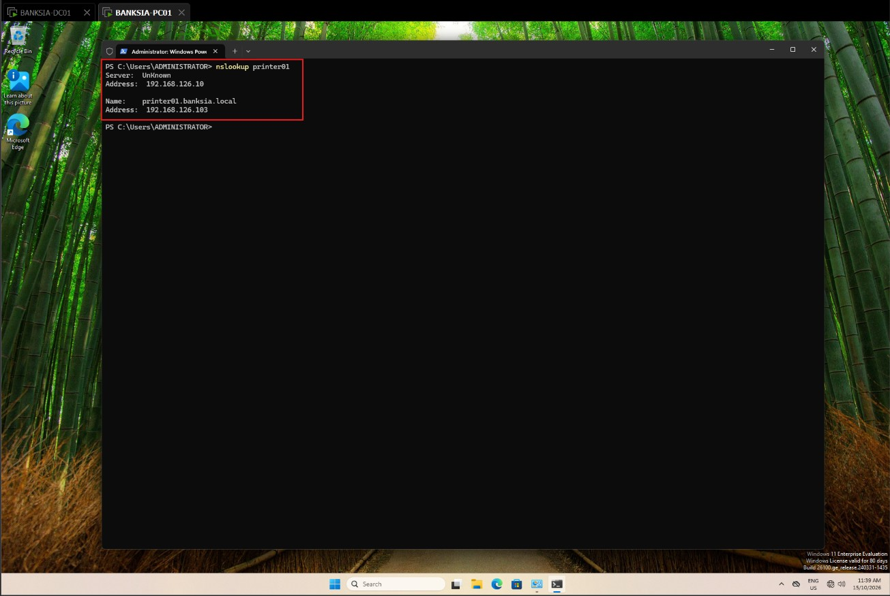

### The scope runs out

With only four addresses, it doesn't take many devices to fill the scope. DHCP identifies a device by its MAC address, so changing PC01's MAC in VMware makes DHCP treat it as a new device each time.

- PC01 with its original MAC held .100.
- My host laptop's VMnet8 adapter had also taken .101 from DC01, because VMware's DHCP was off.
- After one MAC change PC01 got .102. The only address left was .103, which is reserved for the printer, so the pool was full.
- After the next MAC change there was nothing left to give, and PC01 fell back to an APIPA address.

*PC01 with no lease. The release fails, the renew times out, and the adapter ends up on 169.254.239.228.*

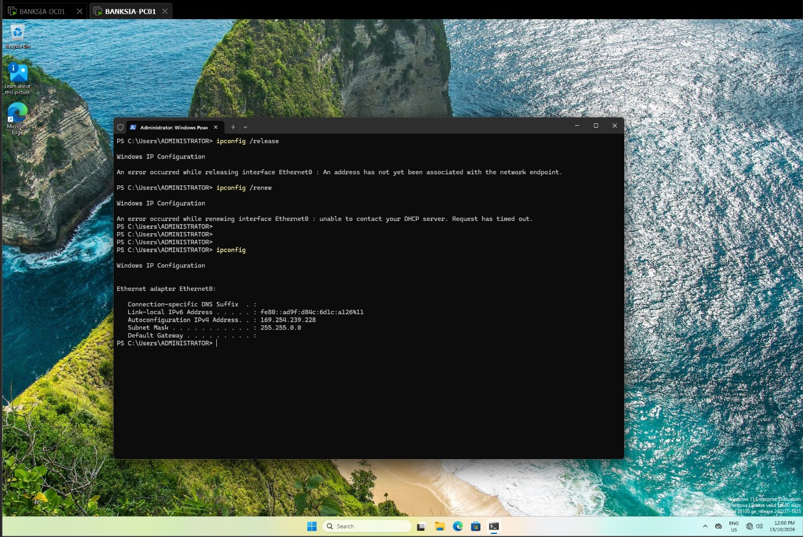

*The address leases on DC01 with .100, .101 and .102 leased and the .103 reservation.*

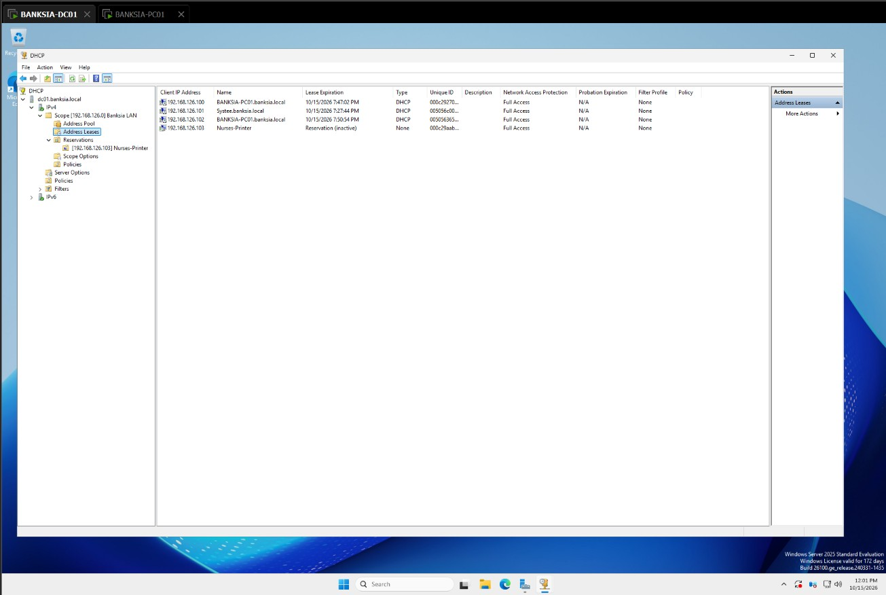

*The scope statistics showing 4 addresses in use (100%) and 0 available.*

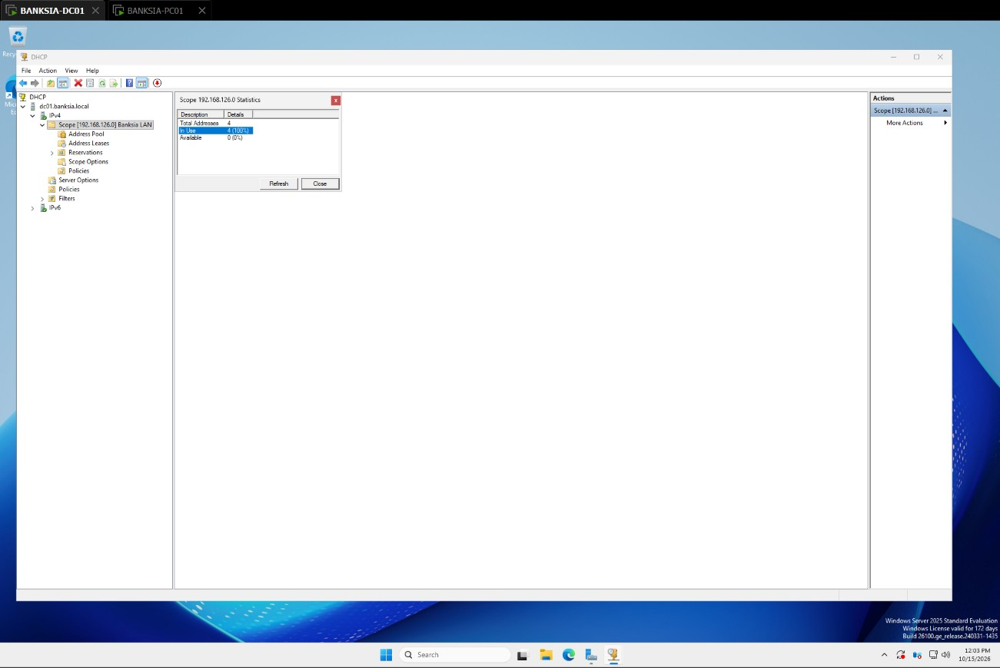

**The fix.** The real cause is a scope that is too small. I extended the end of the range to 192.168.126.120, which adds 17 free addresses. Shortening the lease time or deleting stale leases would also have helped, but they treat the symptom. After a release and renew PC01 got 192.168.126.104.

*PC01 back on a valid address (192.168.126.104) with the right gateway, DHCP server and DNS.*

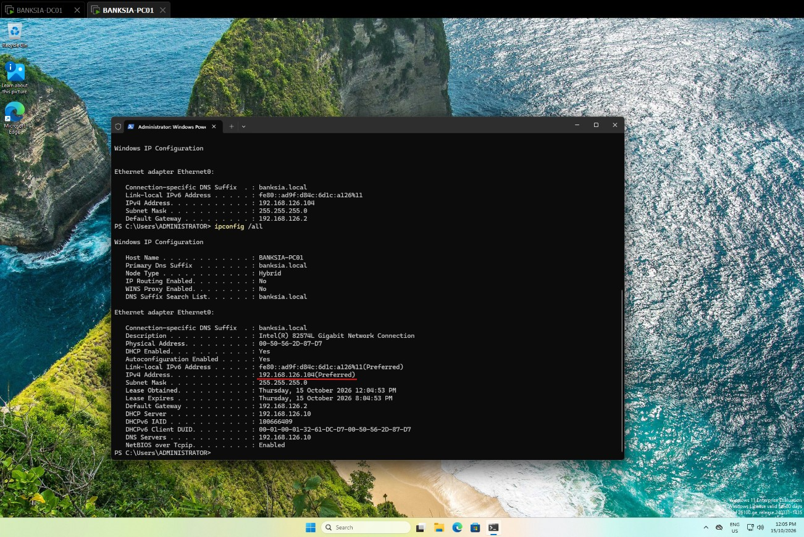

**Troubleshooting notes**
```
Issue: PC cannot get an IP address.
Checked: ipconfig on PC01 showed an APIPA address (169.254.239.228), no gateway.
DHCP console on DC01: scope Banksia LAN (192.168.126.100-.103) showed 4 (100%) in use.
Cause: scope too small for the devices requesting addresses.
Fix: extended the scope end address to 192.168.126.120.
Verified: ipconfig /release and /renew gave 192.168.126.104, gateway 192.168.126.2, DNS 192.168.126.10.
```

---

## 3. Troubleshooting on the lab network

For each fault I used the same method, going from near to far: `ipconfig /all`, ping the gateway, `ping 8.8.8.8`, `nslookup google.com`, `tracert 8.8.8.8`. Each result narrows down where the fault sits.

### Scenario 1: wrong gateway

A nurse at the nurses' station can open the shared drive but not the internet. PC01 was set to a static IP of 192.168.126.150 with a gateway of 192.168.126.99, where nothing exists.

*Broken. The gateway is .99, DC01 answers, `ping 8.8.8.8` is 100% loss and `tracert` stops at the first hop.*

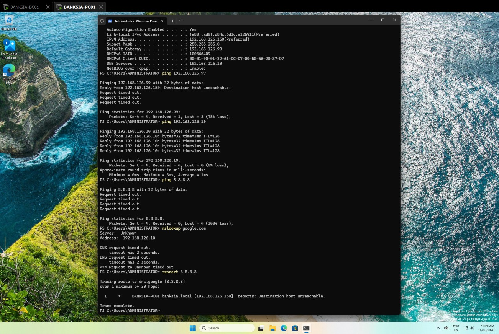

I changed only the gateway to 192.168.126.2 and ran the same checks.

*Fixed. The gateway answers, 8.8.8.8 answers, google.com resolves, and `tracert` now shows 192.168.126.2 as hop 1.*

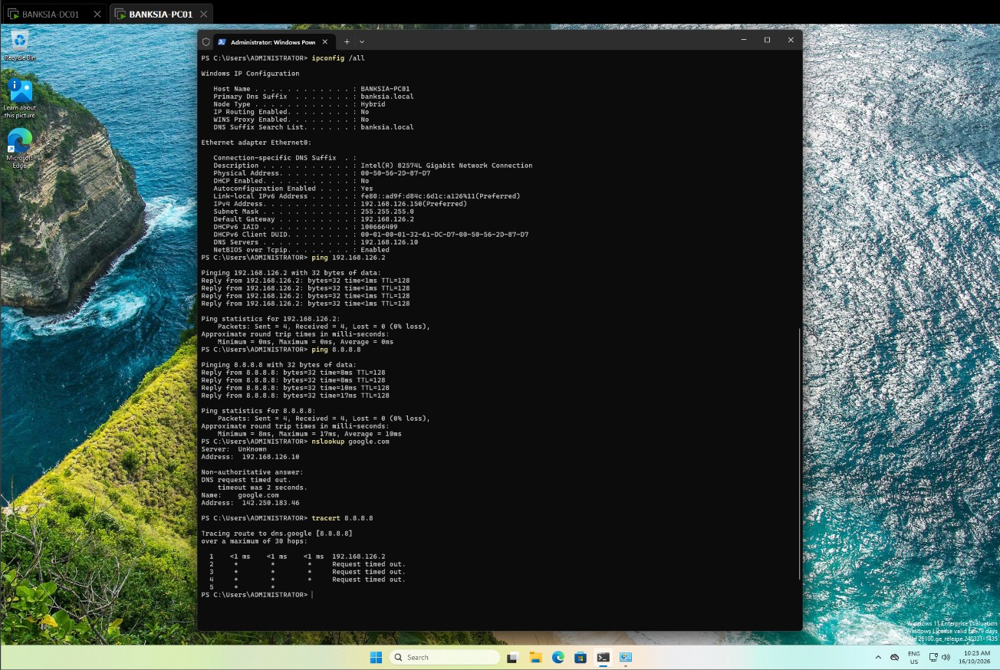

**Troubleshooting notes**
```
Issue: no internet from PC01; the shared drive works.
Checked: ipconfig /all showed IP 192.168.126.150, gateway 192.168.126.99, DNS 192.168.126.10.
ping 192.168.126.10 (DC01): 4 of 4 replies. ping 192.168.126.99: no replies.
ping 8.8.8.8: 100% loss. nslookup google.com: timed out. tracert 8.8.8.8: stopped at hop 1.
Cause: wrong default gateway.
Fix: set the gateway to 192.168.126.2.
Verified: ping 192.168.126.2 and 8.8.8.8 4 of 4 replies, google.com resolves, tracert hop 1 = 192.168.126.2.
```

### Scenario 2: wrong DNS

The internet shows as connected, but no websites open. The gateway was correct, and DNS was set to 192.168.126.99.

*Broken. `ping 8.8.8.8` works, `nslookup google.com` times out against .99, and `nslookup google.com 8.8.8.8` works, which isolates the fault to the DNS setting.*

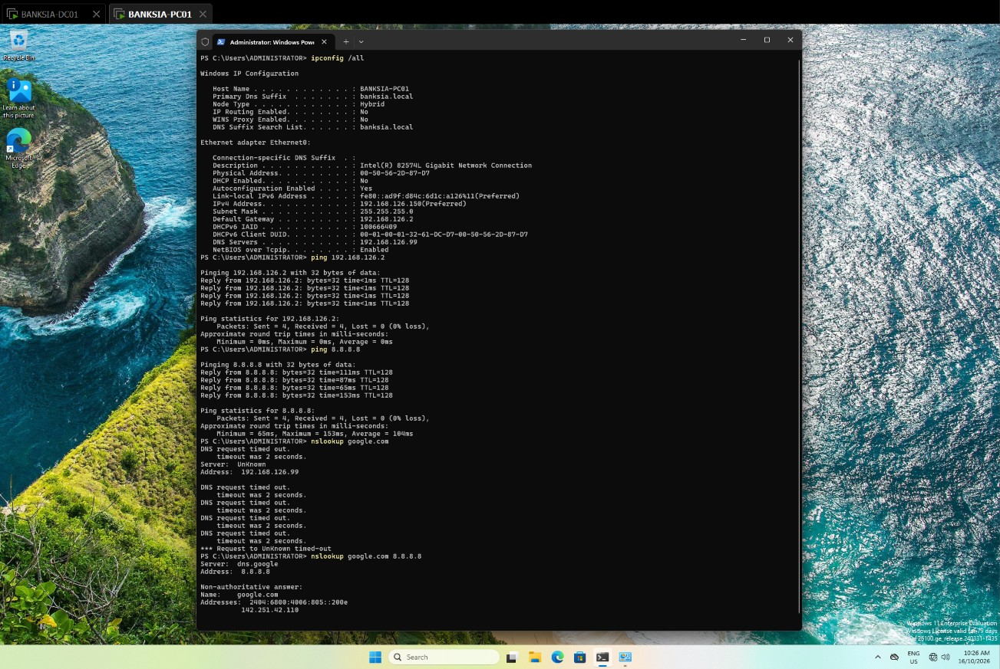

I set DNS back to 192.168.126.10 and ran `ipconfig /flushdns` to clear anything cached.

*Fixed. DNS is .10 and google.com resolves straight away.*

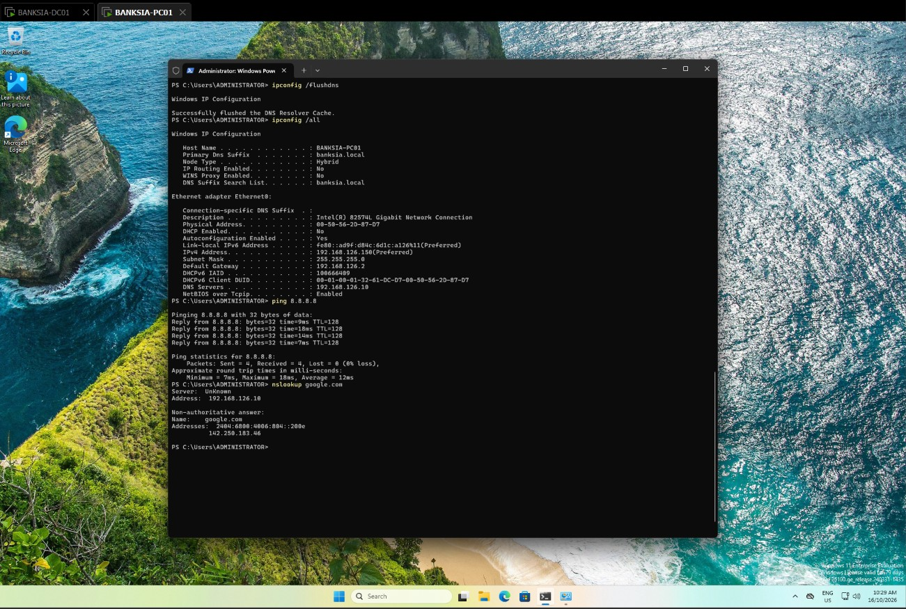

**Troubleshooting notes**
```
Issue: websites do not open; internet otherwise connected.
Checked: gateway 192.168.126.2 replies, ping 8.8.8.8 works.
nslookup google.com timed out against 192.168.126.99.
nslookup google.com 8.8.8.8 returned an answer, so the internet and name lookup work when the right server is asked.
Cause: DNS server set to 192.168.126.99, where nothing exists.
Fix: DNS set to 192.168.126.10, ipconfig /flushdns.
Verified: ping 8.8.8.8 4 of 4, nslookup google.com resolved via 192.168.126.10.
```

### Scenario 3: IP conflict

A PC says there is an address problem and the connection is unreliable. I gave PC01 the static address 192.168.126.10, which is DC01's address. I set it in the network adapter window, so any popup would show. None appeared, so the evidence came from other places.

*`arp -a` on PC01. The interface line shows the 169.254 fallback address, and .10 maps to a different MAC (00-0c-29-98-be-ae) from PC01's own (00-50-56-2d-87-d7).*

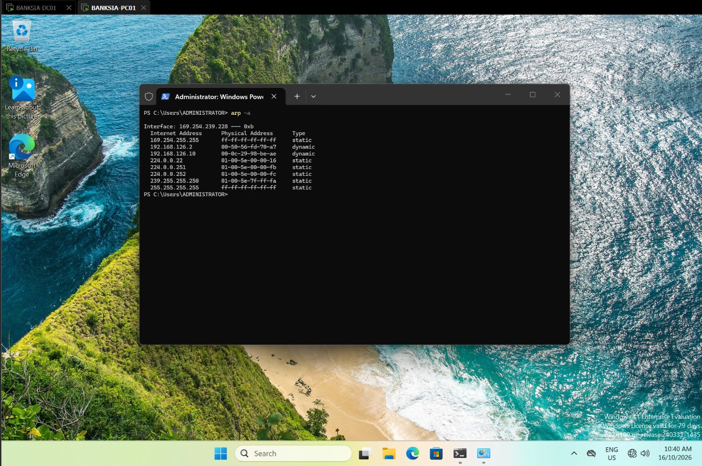

*Event 4199 (Tcpip) in the System log, reporting a conflict for 192.168.126.10 with hardware address 00-0C-29-98-BE-AE.*

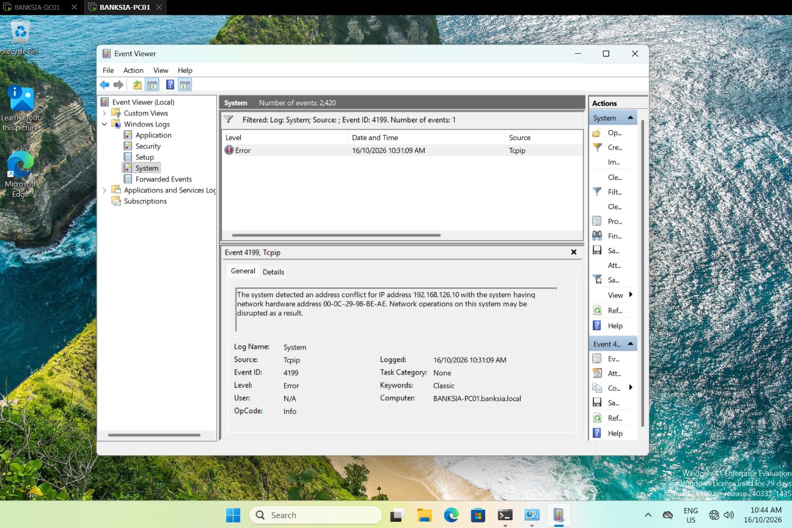

I set PC01 back to automatic IP and DNS and ran a release and renew.

*PC01 back on DHCP with 192.168.126.104, gateway .2, DHCP server .10 and DNS .10.*

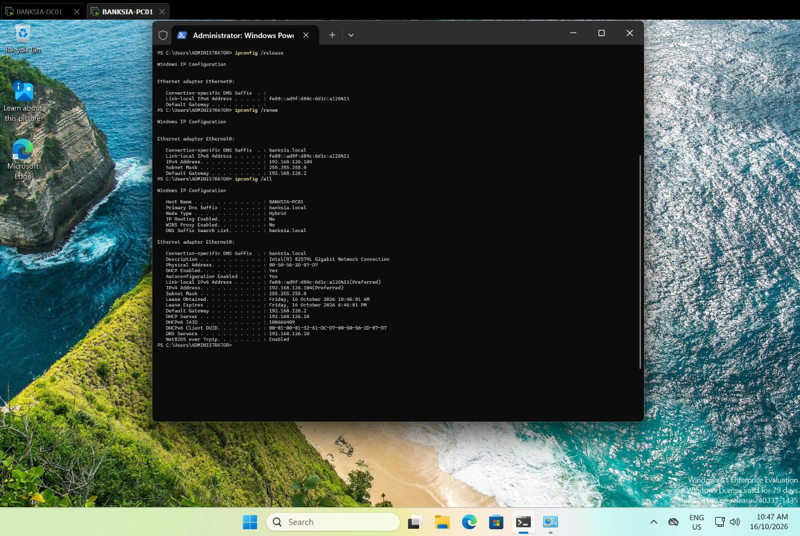

**Troubleshooting notes**
```
Issue: PC cannot connect reliably after an address change.
Checked: PC01 was set to static 192.168.126.10 (no popup appeared).
arp -a: interface address was 169.254.239.228, and 192.168.126.10 mapped to a different MAC from PC01's own.
Event Viewer > System, Tcpip, ID 4199: address conflict for 192.168.126.10 with 00-0C-29-98-BE-AE.
Cause: PC01 was given an address already in use by DC01.
Fix: set PC01 back to automatic IP and DNS, ipconfig /release and /renew.
Verified: PC01 received 192.168.126.104 from DHCP server 192.168.126.10.
```

---

## 4. SOHO router, Wi-Fi and WAN (Packet Tracer, simulated)

This is a separate Packet Tracer file, [part3-soho-wan.pkt](packet-tracer/part3-soho-wan.pkt). It is the kind of small-office equipment a service desk supports.

I set up a Wireless-N router with its own LAN address of 192.168.20.1 and DHCP handing out addresses from .100 for up to 20 users.

*The router's basic setup, with the LAN address and DHCP range.*


I set the Wi-Fi name to `Banksia-Staff` with WPA2 Personal and AES encryption. The passphrase on screen is a lab passphrase for a simulated router.

*Wireless security set to WPA2 Personal with AES.*

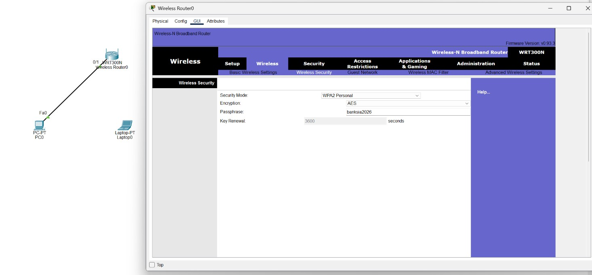

I swapped the laptop's wired module for a wireless one (WPC300N) and connected it to `Banksia-Staff`.

*The laptop connected to the access point with full signal and link quality.*

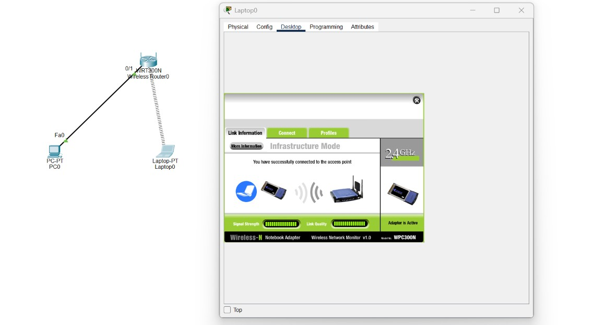

### WAN between two sites

Two routers, `MAIN` and `NORTHSIDE`, each with its own LAN, joined by a link on 10.0.0.0/30. Each router needs a static route to the other site's LAN, because it has no other way to learn it.

*MAIN's routing table with the static route to 192.168.30.0/24 via 10.0.0.2, next to a successful ping from a PC at MAIN to a PC at NORTHSIDE. The first attempt timed out while ARP resolved, so this is the second attempt.*

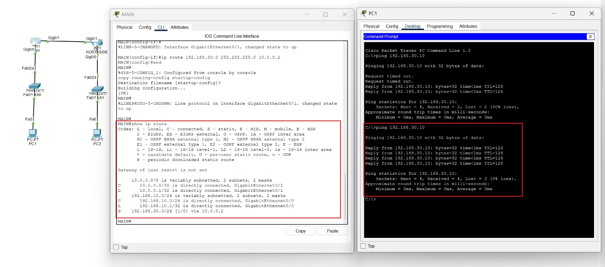

The WAN link is simulated. A real provider link would add an ISP and usually dynamic routing.

---

## 5. VLANs and device management (Packet Tracer, simulated)

This is a new Packet Tracer file, [part4-vlans.pkt](packet-tracer/part4-vlans.pkt), built for Banksia. A 2960 switch (`BANKSIA-SW1`) and a 2911 router (`BANKSIA-R1`) connect a Clinical PC, an Admin PC, a TFTP server and a Guest PC. The server stands in for the real servers at the site.

*The topology.*

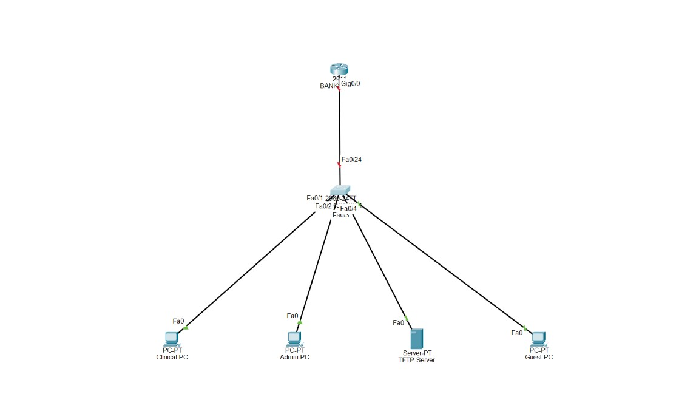

I created three VLANs and put each port in one: Clinical (VLAN 10) on Fa0/1, Admin (VLAN 20) on Fa0/2 and Fa0/3, and Guest (VLAN 30) on Fa0/4.

*`show vlan brief` with each port in its VLAN.*

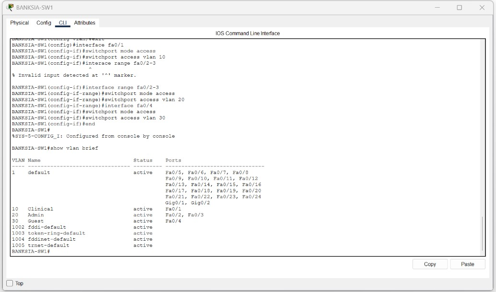

Before the trunk and router existed, I checked that the VLANs are isolated.

*A ping from the Clinical PC to the Admin PC at 100% loss.*

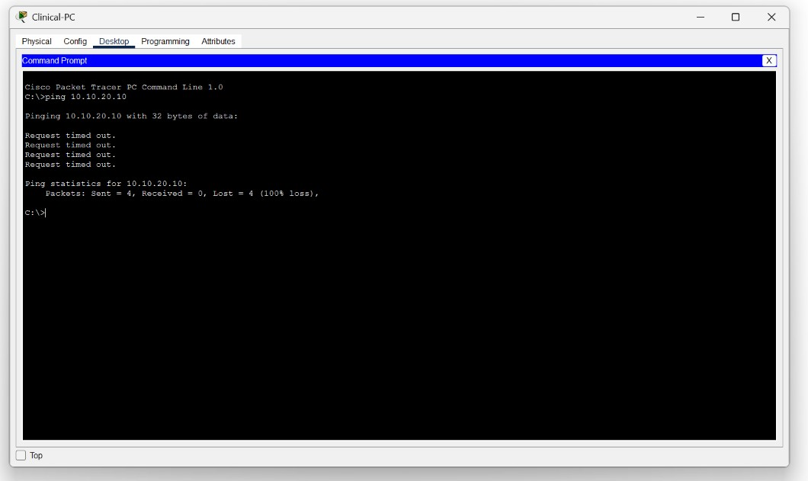

### Trunk and router-on-a-stick

The switch keeps the VLANs apart, so a router is needed to connect them. I made Fa0/24 a trunk and gave the router one subinterface per VLAN (10.10.10.1, 10.10.20.1 and 10.10.30.1), each using 802.1Q tagging.

*The trunk on the switch (VLANs 1, 10, 20 and 30 active) and the router's subinterfaces up with the right addresses.*

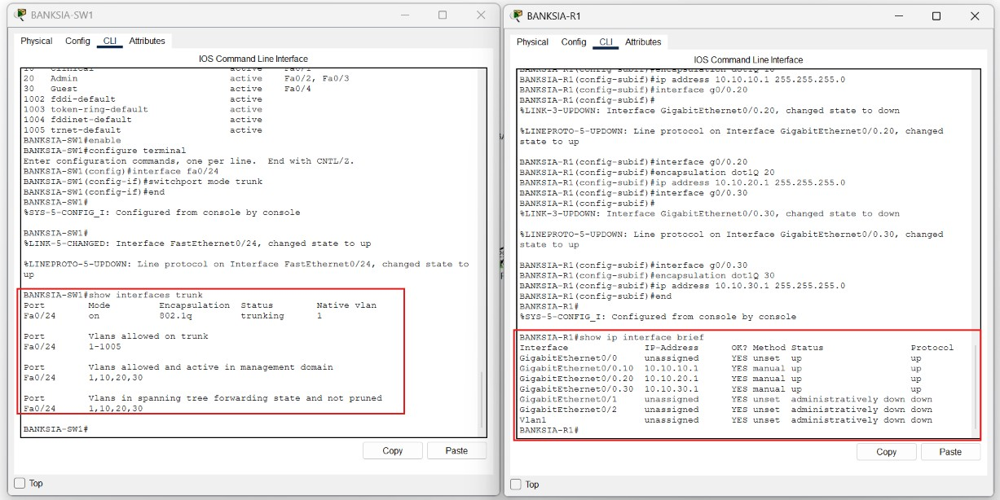

*The same ping that failed before now works. The first attempt timed out while ARP resolved. `TTL=127` shows the traffic crossed the router.*

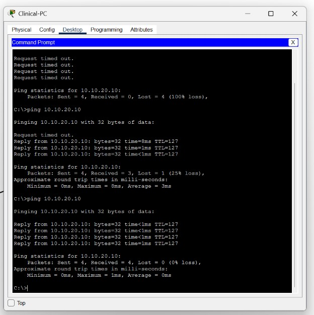

Routing between the VLANs also means Guest can reach Clinical. An ACL would block that, but I haven't built one here.

### Router management and backup

On `BANKSIA-R1` I set the hostname and domain name first, then an enable secret and an admin user, generated a 2048-bit RSA key, enabled SSH version 2 and limited the VTY lines to SSH with local login. I saved the config and copied it to the TFTP server.

Remote login over SSH from the Admin PC did not work in Packet Tracer, so I made the backup from the router's console instead.

*`copy running-config tftp` to 10.10.20.20, with 1164 bytes copied.*

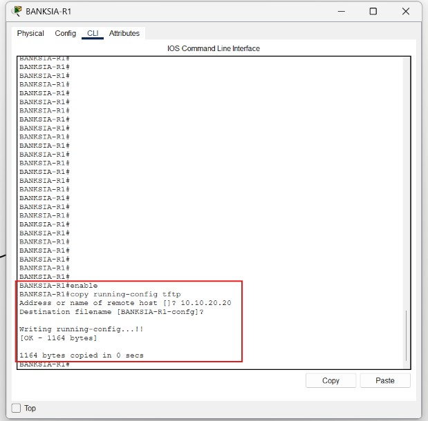

---

## 6. VLAN mismatch and link down (Packet Tracer, simulated)

### Scenario 4: VLAN mismatch

A PC is on but can't reach anything. Its switch port had been put in the wrong VLAN. I moved Fa0/1, the Clinical PC's port, into VLAN 20. The PC kept its 10.10.10.10 address, so its port and its address no longer matched.

*Fa0/1 sits under Admin in `show vlan brief`, and pings to the gateway (10.10.10.1) and to Admin (10.10.20.10) both fail.*

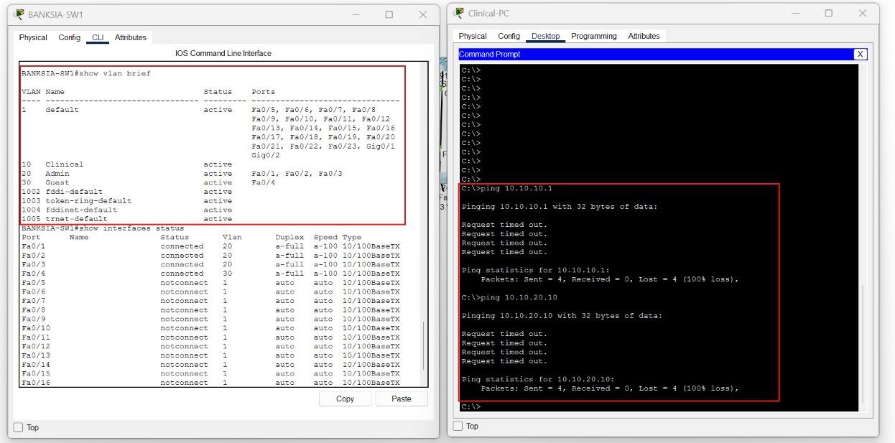

I put Fa0/1 back in VLAN 10.

*Fa0/1 back under Clinical, and both pings get replies.*

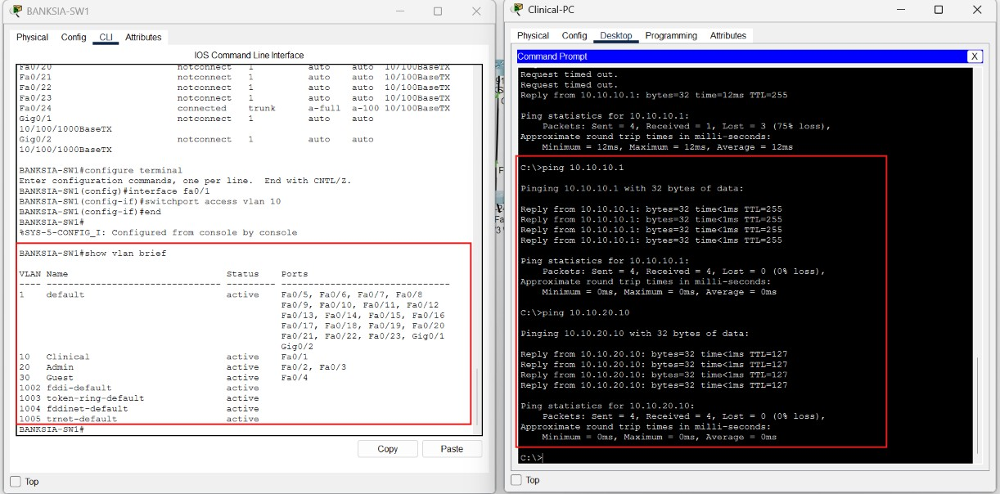

**Troubleshooting notes**
```
Issue: Clinical PC cannot reach its gateway or any other host.
Checked: show vlan brief showed Fa0/1 in VLAN 20 (Admin), not VLAN 10 (Clinical).
ping 10.10.10.1 and ping 10.10.20.10: 100% loss.
Cause: switch port in the wrong VLAN for the PC's address.
Fix: interface fa0/1, switchport access vlan 10.
Verified: ping 10.10.10.1 and ping 10.10.20.10: 4 of 4 replies.
```

### Scenario 5: link down

A cable gets knocked out and a PC drops off the network. I removed the cable on Fa0/2 (the Admin PC), checked `show interfaces status` and pinged from the Clinical PC, then reconnected a straight-through cable and checked again.

*Broken on top (Fa0/2 `notconnect`, ping at 100% loss) and fixed below (Fa0/2 `connected`, ping at 0% loss).*

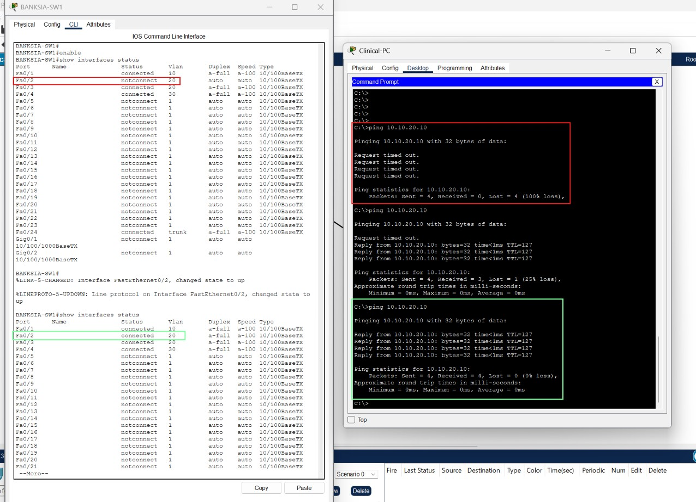

**Troubleshooting notes**
```
Issue: Admin PC unreachable.
Checked: show interfaces status showed Fa0/2 notconnect. ping 10.10.20.10 from the Clinical PC: 100% loss.
Cause: cable disconnected.
Fix: reconnected a straight-through cable to Fa0/2.
Verified: Fa0/2 connected in VLAN 20, ping 10.10.20.10: 4 of 4 replies.
```

---

## 7. WireGuard VPN

I set up a tunnel between my laptop (the host, acting as the VPN server) and PC01 (the user). Each end generates a private key it never shares and a public key it gives to the other side. The tunnel addresses are 10.8.0.1 (host) and 10.8.0.2 (PC01).

- **Endpoint:** PC01 finds the host at 192.168.126.101:51820. That is the host's VMnet8 address, which came from DC01's DHCP.
- **AllowedIPs = 10.8.0.1/32** on PC01 sends only tunnel traffic through the VPN, so PC01's normal internet and domain DNS stay outside it.
- **Host firewall:** I allowed UDP 51820 for the VPN and ICMPv4 from 10.8.0.0/24 only, for ping.

*Both tunnel configs. The private keys are covered, and the public keys are safe to show.*

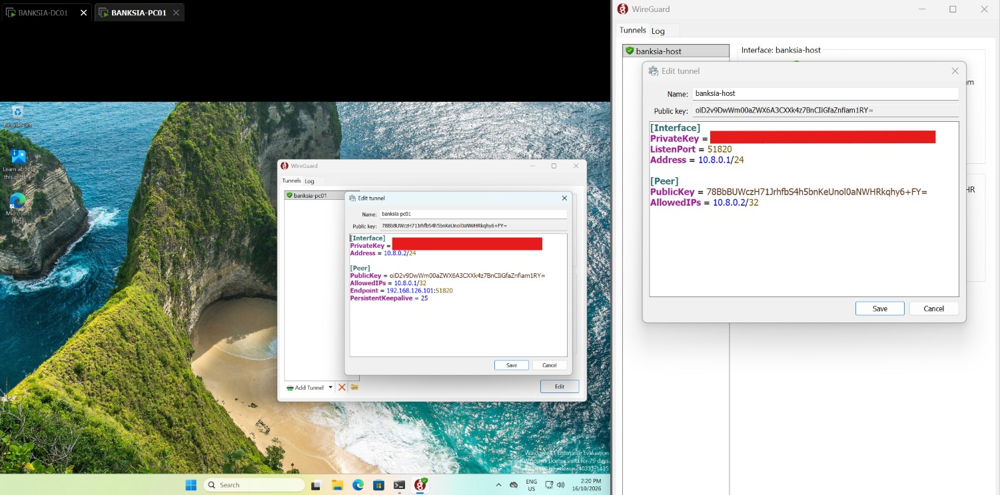

*PC01's tunnel active with a recent handshake, and four replies from 10.8.0.1 with 0% loss.*

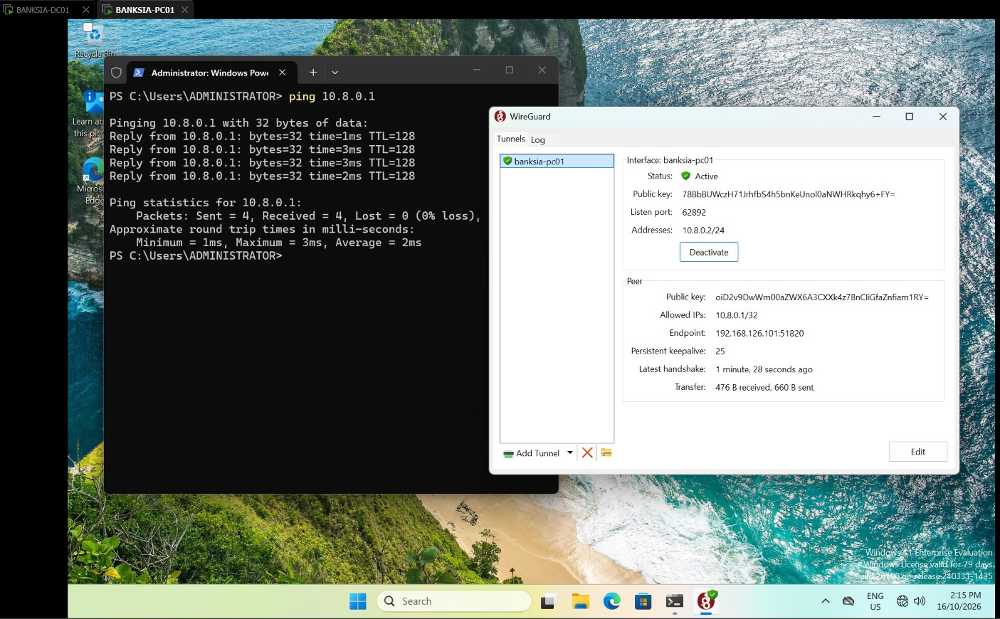

Both ends are on one laptop, so this proves the configuration works, not a real remote path.

If a user says their VPN won't connect, these are the checks: are the keys right, is the endpoint address right, is the firewall letting the traffic in, and does a handshake show?

---

## 8. Extra notes

**Wi-Fi and the router**
- **Mesh Wi-Fi:** several nodes work together as one network with one name, and devices move between them as you walk around.
- **Guest SSID:** a separate Wi-Fi name for visitors, kept apart from the internal network, usually on its own VLAN.
- **Port forwarding:** the router sends traffic that arrives on a certain port to one device inside the network, for example a camera. It can also expose that device to the internet, so it needs care.
- **2.4 vs 5 GHz:** 2.4 GHz travels further through walls but is slower and more crowded. 5 GHz is faster and less crowded but has shorter range.

**Network rules and resilience**
- **ACLs:** rules on a router that permit or deny traffic by address or port. For example, an ACL could stop the Guest VLAN reaching the Clinical VLAN.
- **DHCP failover:** two DHCP servers share one scope, so if one goes down the other keeps handing out addresses.

---

## What I learned

- A device with a 169.254 address couldn't get anything from DHCP. The first questions are whether the DHCP server is up and whether the scope has free addresses.
- The same symptom can have different causes, and the order of the checks tells them apart. If the gateway is wrong, even `ping 8.8.8.8` fails. If DNS is wrong, `ping 8.8.8.8` works and `nslookup` doesn't.
- `nslookup google.com 8.8.8.8` is a quick way to separate "the internet is down" from "this PC is asking the wrong DNS server".
- With no conflict popup, `arp -a` and Event 4199 still showed which address was duplicated and which MAC was already using it.
- A DHCP option typed wrongly can look fine. I first set the router option to DC01's own address by mistake, and only the options view in the DHCP console showed it was wrong.
- A VLAN keeps ports apart even on one switch. A link light that is on doesn't mean the port is in the right VLAN, so `show vlan brief` is the first check when a connected PC can't reach anything.
- Static routes were enough for two sites, because each router has only one way to the other.
- For SSH on a Cisco device, the order matters: hostname and domain name first, then the RSA key.
