# Module 6: Company File Sharing Support

Simulated lab set in **Banksia Aged Care**, the fictional aged care provider from Modules 1-5. The servers, shares, permissions and logs are real and built by me. User calls are role-played. Problems are written up as scenario notes rather than ServiceNow tickets (ticketing is covered in [Module 1](../module-01-servicenow-itsm/)).

**Skills shown:** SMB file shares · share vs NTFS permissions · access-based enumeration · Effective Access · Group Policy drive maps · Previous Versions · `icacls`, `Test-NetConnection`, `whoami /groups`, `gpresult` · workgroup sharing · Sysprep and duplicate SIDs · OpenMediaVault NAS · RAID1 failure and rebuild

## Environment

| Machine | Role |
|---|---|
| BANKSIA-DC01 | Windows Server 2025. Domain controller (Module 3) and now file server, with a separate data disk E: (192.168.126.10) |
| BANKSIA-PC01 | Windows 11, joined to banksia.local. Staff PC |
| BANKSIA-PC02 | Windows 11, workgroup (not on the domain). Plays the Eastwood site's reception PC |
| banksia-nas | OpenMediaVault 8 in a VM. One 8 GB system disk and two 5 GB data disks (192.168.126.20) |

Test users: Fred Luddy and Jade Erlebach (Clinical Staff), Beth Anglin (Care Managers), Sabrina Deppert (Admin Office).

**Lab setup:** DC01 is both the domain controller and the file server, the NAS runs as software in a VM, and PC02 is a cloned VM. In a real company the file server would be a separate machine, because a domain controller holds every account in the domain and shouldn't also run file shares.

## Key terms

| Term | Meaning |
|---|---|
| SMB / UNC path | Windows file sharing on port 445. A share's address looks like `\\DC01\Departments` |
| Share vs NTFS permissions | Share permissions control network access, NTFS controls the files. Both apply, and the stricter one wins |
| Access-based enumeration | Users only see folders they're allowed to open |
| Effective Access | What one person can actually do once all their groups are combined |
| Workgroup | PCs with no domain. Each PC keeps its own user accounts |
| SID / Sysprep | Every Windows install has a unique ID. Sysprep resets it before a PC is copied |
| RAID1 | Data mirrored on two disks, so one can fail without losing anything |

## Setup problems

| Problem | Cause | Fix |
|---|---|---|
| Department folders had unwanted **Users** permissions | I created them directly on E:\, so they copied E:'s defaults | Recreated them inside the locked-down share folder |
| Share path became `E:\Shares\Departments` | The New Share wizard made its own folder | Kept it. Users still just see `\\DC01\Departments` |
| Couldn't sign in to PC01 as Fred | His Microsoft 365 account (Module 4) is separate from his domain account | Reset his domain password in ADUC |
| Linked clone unavailable | PC01 is encrypted by its virtual TPM | Used a full clone |
| Sysprep failed validation | A handwriting app was installed for one user only (found in `setupact.log`) | Removed it with `Remove-AppxPackage -AllUsers` |
| NAS RAID plugin wouldn't install | Out-of-date package list | Checked for updates first |
| NAS disk letters changed after adding a disk | Linux names disks in the order it finds them | Picked the mirror disks by size, not letter |

---

## Part 1: Domain file shares and NTFS permissions

**Scenario:** Banksia needs one place for department files, where nurses can't open admin records and admin staff can't open clinical ones. In aged care, that's a privacy requirement.

**What I did**
- Added a data disk E: to DC01, so files are kept apart from Windows.
- Shared `E:\Shares\Departments` as **Departments**, with access-based enumeration on.
- **Share permission:** removed Everyone and gave Authenticated Users Full Control. The share stays open and NTFS does the real control, so access is managed in one place.
- **Top folder:** Domain Users can list the folders but nothing flows down into them.
- **Department folders:** set by group, never by person. I did Clinical by hand, then the rest with an `icacls` script so every folder was set the same way.

| Folder | Clinical Staff | Care Managers | Admin Office | Service Desk |
|---|---|---|---|---|
| Clinical | Modify | Modify | – | – |
| Admin | – | Read | Modify | – |
| Management | – | Modify | – | – |
| Policies | Read | Modify | Read | Read |

`icacls` on the Admin folder (`M` = Modify, `RX` = Read & execute, `F` = Full Control):
```
E:\Shares\Departments\Admin BANKSIA\Care Managers:(OI)(CI)(RX)
                            BANKSIA\Admin Office:(OI)(CI)(M)
                            BUILTIN\Administrators:(OI)(CI)(F)
                            NT AUTHORITY\SYSTEM:(OI)(CI)(F)
                            CREATOR OWNER:(OI)(CI)(IO)(F)
```

**NTFS permissions on Clinical:** inheritance off, Clinical Staff and Care Managers with Modify.

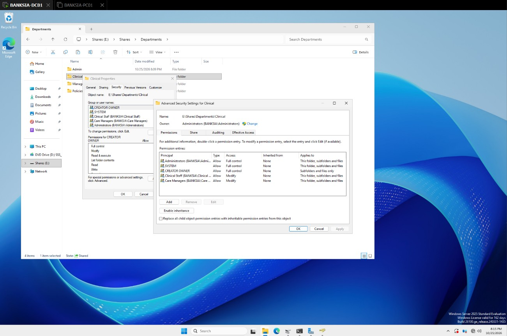

**Effective Access for Fred:** Modify on Clinical, no access to Admin.

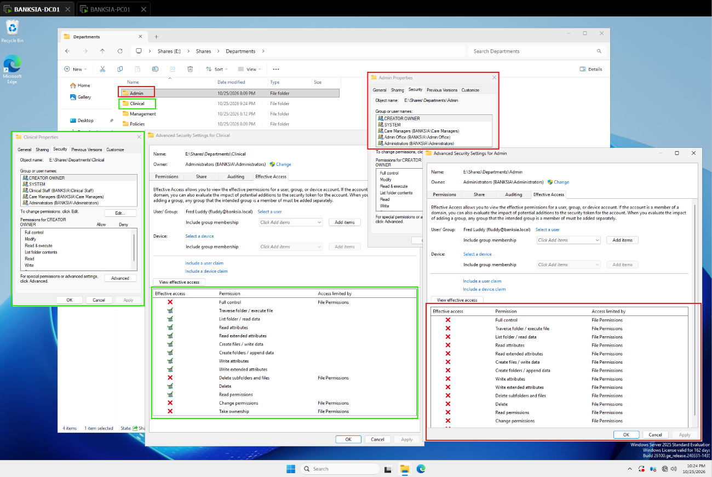

**Signed in as Fred:** he sees only Clinical and Policies, and typing the Admin path is refused. Hiding a folder isn't the lock; NTFS is.

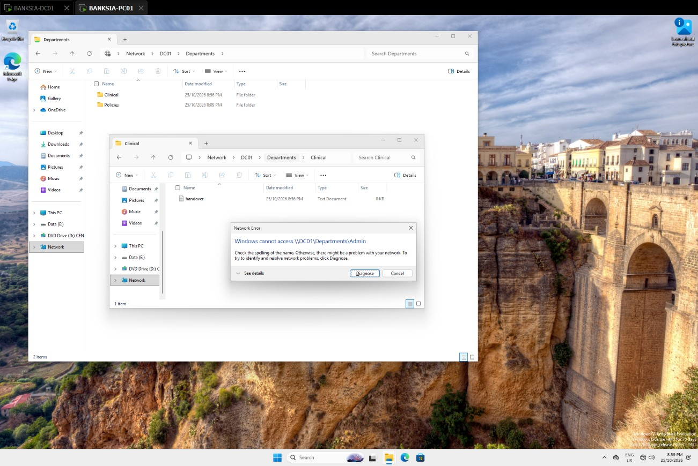

## Part 2: Drive maps by Group Policy

**Scenario:** staff shouldn't have to type `\\DC01\Departments`. Everyone gets a drive at sign-in, and managers get an extra one.

- GPO **Staff - Drive Maps**, linked to the Staff OU. Drive maps are user settings, so the GPO goes where the user accounts are.
- **S:** for all staff. **M:** (Management) only for Care Managers, using item-level targeting.

**The two drive maps, and the targeting rule for M:**

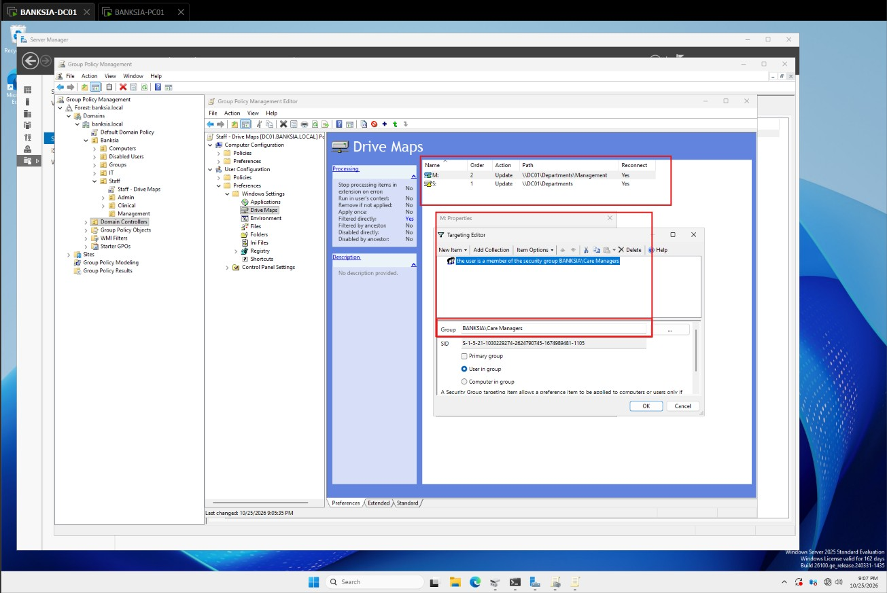

**Fred (Clinical Staff):** S: only

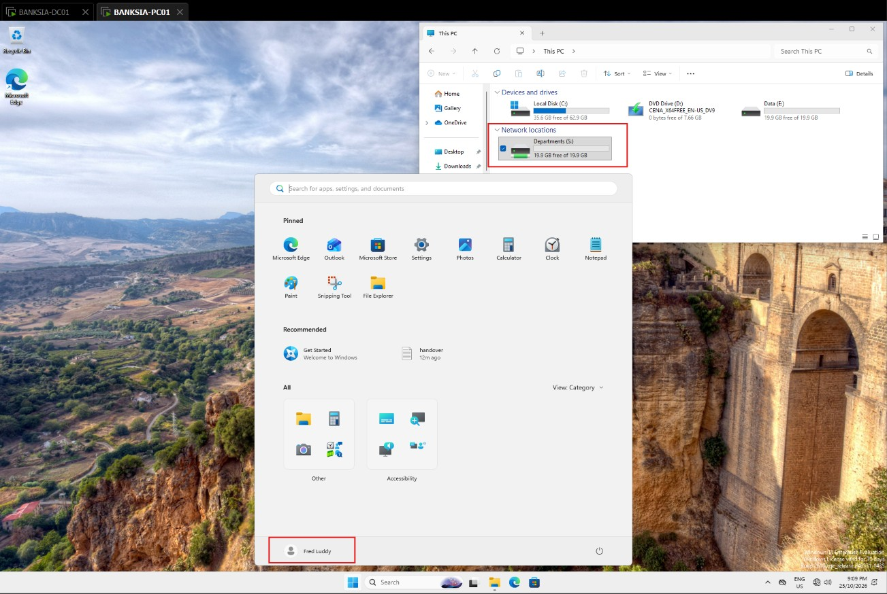

**Beth (Care Manager):** S: and M:

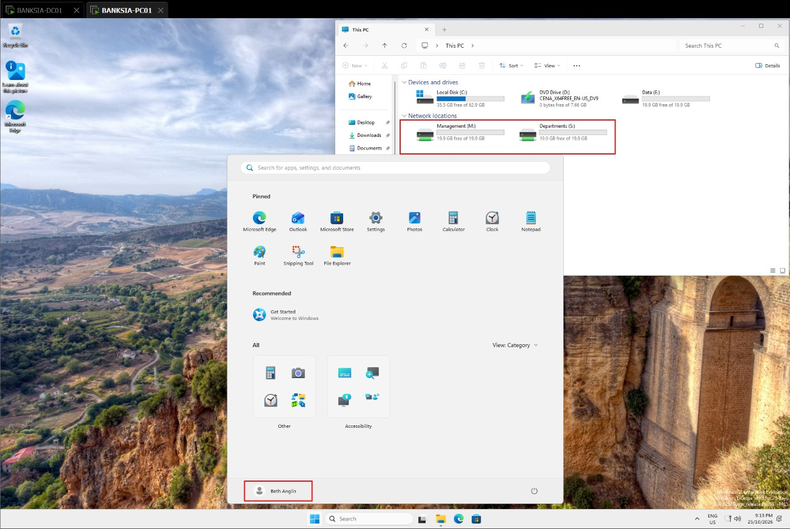

## Part 3: Previous Versions (deleted file)

**Scenario:** Fred deletes this week's roster. Files deleted from a network share skip the Recycle Bin.

Turned on shadow copies for E:. Fred deleted `Roster-Week42.txt`, and I got it back through **Clinical > Properties > Previous Versions > Open**, copying just that file. I didn't use **Restore**, because it rolls back the whole folder and could undo other people's work.

**The snapshot list and the recovered file:**

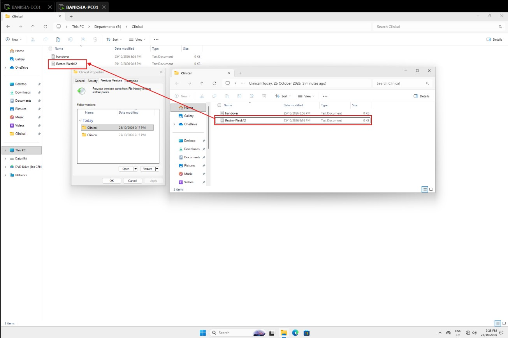

Shadow copies sit on the same disk as the files, so they work as a quick undo rather than a backup.

---

## Part 4: Troubleshooting scenarios

I used the same check order every time, from nearest to furthest:

1. `ping DC01` and `Test-NetConnection DC01 -Port 445`: can I reach the server and its file-sharing port?
2. `nslookup`: does the name resolve?
3. `whoami /groups`: which groups did this sign-in actually get?
4. `net use`: what am I connected to?
5. `Get-SmbShareAccess` and `icacls` on DC01: share and NTFS permissions
6. Effective Access: what do they add up to for this person?

After a group change the user must sign out and back in, because groups load at sign-in.

### Scenario 1: "I can't see the Clinical folder"
```
Issue: Jade's S: drive was empty.
Checked: whoami /groups did not list Clinical Staff.
Cause: Jade wasn't in the Clinical Staff group, so access-based enumeration hid both her folders.
Fix: Added her back, then she signed out and in.
Verified: S: showed Clinical and Policies, and whoami /groups listed Clinical Staff.
```

**Before:** S: empty, no Clinical Staff group

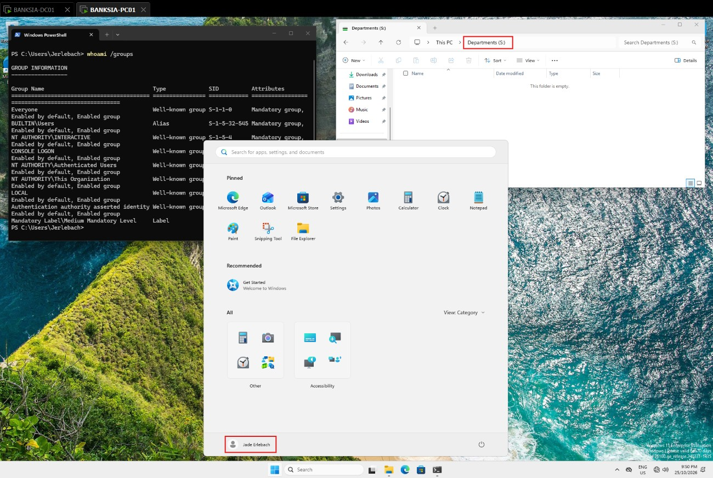

**After:** folders back, group listed

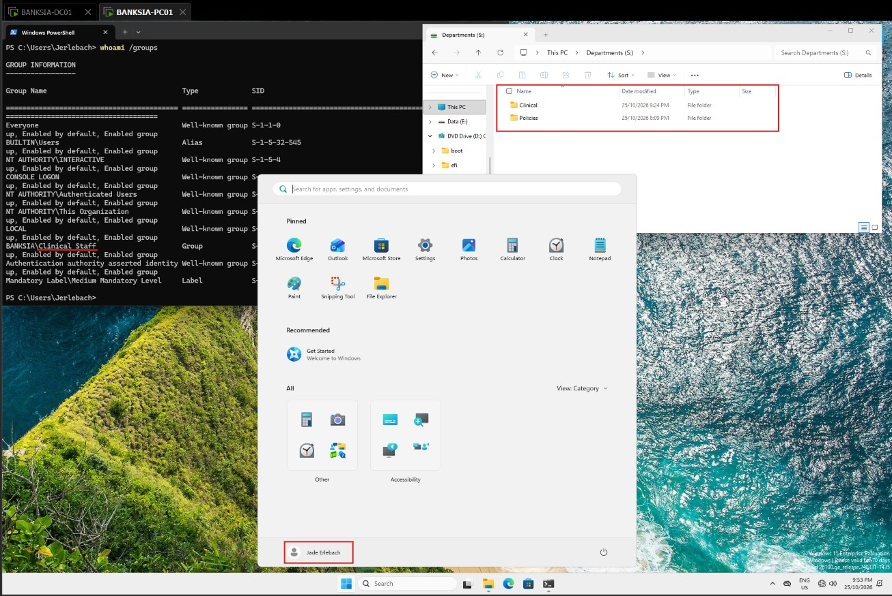

### Scenario 2: "I can open files but not save"
```
Issue: Fred could open handover.txt but not save it.
Checked: Get-SmbShareAccess showed the share set to Read. icacls showed Clinical Staff still had Modify.
Cause: Share Read + NTFS Modify = Read, because the stricter permission wins.
Fix: Set the share back to Full Control for Authenticated Users.
Verified: Get-SmbShareAccess showed Full, and Fred could save.
```

**Before:** save refused while the share was Read

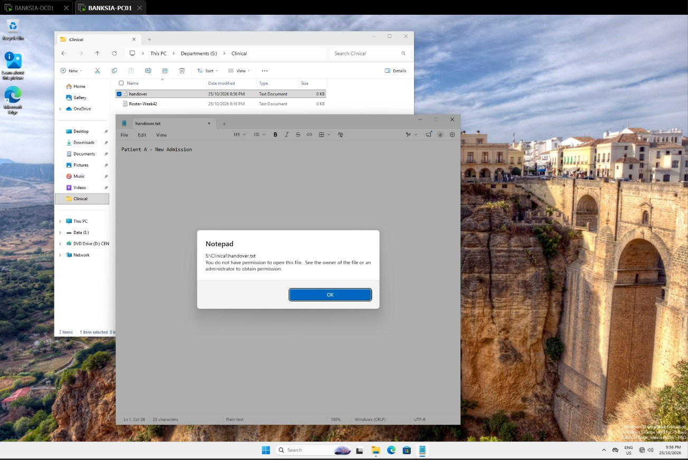

**Fix:** share set to Read (red), then back to Full (green)

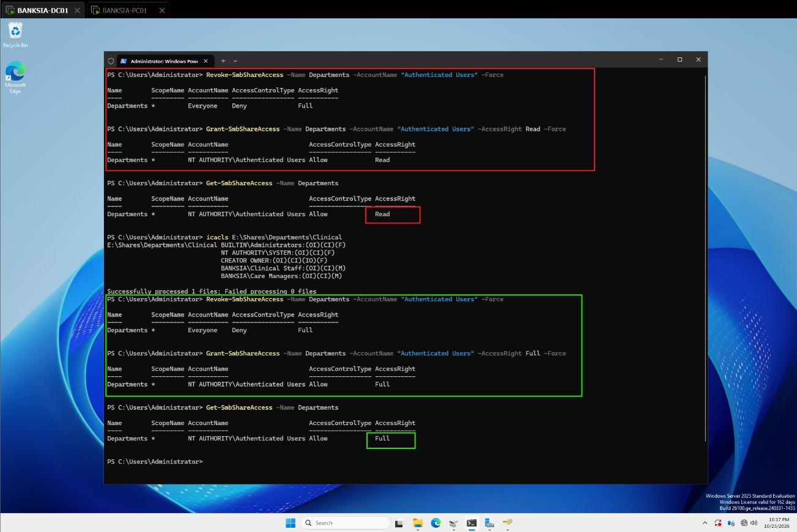

### Scenario 3: "Network path not found"
```
Issue: Fred couldn't reach the share, and S: was missing.
Checked: ping DC01 worked, but Test-NetConnection -Port 445 showed TcpTestSucceeded : False.
Cause: A firewall rule on DC01 was blocking TCP 445.
Fix: Removed the block rule.
Verified: Port 445 showed True and the share opened.
```
My first attempt, disabling the standard "File and Printer Sharing (SMB-In)" rule, didn't block anything. A domain controller probably has other rules that also allow 445, so I used a block rule instead. I only caught this by testing the port after the change rather than assuming it worked.

**Before:** ping works, port 445 fails, no S:

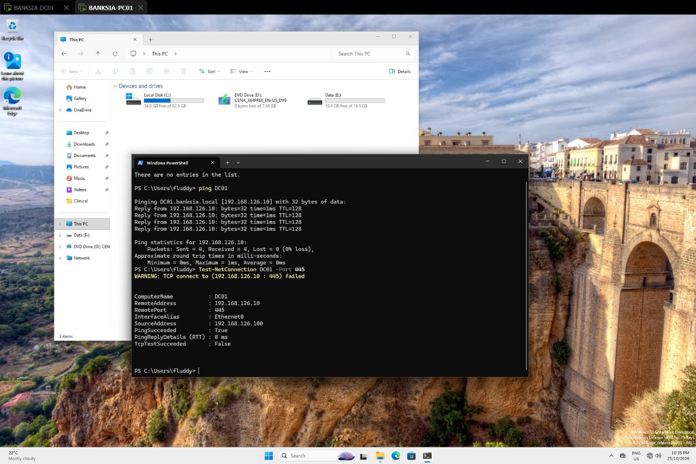

**After:** port 445 open, share opens

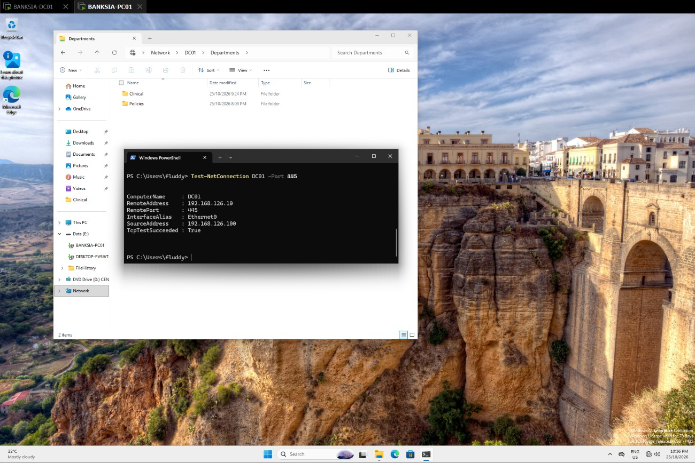

### Scenario 4: "My S: drive has gone"
```
Issue: Fred's S: drive disappeared.
Checked: gpresult /r /scope user showed his account in OU=IT and no GPOs applied.
Cause: His account had been moved out of the Staff OU, so the drive map policy no longer reached him.
Fix: Moved him back to Staff\Clinical, then he signed out and in.
Verified: S: was back, and gpresult listed Staff - Drive Maps.
```

**Before:** Fred in the IT OU, no GPOs, no S:

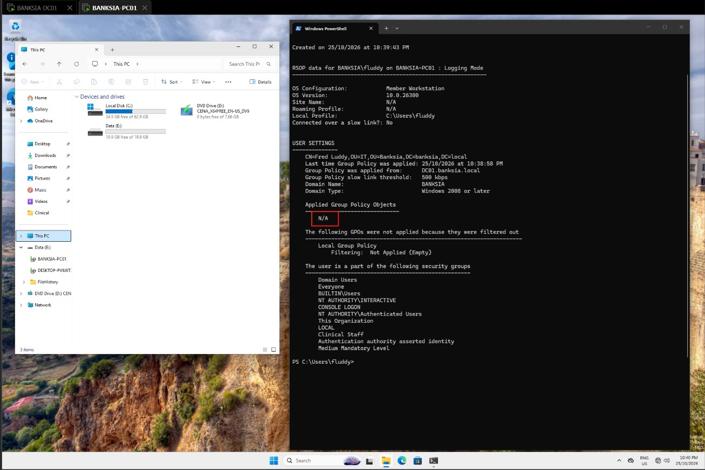

**After:** back in Staff, policy applied, S: back

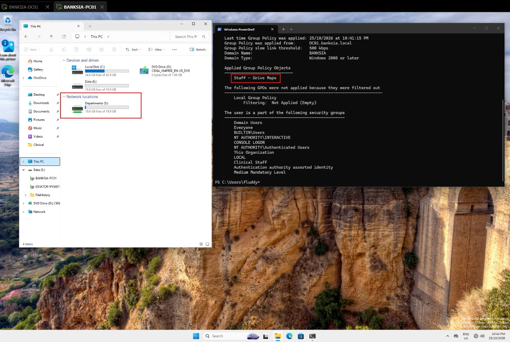

---

## Part 5: Workgroup sharing (Eastwood reception PC)

**Scenario:** Banksia's Eastwood site has no server. Reception keeps the visitor sign-in log, and the night nurse needs to read it, so reception shares the folder from its own PC.

- PC02 (the reception PC) is not on the domain, so it doesn't know Fred's Banksia login. I created a **local** account for Fred on PC02.
- Shared `C:\Visitor Logs` with **Read** for Fred, and turned on sharing for Private networks.

**PC02:** Fred's local account, the Visitor Logs folder, and the share set to Read.

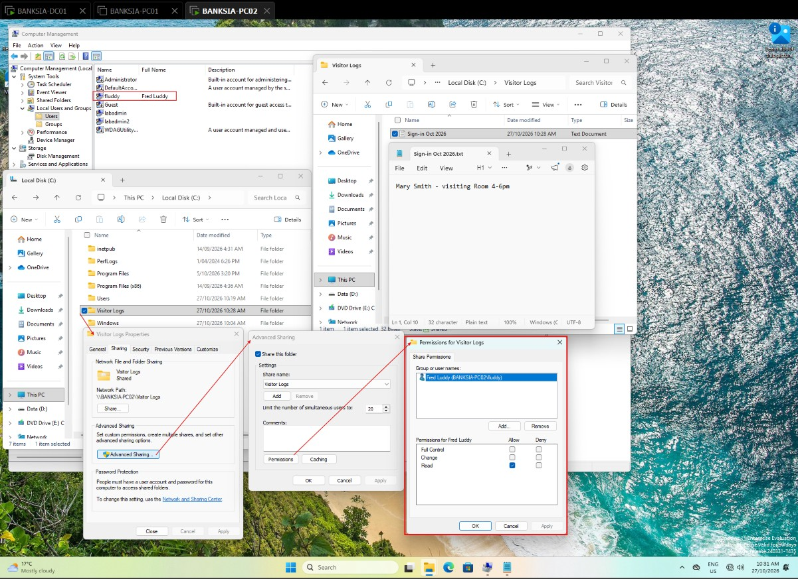

**The problem:** PC01 kept rejecting Fred's PC02 login as "password not correct", even though it was right.
```
Checked: Event Viewer on PC02 showed Event 6167 for each attempt, saying it can happen if a machine was cloned without Sysprep.
Cause: PC02 was cloned from PC01 without Sysprep, so both had the same SID. Windows updates released since late August 2025 (Windows 11 24H2/25H2 and Server 2025) block sign-ins between PCs with duplicate SIDs.
Fix: Re-cloned PC02 and ran Sysprep with Generalize to give it a unique SID.
Verified: Fred opened the visitor log from PC01, and saving was refused, proving read-only access.
```

Source: [Microsoft: Kerberos and NTLM authentication failures due to duplicate SIDs](https://support.microsoft.com/topic/kerberos-and-ntlm-authentication-failures-due-to-duplicate-sids-76f7394d-c460-4882-9ed1-d27e0960f949)

**Problem:** password rejected, Event 6167 on PC02

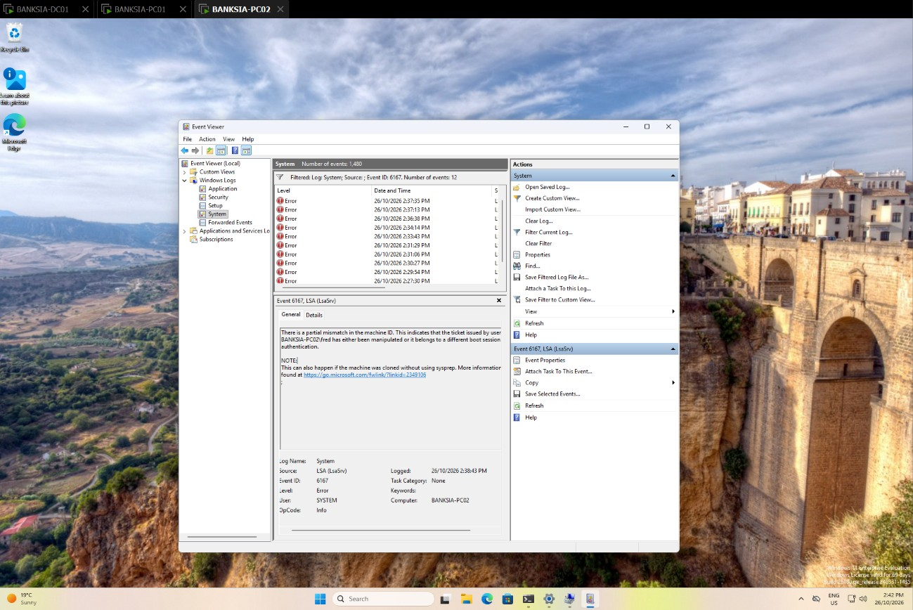

**After Sysprep:** log opens, save refused (read-only)

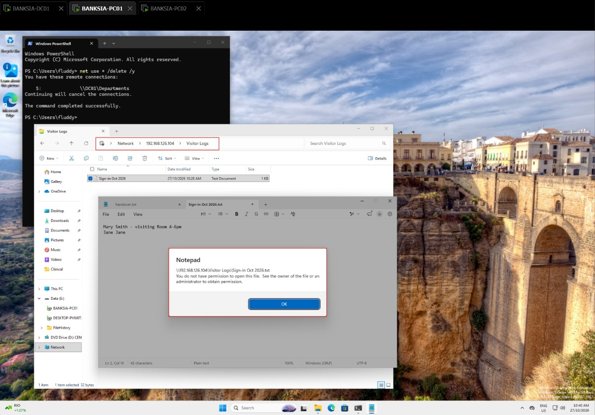

**What this shows:** in a workgroup, every PC needs its own accounts, so Fred needed a separate login on the reception PC. A cloned Windows PC also needs Sysprep before it can work alongside the original.

---

## Part 6: NAS with RAID1 (Northside clinical storage)

**Scenario:** Banksia's Northside site gets a NAS for clinical files instead of a full server. Fred should have access and Sabrina shouldn't. Files are kept on two disks so one can fail without losing anything.

**Setup**
- Installed OpenMediaVault onto the 8 GB disk only, keeping the system separate from the data disks.
- Changed the default admin password, installed updates, set a fixed IP, and added a DNS record on DC01 so staff can type `\\banksia-nas`.
- Built a **RAID1 mirror** from the two 5 GB disks (5 GB usable, since everything is stored twice) and formatted it EXT4.
- Created NAS users `fluddy` (in group `clinical`) and `sdeppert`. Folder permissions: clinical Read/Write, sdeppert No access. Shared over SMB with **Public: No**.

**NAS dashboard:** hostname, version, fixed IP

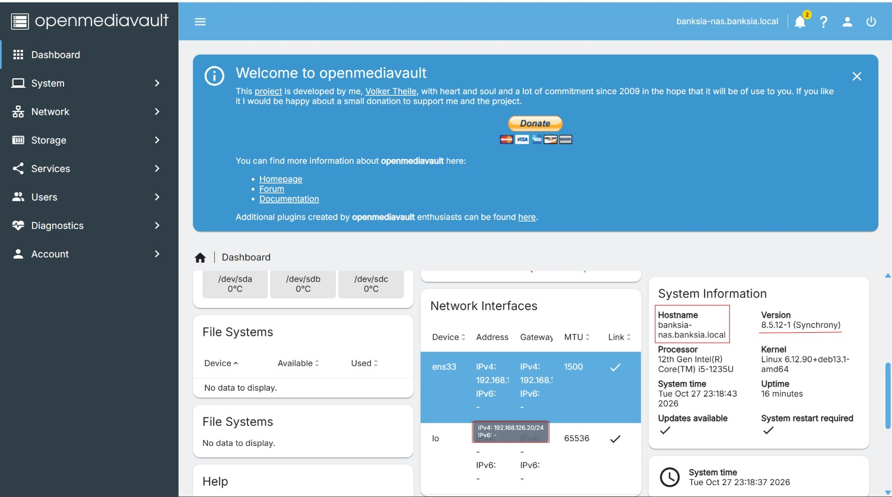

**Folder permissions and SMB share (Public: No)**

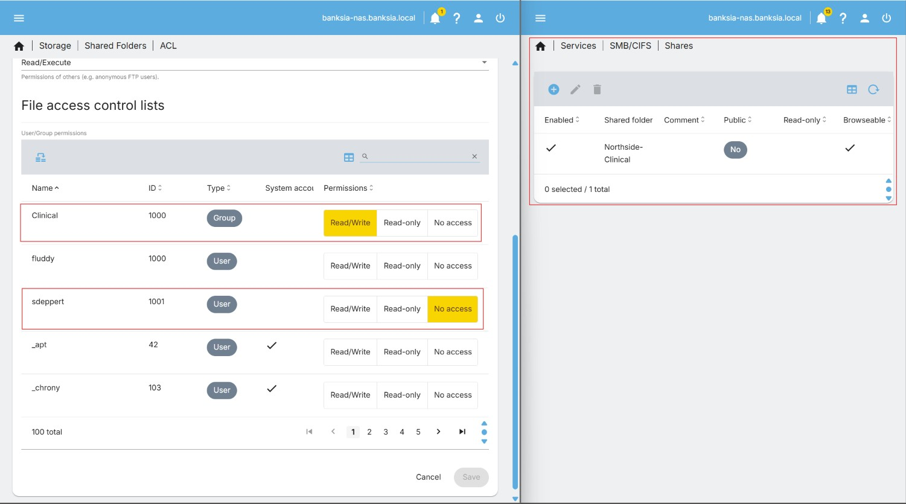

**Access test:** Fred opened the share. Sabrina's login was accepted, but `dir` gave **Access is denied**. The NAS knew who she was, but her permissions said no, the same difference between logging in and having access as on DC01.

**Fred's file in the share, and Sabrina denied:**

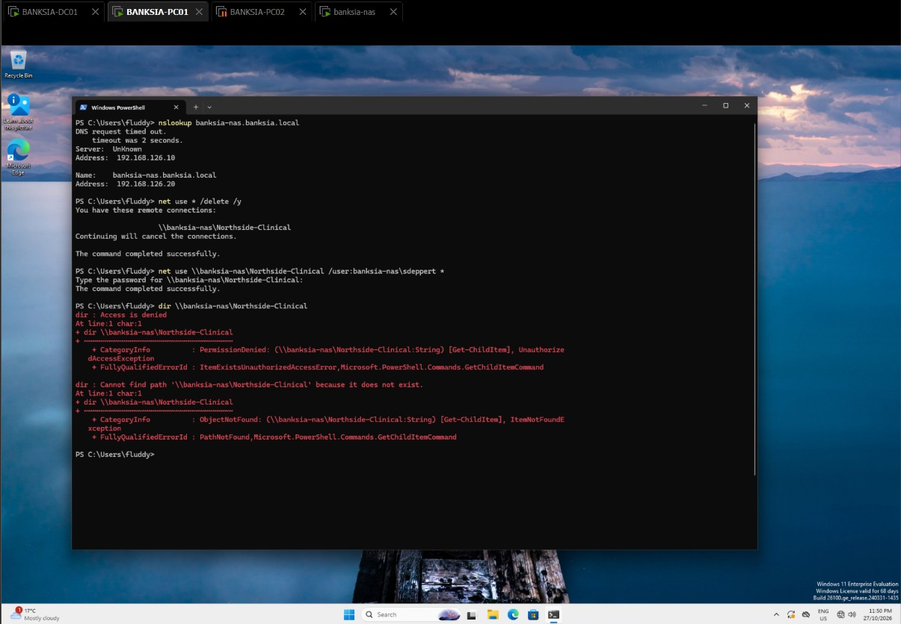

**Disk failure**
```
Issue: One data disk "failed" (removed in VMware).
Checked: The mirror disappeared from OMV. cat /proc/mdstat showed md0 inactive.
Cause: Linux won't start a mirror with a disk missing until an admin confirms it.
Fix: mdadm --stop /dev/md0, then mdadm --assemble --run /dev/md0 /dev/sdb. The mirror ran on one disk ("clean, degraded").
Fred kept working and created a file while it was degraded.
Rebuild: added a new disk and used Recover in OMV.
Verified: Mirror clean on two disks, and all files intact.
```

**1. Disk removed:** mirror missing

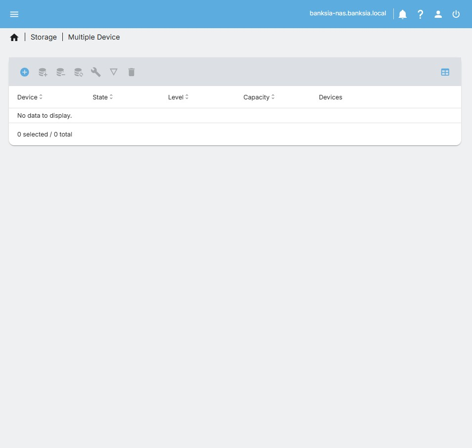

**2. Running on one disk:** clean, degraded

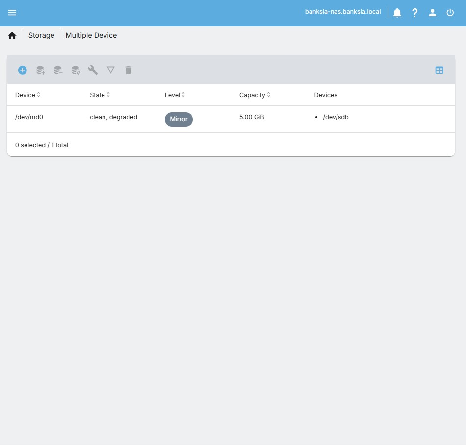

**3. Rebuilt:** clean on two disks

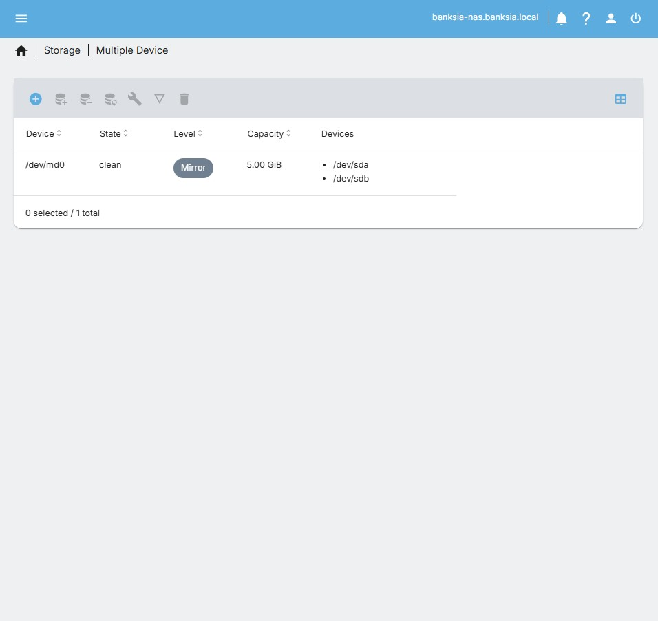

RAID keeps staff working when a disk dies, but it isn't a backup. A deleted file is deleted from both disks at once.

**NAS data protection and security**
- **Disk failure:** RAID1 mirror, tested by removing a disk and rebuilding.
- **Access control:** local users and groups, folder permissions with no access for others, and the SMB share set to Public: No.
- **Hardening:** default admin password changed, updates installed, fixed IP.

**SMB security on DC01 (the file server)** (`Get-SmbServerConfiguration`):
```
EnableSMB1Protocol EnableSMB2Protocol RequireSecuritySignature EncryptData
------------------ ------------------ ------------------------ -----------
             False               True                     True       False
```
SMB1 is off, SMB2/3 is on, and signing is required, so traffic can't be tampered with. Encryption is off.

---

## What I learned

- Share and NTFS permissions both apply, and the stricter one wins.
- Give access to groups, not people. Fixing Jade was one group change.
- Hiding a folder isn't locking it.
- Test after every change. My first firewall change didn't do what I assumed.
- Error messages can mislead. "Password not correct" was really a duplicate SID.
- RAID survives a dead disk, but it isn't a backup.

## Quick reference

| Problem | First check |
|---|---|
| Can't see a folder | `whoami /groups` |
| Can open but not save | Share vs NTFS permissions |
| Network path not found | `Test-NetConnection -Port 445` |
| Mapped drive missing | `gpresult /r /scope user` |
| Deleted file on a share | Previous Versions |
| Cloned PC can't sign in to another | Event 6167, then Sysprep |
| NAS mirror missing after a disk fails | `cat /proc/mdstat` |
