# Module 7: Backup, Endpoint Protection and Printing

This module covers syllabus Modules 7–9 (Backup, Endpoint Protection, Printers) in one lab, using the Banksia Aged Care scenario. I set up each service, broke it the way it usually breaks at work, and fixed it.

**Machines used**
- **BANKSIA-DC01** (Windows Server 2025): print server, file server, Windows Server Backup
- **BANKSIA-PC01** (Windows 11, domain-joined): staff PC
- **banksia-nas** (OpenMediaVault, RAID1 mirror from Module 6): backup target

---

## Part 1: Printing

I don't have a physical printer, so both printers use a local port that writes to a text file instead of an IP address. Everything else is set up the way it would be for a real network printer: the print server, sharing, permissions, Group Policy deployment and the print queue. On a real printer the only change would be a Standard TCP/IP port with the printer's IP.

| Printer | Share | Port | Who can print | Deployed by |
|---|---|---|---|---|
| Nurses Station Printer | `\\DC01\NursesStation` | `C:\PrinterOutput\NursesStation.txt` | Clinical Staff (Care Managers added in P2) | GPO `Staff - Printers`, targeted to Clinical Staff |
| Admin Office Printer | `\\DC01\AdminOffice` | `C:\PrinterOutput\AdminOffice.txt` | Admin Office | GPO `Staff - Printers`, targeted to Admin Office |

I installed the Print Server role on DC01 and created both printers with the Generic / Text Only driver. On each printer I removed Everyone from the Security tab and gave Print only to the department's group. Then I deployed both printers with one Group Policy, `Staff - Printers`, linked to the Staff OU, using item-level targeting so each group only gets its own printer.

Test page from DC01. It shows the port, share name and location:

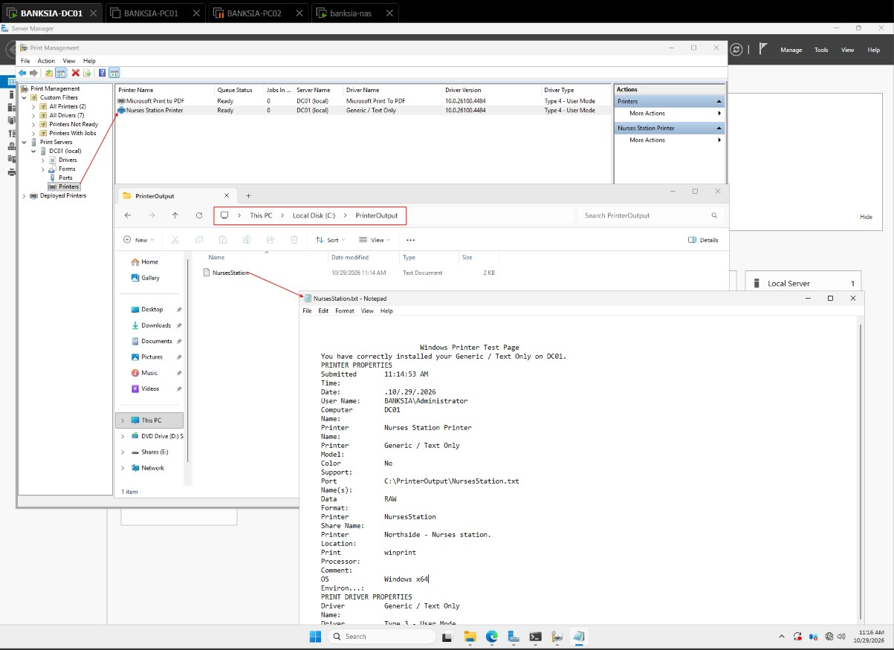

### Setup problem: Fred's printer didn't appear

When Fred (Clinical Staff) signed in to PC01, the Nurses Station Printer wasn't there. `gpresult` showed the `Staff - Printers` GPO had applied, and Event Viewer had Group Policy Printers event 4098: the printer item failed with `0x80070005 Access is denied`.

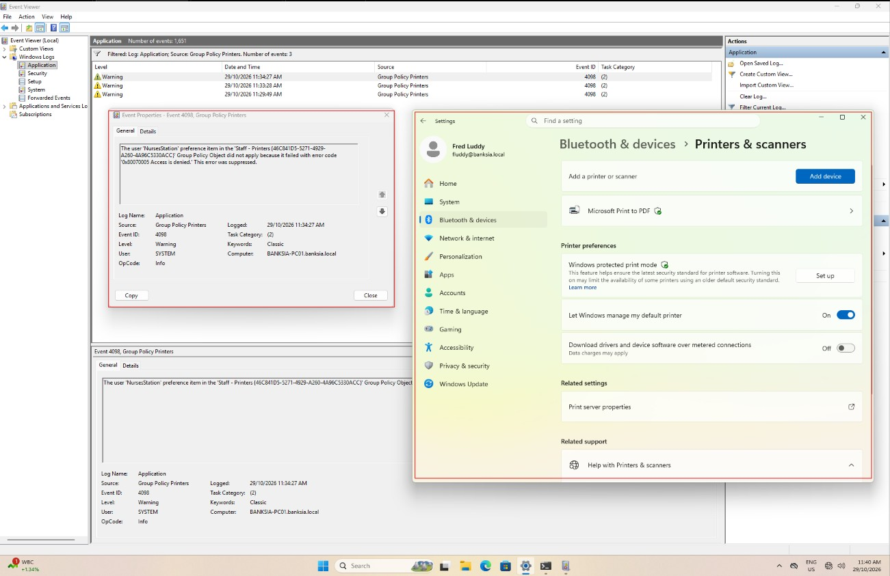

Since the 2021 PrintNightmare security changes, normal users can't install printer drivers from a print server, and PC01 didn't have the driver yet. I signed in as a domain admin and connected to the printer once, which installed the driver. After `gpupdate /force`, the policy added the printer for Fred.

**In a real workplace:** drivers are put on PCs before printers are deployed, through the software deployment tool (such as Intune) or by using printers with package-aware drivers, so staff never hit this.

Fred gets only the Nurses Station Printer, and Sabrina (Admin Office) gets only the Admin Office Printer:

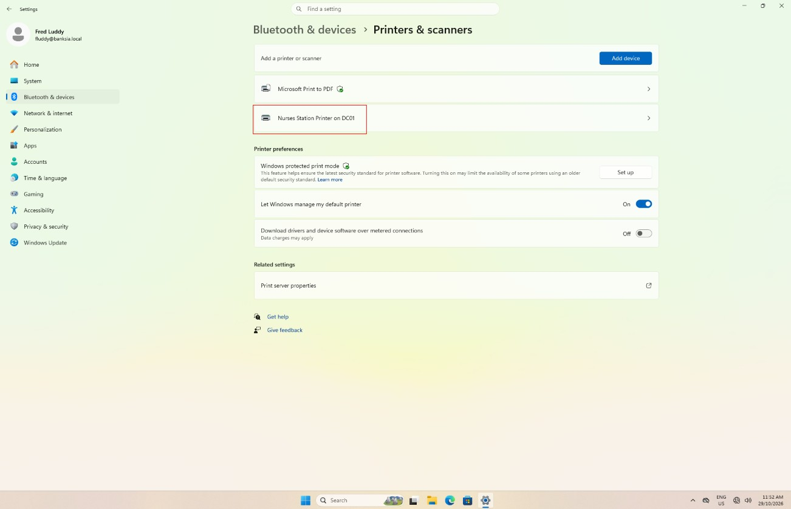
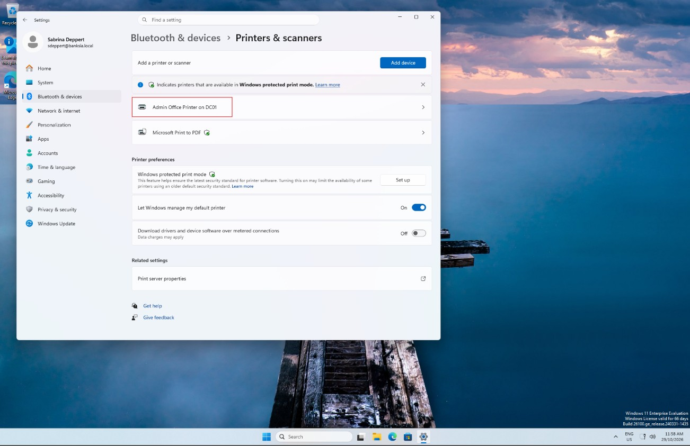

### Scenario P1: Nurses' printer offline, jobs stuck

**Lab setup:** I pointed the Nurses Station Printer at `192.168.126.103`, an address with no device on it, to act like a network printer that had been switched off or unplugged. Fred then printed from PC01.

**What I checked (from DC01):**
- The queue showed Fred's job with the status Error, on port 192.168.126.103.
- `ping 192.168.126.103` gave "Destination host unreachable". The replies came from DC01 itself, so nothing on the network answered at that address.
- `Test-NetConnection 192.168.126.103 -Port 9100` returned `TcpTestSucceeded : False`. Port 9100 is the port network printers receive jobs on.

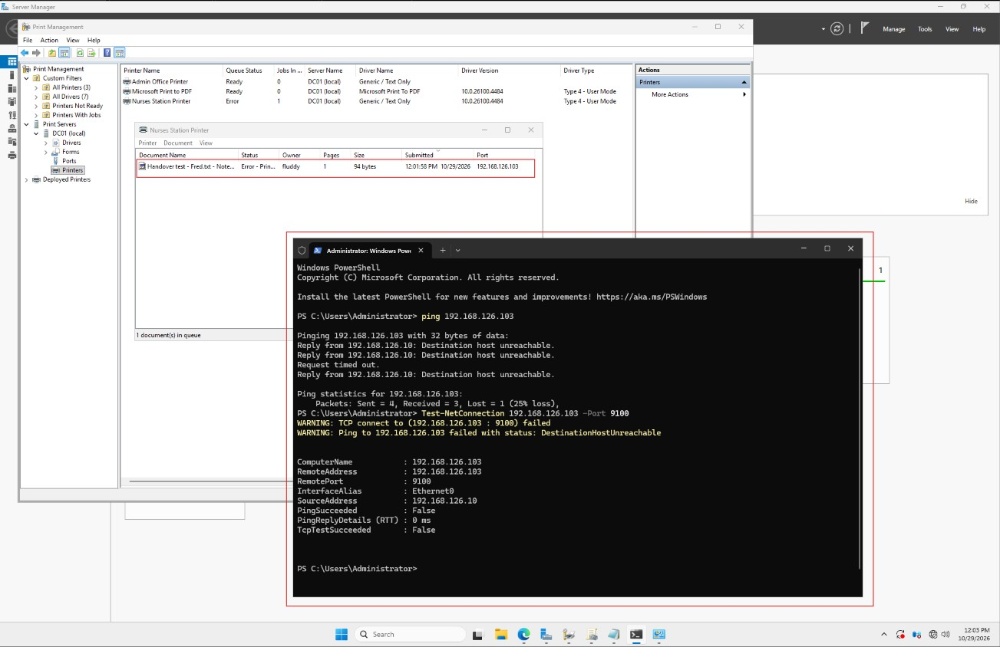

**Cause:** the printer wasn't reachable on the network.

**Fix:** I pointed the printer back at its file port and cancelled the stuck job. Fred printed again and his job came through:

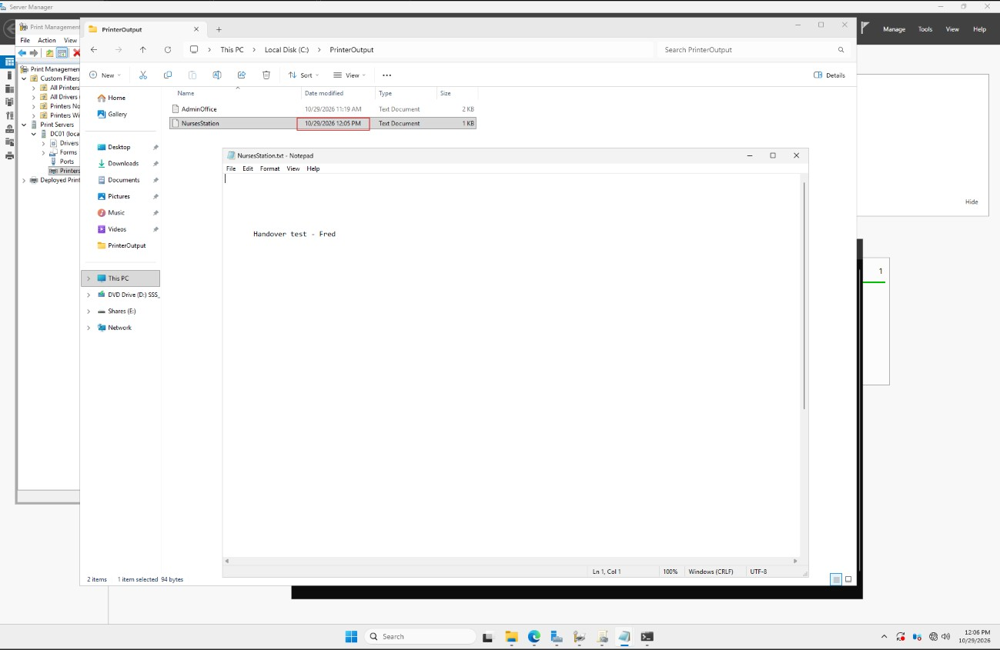

**In a real workplace:** the same checks would point to the printer itself. The fix would be checking the printer's power, network cable and display, and confirming its IP hasn't changed. A DHCP reservation for the printer stops the IP changing. The stuck jobs would then be cleared, with a spooler restart if needed.

### Scenario P2: Beth can't add the nurses' printer

**Ticket:** Beth Anglin, a care manager, is covering the Northside nurses' station and needs to print there.

**What I checked:** `whoami /groups` on PC01 showed Beth is in Care Managers but not Clinical Staff. Connecting to `\\DC01\NursesStation` failed with error 0x00000005, Access is denied. On DC01, the printer's Security tab had no entry for Care Managers.

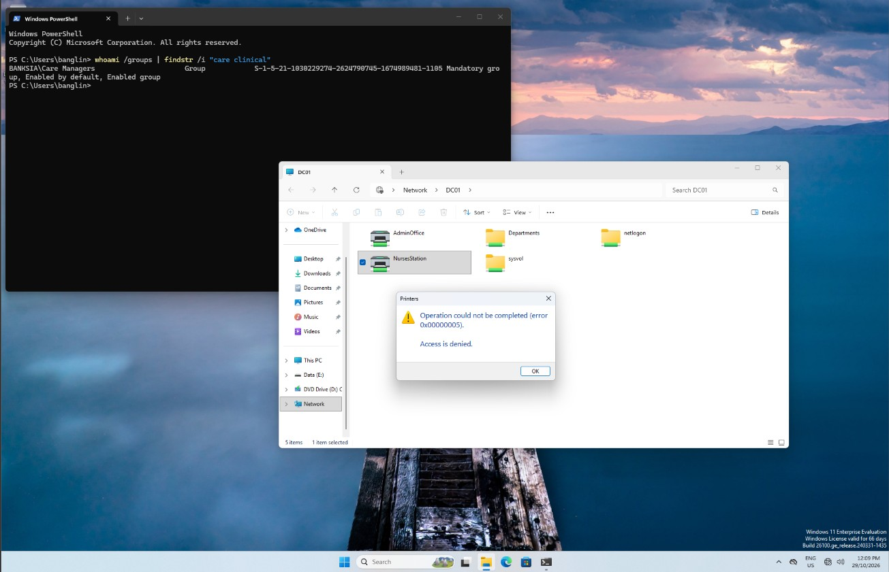

Fred's earlier error had the same code but a different cause (the missing driver). The driver was already on PC01 by now, so this one was permissions.

**Cause:** Care Managers didn't have the Print permission on that printer.

**Fix:** I added Care Managers with Print on the Nurses Station Printer. Because of the lab's file port, I also gave Care Managers Modify on `C:\PrinterOutput` (see the setup problems below). Beth could then connect:

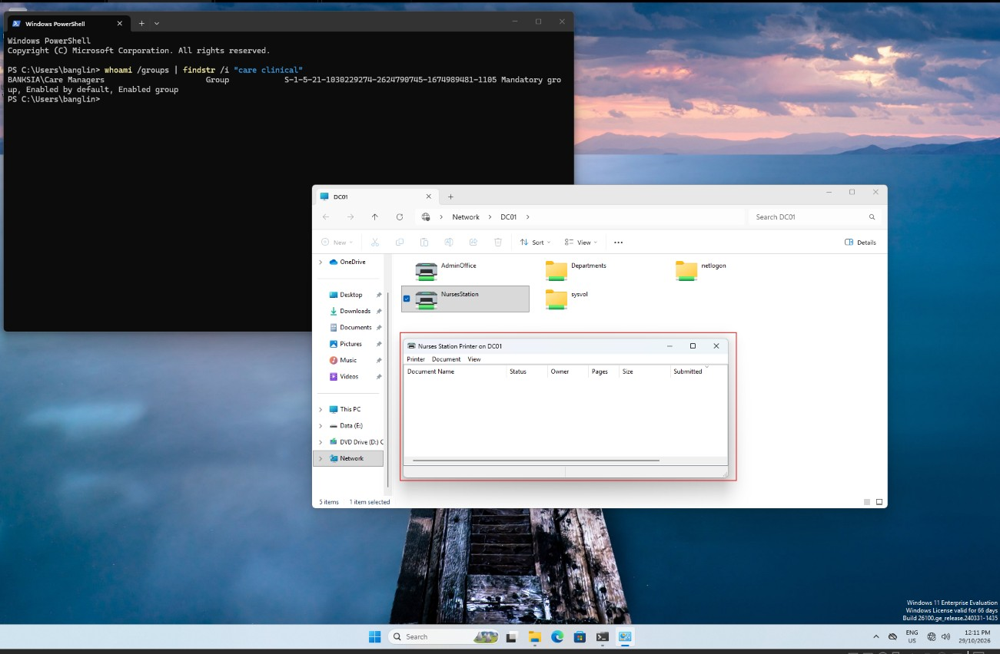

**In a real workplace:** I'd confirm with Beth's manager that she should have access before granting it, and grant it to the group rather than to her personally.

---

## Part 2: Endpoint protection (Microsoft Defender)

### Scenario E1: Same Defender settings on every Banksia PC

I created a GPO, `Computers - Defender Settings`, linked to the Computers OU (where PC01 sits), under Computer Configuration > Administrative Templates > Windows Components > Microsoft Defender Antivirus:

| Setting | Value |
|---|---|
| Turn off real-time protection | Disabled (keeps it on and stops users turning it off) |
| Scan type for scheduled scan | Quick scan |
| Time of day for scheduled scan | 180 minutes after midnight (3:00 AM) |
| Day of week for scheduled scan | Every day |

On PC01, `gpresult` showed the GPO applied. `Get-MpPreference` showed day 0 (every day), 03:00:00 and scan type 1 (quick), and `Get-MpComputerStatus` showed real-time protection on. Tamper Protection was also on, and the scan schedule still applied. Tamper Protection stops Defender being weakened (such as turning real-time protection off), not normal scheduling settings.

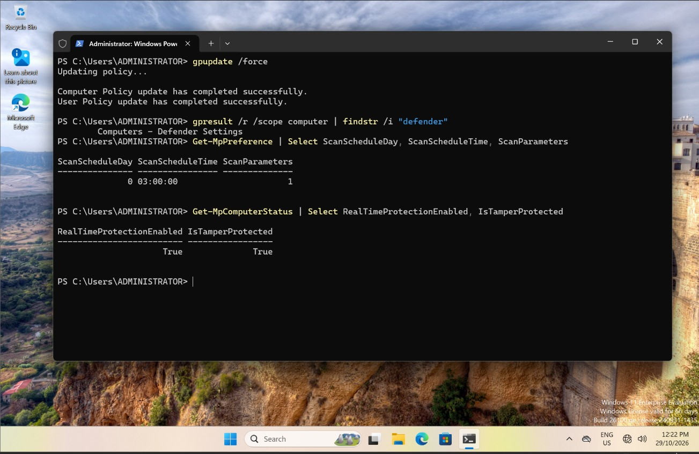

**In a real workplace:** larger organisations usually push these same Defender settings through Intune or Microsoft Defender for Endpoint instead of Group Policy, but the settings and the checks on the PC are the same.

### Scenario E2: "Defender deleted my file"

**Lab setup:** I used the EICAR test file, a harmless line of text that antivirus products treat as a virus on purpose. I saved it as `C:\FileTests\Roster-Template.txt` to stand in for a legitimate file that gets flagged by mistake. Defender didn't catch it at the moment I saved it, but detected it a short time later.

**What I checked:** Protection history showed Threat quarantined, `Virus:DOS/EICAR_Test_File`, with the file path. `Get-MpThreatDetection` showed the same detection with `ActionSuccess : True`.

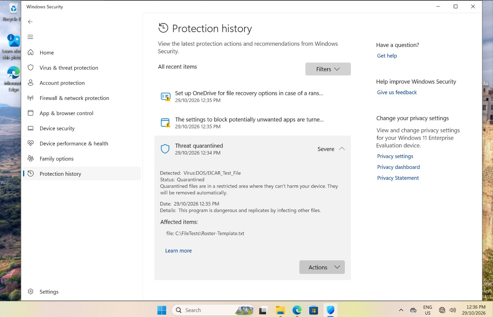

**Fix (treating it as a false positive):** I added an exclusion for that one file first, then restored it from Protection history. Restoring first would just get it quarantined again.

```powershell
Add-MpPreference -ExclusionPath "C:\FileTests\Roster-Template.txt"
```

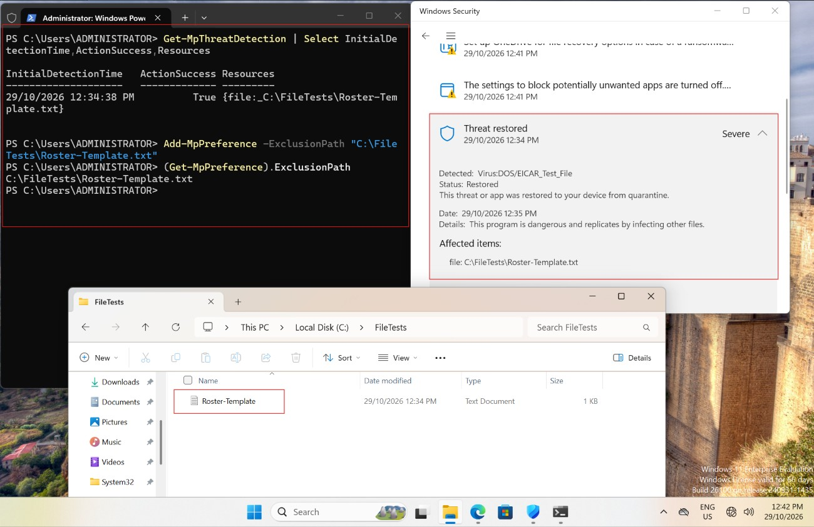

I then deleted the file and removed the exclusion, because an exclusion is a gap in protection.

**In a real workplace:** before restoring, I'd confirm the file is safe (where it came from, or ask the security team), and report the false positive to Microsoft so the detection gets fixed, rather than leaving an exclusion in place.

---

## Part 3: Backup

DC01's `E:` drive holds the Departments shares. I installed Windows Server Backup and backed up `E:` to the NAS share `\\banksia-nas\DC01-Backups`. Only the service account `svc-backup` has access to that share. I added a 200 MB test file to the Admin folder first, so the backup and restore had something measurable. The first manual backup (Backup Once) sent 261.94 MB in under a minute.

### Setup problem: the nightly schedule refused the NAS account

Backup Once worked using the NAS account `banksia-nas\svc-backup`, but the Backup Schedule wizard refused it:

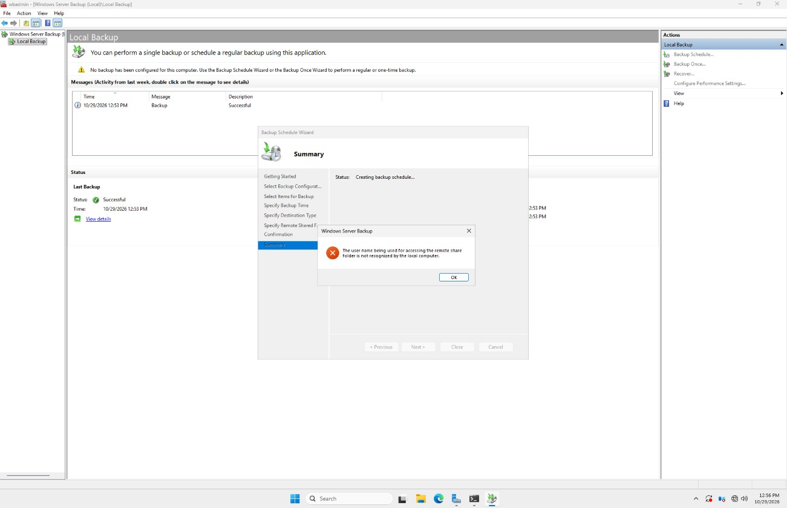

A scheduled backup runs as a scheduled task on DC01, so DC01 has to recognise the account. `banksia-nas\svc-backup` only existed on the NAS. I created a domain service account, `BANKSIA\svc-backup`, in the IT OU, added it to Backup Operators, and gave it the same password as the NAS account so the NAS accepts it too. The wizard still rejected it, so I set the schedule with `wbadmin enable backup` instead:

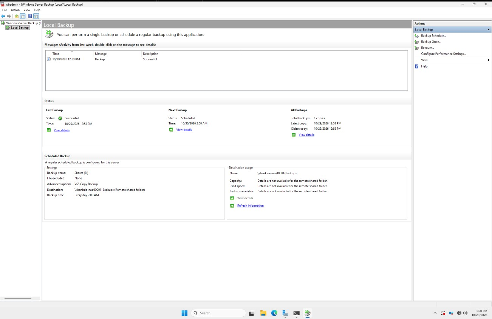

Windows warned that a network share keeps only the latest backup, and that backups there can be read by anyone with access to the share. That's why only svc-backup has access to the folder.

### Scenario B1: Admin Office's folder was deleted

**Ticket:** "The whole Admin folder on the shared drive is gone."

**Before deleting it,** I saved the folder's permissions and a hash of every file:

```powershell
icacls E:\Shares\Departments\Admin > C:\Temp\icacls-before.txt
Get-ChildItem E:\Shares\Departments\Admin -Recurse -File | Get-FileHash | Select Hash,@{n='File';e={Split-Path $_.Path -Leaf}} | Sort File | Export-Csv C:\Temp\hash-before.csv
```

Then I deleted it:

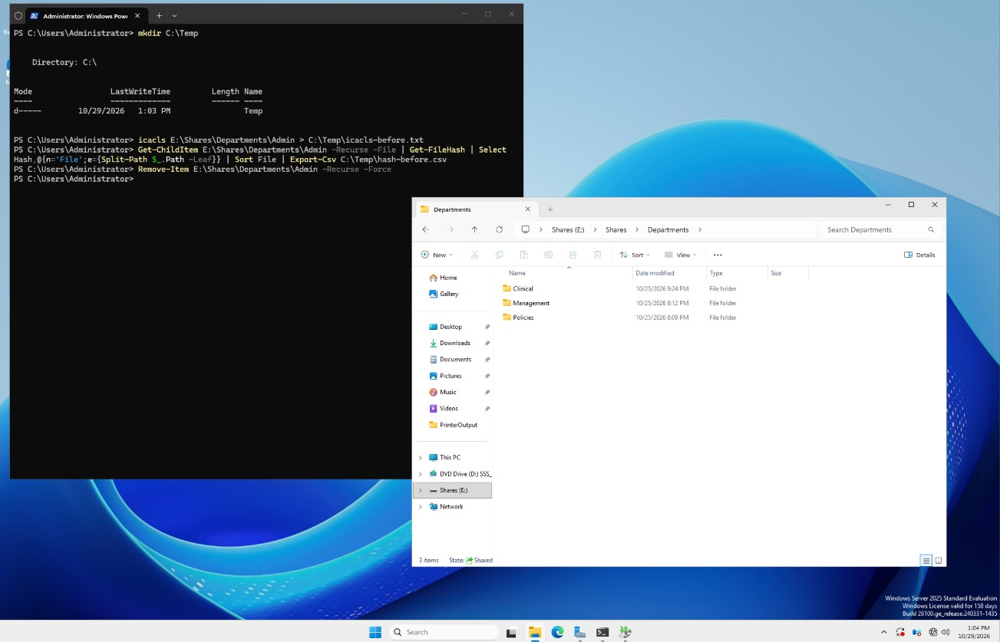

**Restore:** my first attempt with the Recovery wizard restored the two files loose into `Departments` instead of rebuilding the Admin folder (see the setup problems below). I removed them and restored the folder itself from the command line:

```powershell
wbadmin start recovery -version:<version id> -itemType:File -items:E:\Shares\Departments\Admin -recursive -backupTarget:\\banksia-nas\DC01-Backups -quiet
```

200 MB was recovered, with 0 failures, and the folder was back in place:

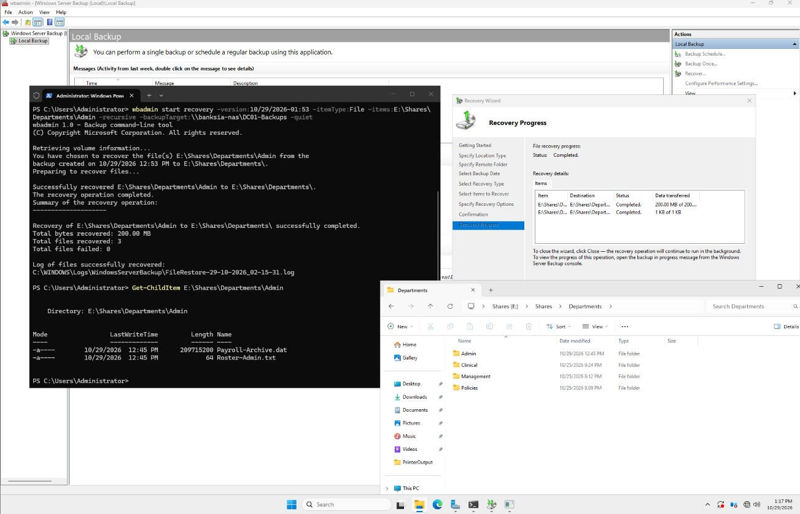

**Verified:** I ran the same `icacls` and `Get-FileHash` commands to "after" files and compared them with `Compare-Object`. Both comparisons returned nothing, so the files and the permissions are identical to before the deletion.

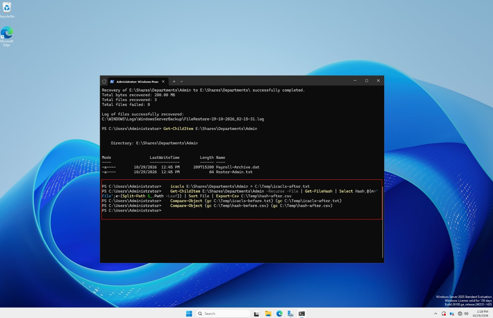

**In a real workplace:** I'd confirm with the user which folder and roughly when it was last fine, and check whether Previous Versions could cover it before going to the backup. If they wanted an older copy without overwriting current files, I'd restore to a separate folder and let them pick.

### Scenario B2: The nightly backup failed

**Lab setup:** I changed svc-backup's password on the NAS, as if it had been rotated under security policy, without updating the backup job or the domain account.

**What I checked (from DC01):**
- `Test-NetConnection banksia-nas -Port 445` returned `TcpTestSucceeded : True`, so the NAS was reachable and it wasn't a network problem.
- `net use \\banksia-nas\DC01-Backups` with the old password returned `System error 1326: The user name or password is incorrect`.

I couldn't start the backup task on demand: `Start-ScheduledTask` was refused, because this task doesn't allow manual runs. So I proved the cause with the credential test rather than waiting for a failed 2 AM run.

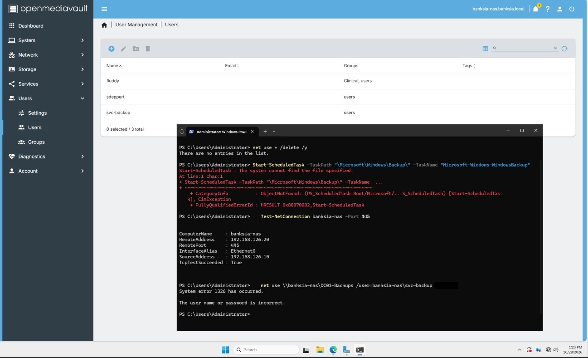

**Cause:** the credentials stored for the backup no longer matched the NAS.

**Fix:** I set the domain account to the new password with `Set-ADAccountPassword`, then re-registered the schedule with `wbadmin enable backup` using the new password. wbadmin checks the credentials against the share before saving, so the schedule saving confirms they work. Then I ran a backup with the same account using `wbadmin start backup`, and it completed successfully:

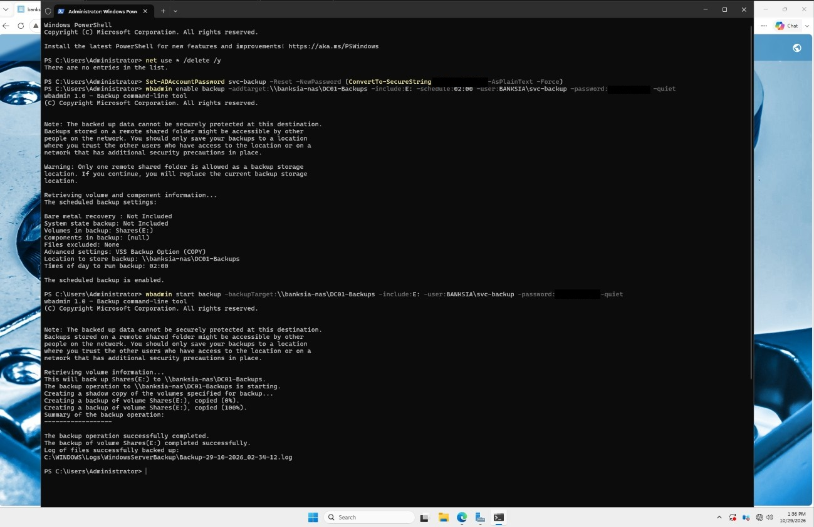

**In a real workplace:** when a service account's password is rotated, every system that uses it has to be updated at the same time. Teams keep a list of where each service account is used, so a rotation doesn't silently break the backups.

### Backup plan

| What | Lives on | Backed up to | How often | RPO | Kept | Off-site | Measured restore |
|---|---|---|---|---|---|---|---|
| Departments file shares | DC01 `E:` | NAS `DC01-Backups` (RAID1 mirror) | Daily, 2:00 AM | Up to 24 hours | Latest copy only | No | 200 MB in about 1 second |

The restore time is a lab number: the 200 MB test file is mostly empty data, and both VMs run on the same PC. Real data over a real network would take much longer.

This setup has two gaps: the network share keeps only the latest backup, and there's no off-site copy. If a file was deleted three days ago and nobody noticed, last night's backup won't have it.

---

## Other setup problems

| Problem | Cause | Fix |
|---|---|---|
| Fred's print job errored after the printer appeared | The file port writes the job using the printing user's permissions, and staff couldn't write to `C:\PrinterOutput` (lab-only) | Gave Clinical Staff, Admin Office and Care Managers Modify on `C:\PrinterOutput` |
| Couldn't pick the quarantined file in the Defender exclusion file picker | The file didn't exist while it was in quarantine | Added the exclusion with `Add-MpPreference -ExclusionPath` |
| Recovery wizard restored the two files loose into `Departments` | Another location was chosen with the files selected instead of the folder; Original location wasn't available | Removed the loose files and restored the folder with `wbadmin start recovery` |
| `Start-ScheduledTask` couldn't run the backup task | This task doesn't allow on-demand runs | Proved the B2 cause with a credential test and the fix with `wbadmin start backup` |
