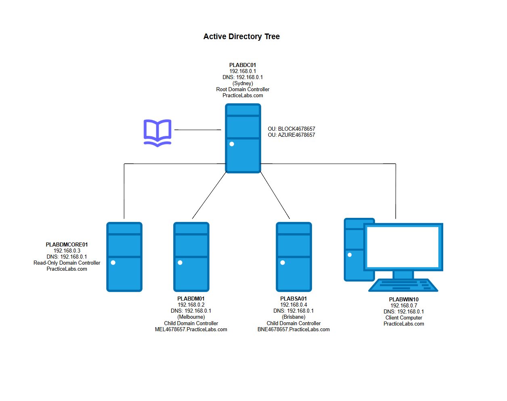
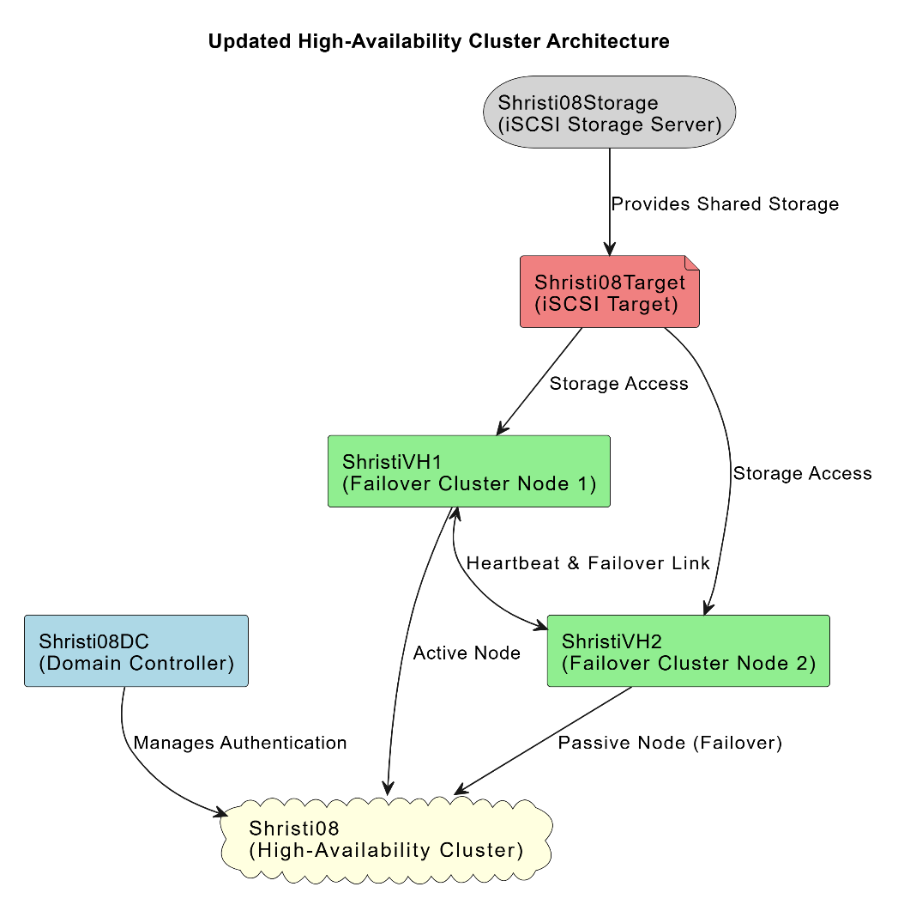

# Windows Server Labs

Hands-on Windows Server administration across two areas: **Active Directory** and **Hyper-V / failover clustering**. Each page covers the scenario, what I built, the commands I used, how I checked it worked, and what went wrong along the way.

## [Active Directory →](active-directory.md)
Root domain with two child domains, a read-only DC, OUs and Group Policy. Also offline domain join, account lockouts, and DC install from media.

## [Hyper-V and Failover Clustering →](hyper-v.md)
VM sizing and nested virtualisation, a 2-node failover cluster on iSCSI shared storage, live migration, changes on the live cluster, and Docker on the clustered server.

## Skills covered
| Area | What I did |
|---|---|
| Accounts and access | Domain join (online and offline), account lockout policy, locked, disabled and inactive accounts, user rights assignment, OUs and users |
| Domain services | DC promotion, install from media (IFM), read-only DC and password replication policy, child domains, DNS |
| Group Policy | Software and Store restrictions, linking GPOs to OUs and computers, checking results with `gpupdate` and `gpresult` |
| Virtualisation | Sizing VMs to user needs and host limits, nested virtualisation, internal vSwitches, static IPs |
| High availability | Failover Clustering, iSCSI target and initiators, Cluster Shared Volumes, quorum, live migration, change requests |
| Containers | Docker Compose, Windows NAT, building, pushing and pulling images |
| Scripting | PowerShell for AD, networking, Hyper-V and clustering, plus `djoin`, `ntdsutil` and `dsadd` |

## How this maps to support work
| Ticket | Where I've done it |
|---|---|
| "I'm locked out" | Finding and checking locked accounts with `Search-ADAccount` |
| "This PC can't join the domain" | Online and offline domain join, DNS pointing at the DC |
| "User can still open an app they shouldn't" | GPO scope (user vs computer settings) and `gpresult /r` |
| "Branch office needs a DC but the site isn't secure" | RODC with a limited password replication policy |
| "The server went down. Is the app still up?" | Failover cluster and live migration between nodes |

## Lab environment
- **AD labs:** Windows Server 2016 domain with 4 servers and a Windows 10 client
- **Hyper-V labs:** Windows Server Hyper-V host (8 vCPU, 32 GB RAM) running Windows Server VMs with nested virtualisation

## Files
- [`scripts/build-cluster.ps1`](scripts/build-cluster.ps1): PowerShell for the failover cluster build (passwords replaced with placeholders)
- [`scripts/docker-compose.yml`](scripts/docker-compose.yml): the WordPress, MySQL and XAMPP stack
- `images/`: screenshots used on both pages

Related module: [Module 3 – Active Directory](../module-03-active-directory/)
