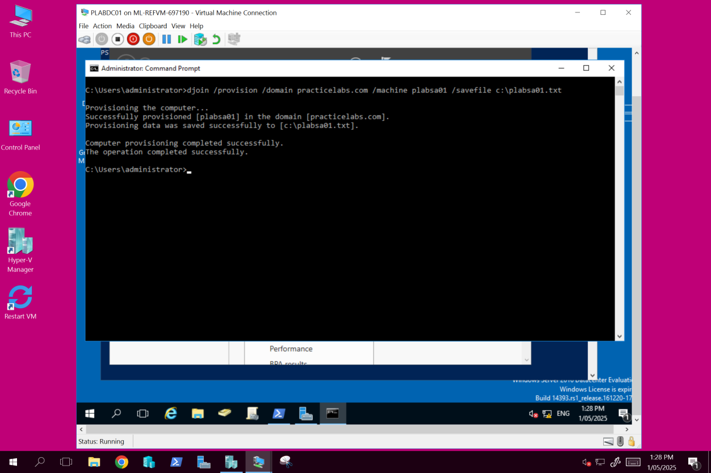

# Active Directory

Windows Server 2016 domain: PLABDC01 (DC), PLABDM01, PLABSA01, PLABDCORE01 (Server Core) and PLABWIN10 (client).

## Contents
- [Account management and offline domain join](#account-management-and-offline-domain-join)
- [IFM, RODC and password replication](#ifm-rodc-and-password-replication)
- [AD design and Group Policy](#ad-design-and-group-policy)

---

## Account management and offline domain join

### What I did
- Removed PLABSA01 from the domain and deleted its computer object in ADUC
- Ran `djoin /provision` on the DC to pre-create the computer account and save a blob file
- Paused the DC and joined PLABSA01 offline with `djoin /requestODJ`
- Resumed the DC and confirmed PLABSA01 was back in the domain
- Set an account lockout threshold in Group Policy and locked a test user out from the Windows 10 client
- Used PowerShell to find locked, disabled and inactive accounts, and re-enabled a disabled one
- Set "Allow log on locally" and "Allow log on through Remote Desktop Services" rights for specific groups

### Commands
```powershell
djoin /provision /domain practicelabs.com /machine PLABSA01 /savefile c:\plabsa01.txt
djoin /requestODJ /loadfile c:\plabsa01.txt /windowspath %SystemRoot% /localos

Search-ADAccount -LockedOut
Search-ADAccount -AccountDisabled
Enable-ADAccount -Identity <username>
Search-ADAccount -AccountInactive -UsersOnly -TimeSpan 1.00:00:00 | ft name
```

### Why it matters
Locked-out accounts are one of the most common service desk tickets. Offline domain join is useful when a machine is built somewhere it can't reach a DC.

### Screenshots
**Computer account pre-provisioned with djoin**


**PLABSA01 back in the domain after the offline join**


**User locked out after hitting the lockout threshold**


**Finding locked-out accounts in PowerShell**


---

## IFM, RODC and password replication

### What I did
- Created IFM media on the existing DC with `ntdsutil`
- Promoted PLABDM01 to a DC from that media, so it didn't have to pull the whole AD database over the network
- Installed a read-only domain controller (RODC) on PLABSA01 with PowerShell
- Set up its password replication policy: created a group, added it to the Allowed RODC Password Replication Group, and prepopulated passwords for specific users

### Commands
```
ntdsutil "activate instance ntds" ifm "create sysvol full C:\IFM" quit quit
```
```powershell
Install-ADDSDomainController -DomainName practicelabs.com -ReadOnlyReplica -SiteName "Default-First-Site-Name" -Credential (Get-Credential)
```

### Troubleshooting
The test user didn't show under "Accounts that have been authenticated to this RODC" because the Windows 10 client failed to log on with a domain trust relationship error. The fix is `Test-ComputerSecureChannel -Repair` on the client.

### Why it matters
An RODC goes in a branch office with weak physical security. It only stores the passwords you allow, not everyone's.

### Screenshots
**IFM media created with ntdsutil**


**RODC showing in ADUC**


**RODC password replication policy**


---

## AD design and Group Policy

### Goal
Build a domain structure across four servers and a Windows 10 client: a root domain, child domains for two sites, a read-only DC, OUs and users. Then use Group Policy to control what software users can run.

### Design
- **Root domain:** `practicelabs.com` on PLABDC01 (Sydney), the main DNS and authentication server
- **Child domains:** MEL (PLABDM01) and BNE (PLABSA01), one per site
- **RODC:** PLABDCORE01 (Server Core) in the root domain
- **OUs:** one for standard users, one for admin users

### What I built
- Promoted the child domains and the RODC entirely in PowerShell
- Created OUs and users with `dsadd`: a standard user who must change password at first logon, and an admin user whose password never expires
- **Software GPO:** "Don't run specified Windows applications", linked to the standard users' OU
- **Computer GPO:** "Turn off the Store application", linked to the client
- Checked both with `gpupdate /force` and `gpresult /r`

```powershell
Install-ADDSDomain -DomainType ChildDomain -NewDomainName MEL -ParentDomainName practicelabs.com -InstallDNS -Credential (Get-Credential)
Install-ADDSDomainController -DomainName practicelabs.com -ReadOnlyReplica -SiteName "Default-First-Site-Name" -Credential (Get-Credential)
```

### Troubleshooting
Blocking Microsoft Edge with the GPO did nothing. When I checked the shortcut, Edge on that build was a UWP app (`Microsoft.MicrosoftEdge_8wekyb3d8bbwe`) with no .exe on disk, and "Don't run specified applications" only matches executable names. I switched the policy to `iexplore.exe` to prove the GPO worked. To block a UWP app properly, you'd use AppLocker packaged-app rules.

### Screenshots
**AD design**


**MEL child domain promoted**


**Domain controllers in ADUC**


**GPO: don't run iexplore.exe**


**App blocked for the standard user**


**Edge is a UWP app, not an .exe**


**gpresult /r confirming the policies applied**

