# Hyper-V and Failover Clustering

**Environment:** a Windows Server Hyper-V host (8 vCPU, 32 GB RAM) running Windows Server VMs, with nested virtualisation for the cluster nodes.

## Contents
- [1. VM sizing and nested virtualisation](#1-vm-sizing-and-nested-virtualisation)
- [2. Two-node failover cluster](#2-two-node-failover-cluster)
- [3. Docker WordPress on the cluster](#3-docker-wordpress-on-the-cluster)

---

## 1. VM sizing and nested virtualisation

### Scenario
An engineering department needs two servers on 172.30.10.0/24 (gateway 172.30.10.2). Both must be able to run their own VMs, which means nested virtualisation.
- **Engineer server:** used daily by 3 engineers, plus 2 on-call contractors when it gets busy
- **IT document server:** read by all 220 staff. The content is stable, but usage is unpredictable

### Design
| VM | vCPU | RAM | Disk | Why |
|---|---|---|---|---|
| Engineer VM | 4 | 14 GB | 128 GB | Heavier compute per user, with headroom for contractors |
| IT VM | 4 | 12 GB | 200 GB | Mostly reads, so more storage and RAM for caching |

Together they had to fit inside the host's 8 vCPU and 32 GB RAM.

### What I did
1. Created both VMs from a prepared Windows Server 2022 VHDX and set CPU, memory and disk
2. Enabled nested virtualisation on each VM (it has to be powered off first)
3. Created an internal vSwitch, connected both VMs, and gave the host's virtual adapter the gateway address
4. Set static IPs, one with PowerShell and one through the GUI
5. Enabled the ICMPv4 echo firewall rule so ping would work

### Commands
```powershell
Set-VMProcessor -VMName <VMName> -ExposeVirtualizationExtensions $true
Get-VMProcessor -VMName <VMName> | Select VMName, ExposeVirtualizationExtensions
New-VMSwitch -Name "<SwitchName>" -SwitchType Internal
New-NetIPAddress -InterfaceAlias "Ethernet" -IPAddress 172.30.10.86 -PrefixLength 24 -DefaultGateway 172.30.10.2
```

### How I checked it worked
- `Get-VMProcessor` showed nested virtualisation turned on for both VMs
- Pings worked host to both VMs, and VM to VM in both directions

### Screenshots
**Both VMs in Hyper-V Manager**

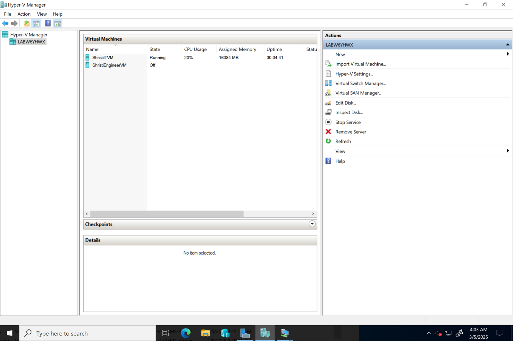

**VM CPU and memory settings**

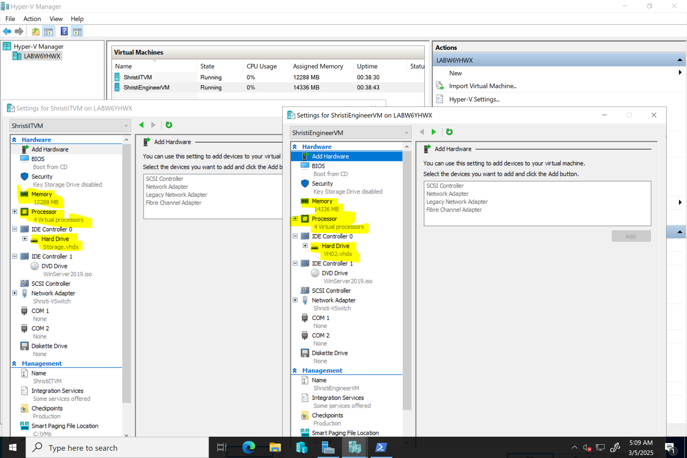

**Memory and nested virtualisation confirmed**

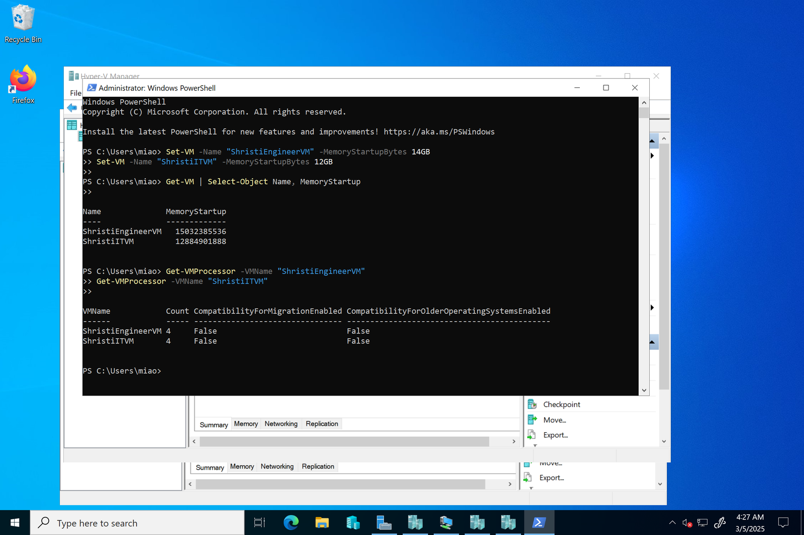

**Internal vSwitch**

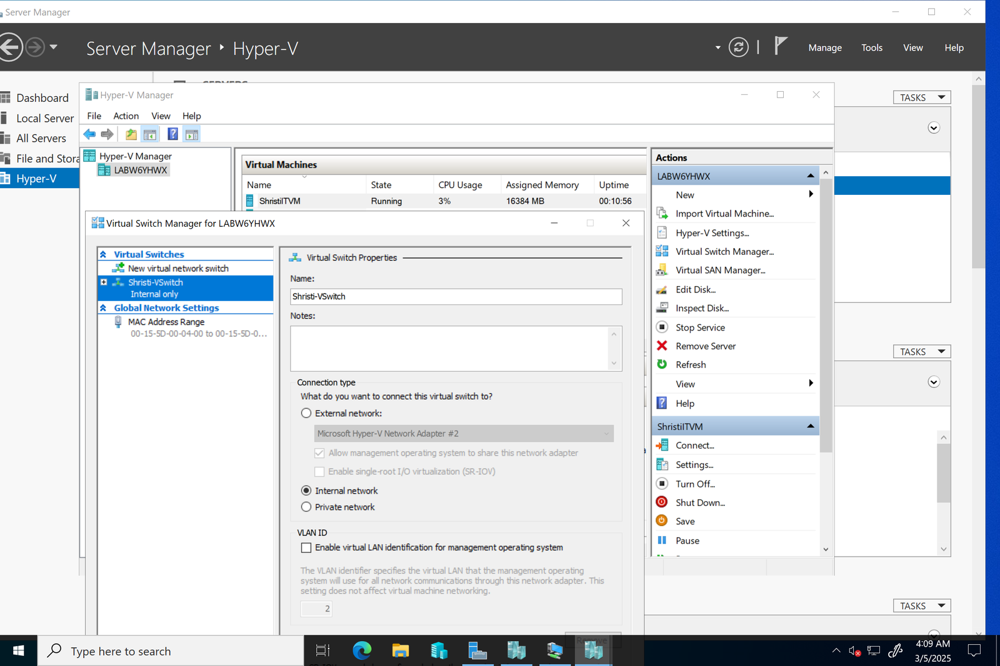

**VM-to-VM ping**

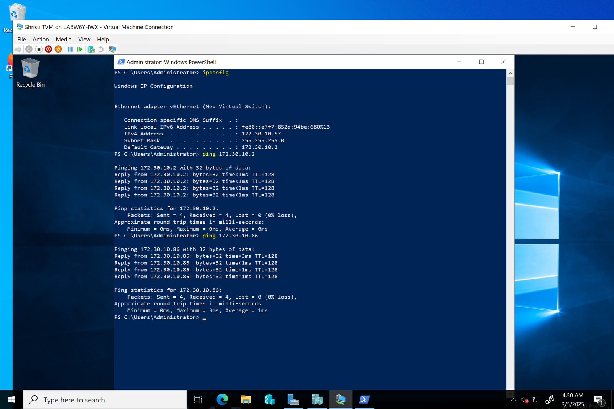

---

## 2. Two-node failover cluster

### Scenario
A department needs an application server that stays online if one physical host fails.

### Design
| VM | Role | vCPU / RAM |
|---|---|---|
| DC | AD DS and DNS for `tuladhar.local` | 1 / 2 GB |
| Storage | iSCSI Target Server (shared storage) | 1 / 2 GB |
| VH1, VH2 | Hyper-V and Failover Clustering nodes | 4 / 10 GB each |
| AppServer | The highly available VM, stored on a Cluster Shared Volume | 4 / 4 GB |

| Network | Subnet | Used for |
|---|---|---|
| Main | 172.x.57.0/24 | Domain, DNS and client traffic |
| myStorageNet | 192.168.111.0/24 | iSCSI traffic only |
| myHeartbeatNet | 192.168.222.0/24 | Cluster health checks only |

I kept storage and heartbeat traffic on their own networks. That way, heavy disk traffic can't delay the heartbeat and make the cluster think a node has failed.

### What I did
1. Created three internal vSwitches and the VMs, added the extra network adapters, and set static IPs
2. Promoted the DC and joined the storage server and both nodes to the domain
3. Turned on nested virtualisation for VH1 and VH2, then installed Hyper-V and Failover Clustering on them
4. Installed iSCSI Target Server, created the virtual disks, and created a target that only the two nodes' IQNs can access
5. Started the iSCSI initiator on both nodes and connected them to the target over the storage network
6. Ran cluster validation, then created the cluster with a static IP and excluded the heartbeat subnet from client traffic
7. Brought the disks online, added them to the cluster, and converted them to Cluster Shared Volumes
8. Created the AppServer VM on the CSV, made it highly available, and live-migrated it from VH1 to VH2

Full commands: [build-cluster.ps1](scripts/build-cluster.ps1) (passwords replaced with placeholders)

### Key commands
```powershell
New-IscsiServerTarget -TargetName "ClusterTarget" -InitiatorIds "IQN:<vh1-iqn>", "IQN:<vh2-iqn>"
Connect-IscsiTarget -NodeAddress "<target-iqn>" -IsPersistent $true
Test-Cluster -Node VH1, VH2
New-Cluster -Name "HACluster" -Node VH1, VH2 -StaticAddress <cluster-ip> -IgnoreNetwork 192.168.222.0/24
Add-ClusterSharedVolume -Name "Cluster Disk 1"
Add-ClusterVirtualMachineRole -VMName AppServer
```

### How I checked it worked
- `Get-ClusterNode` showed both nodes Up
- The CSVs were online in Failover Cluster Manager and reachable from both nodes
- During live migration the VM kept running, and afterwards it showed VH2 as its owner node

### Troubleshooting
- **Disk wouldn't become a CSV:** the cluster had automatically taken Cluster Disk 1 as the quorum witness, which kept it out of Available Storage. I checked with `Get-ClusterQuorum`, switched to `Set-ClusterQuorum -NodeMajority`, moved the disk to Available Storage, and then `Add-ClusterSharedVolume` worked
- **New iSCSI disk showed as offline:** brought it online with `Set-Disk -Number 1 -IsOffline $false`, then initialised it as GPT
- **Cluster validation needed remote access to the second node:** started and enabled the Remote Registry service on VH2 and opened its firewall rule
- **Node names had to match DNS:** renamed VH1 and VH2 before creating the cluster

### Change request on the live cluster
After the build, I updated the design and then applied these changes without rebuilding:
- Re-addressed the storage network to a new subnet on the storage server and both nodes, then re-tested with ping
- Removed one CSV disk and replaced it with a new iSCSI virtual disk and target
- Renamed a cluster node and the cluster itself

### Where this applies
This is how organisations keep a server-hosted service running during hardware failures or maintenance. Moving VMs off a host before patching it uses the same live migration.

### Screenshots
**Cluster architecture**

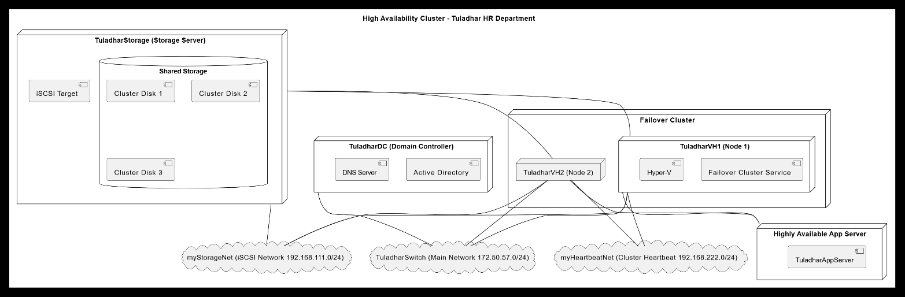

**Storage and heartbeat vSwitches**

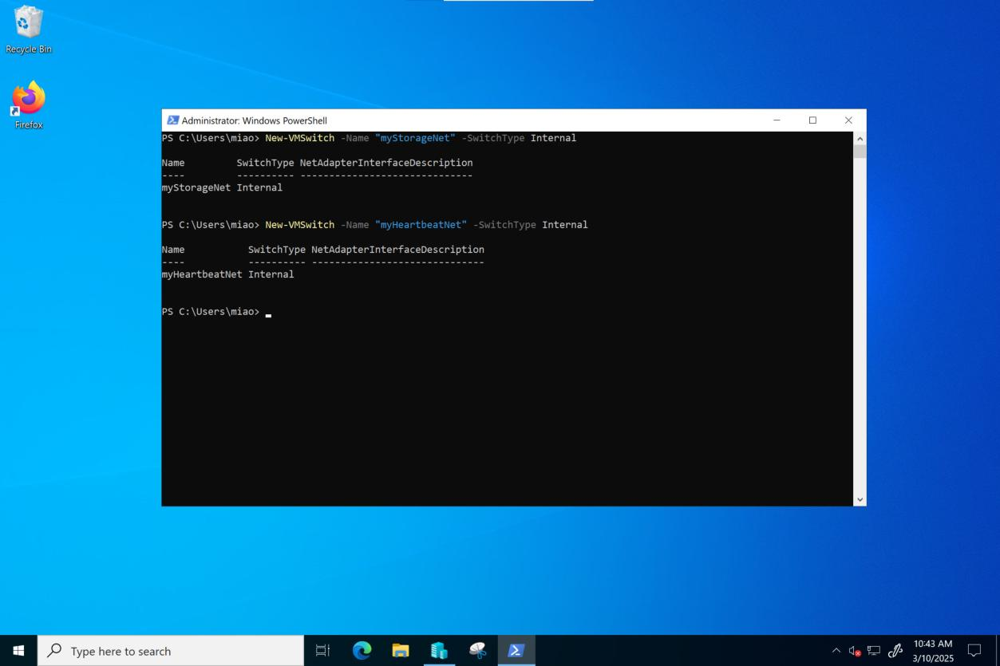

**Cluster created, both nodes up**

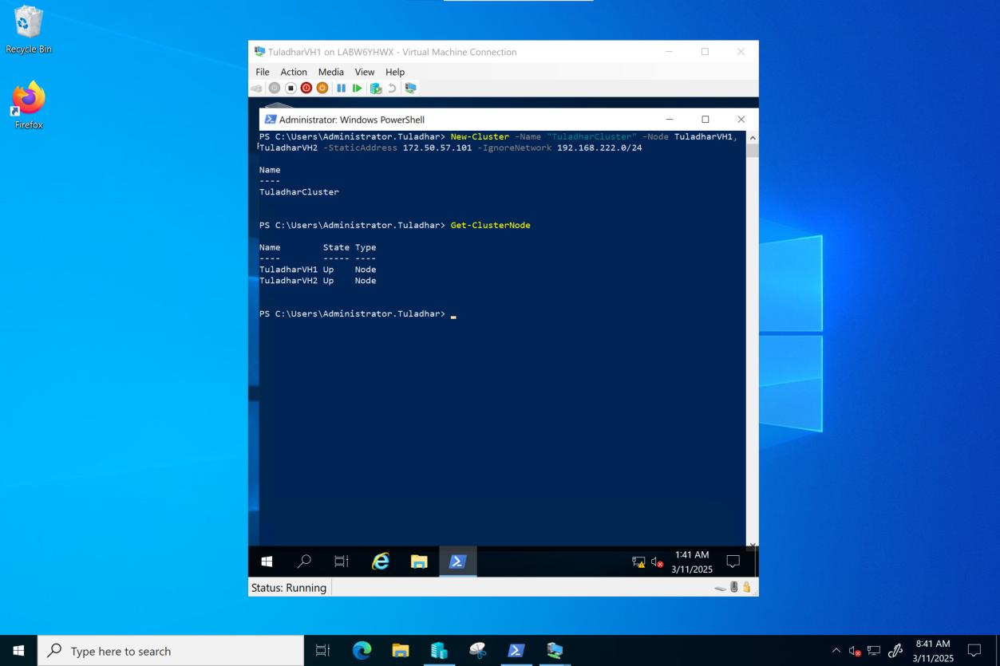

**Quorum fix and disk converted to a CSV**

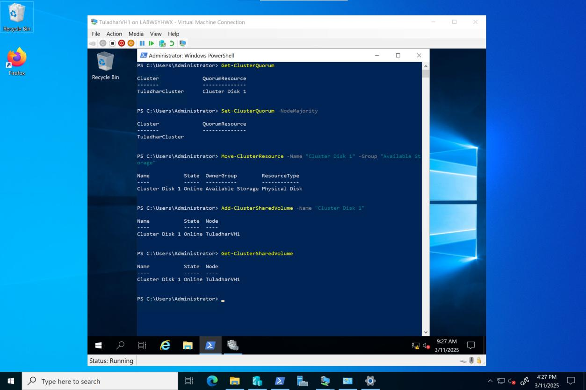

**CSVs in Failover Cluster Manager**

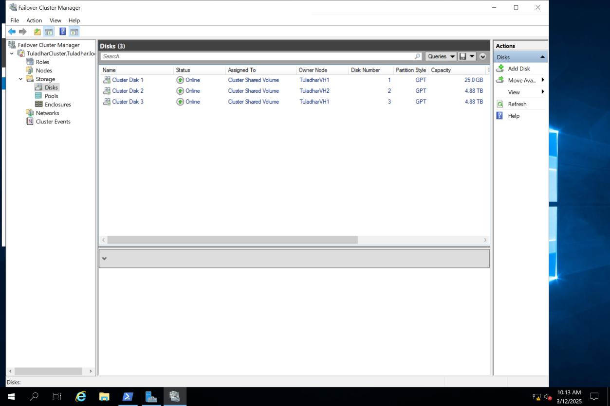

**Making the AppServer VM highly available**

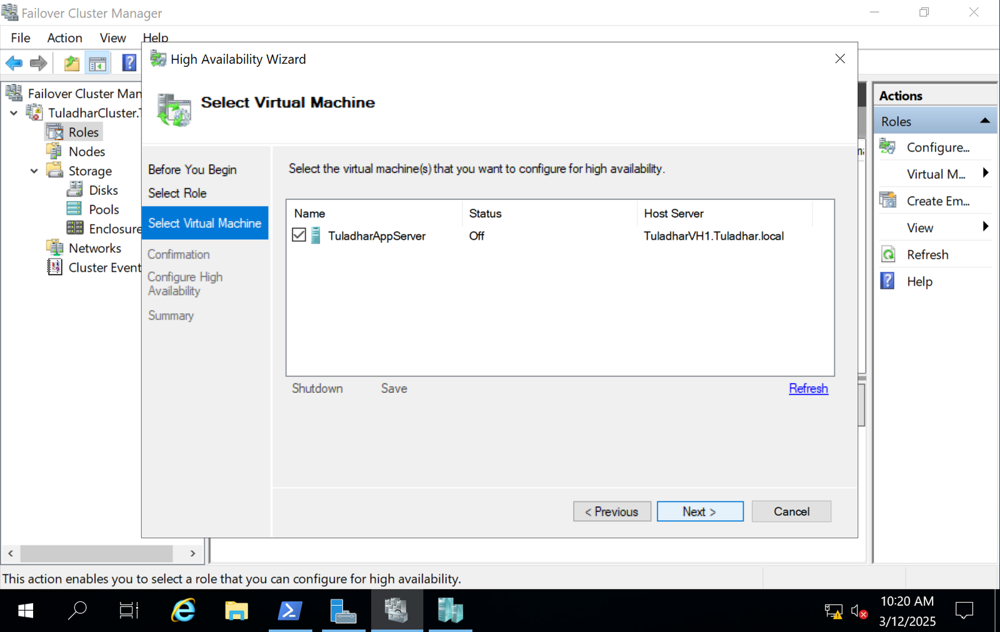

**Live migration from VH1 to VH2**

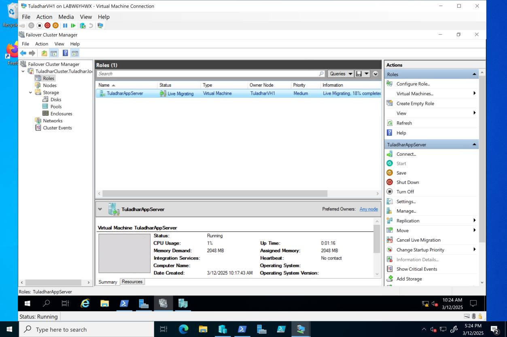

**VM running on the other node after migration**

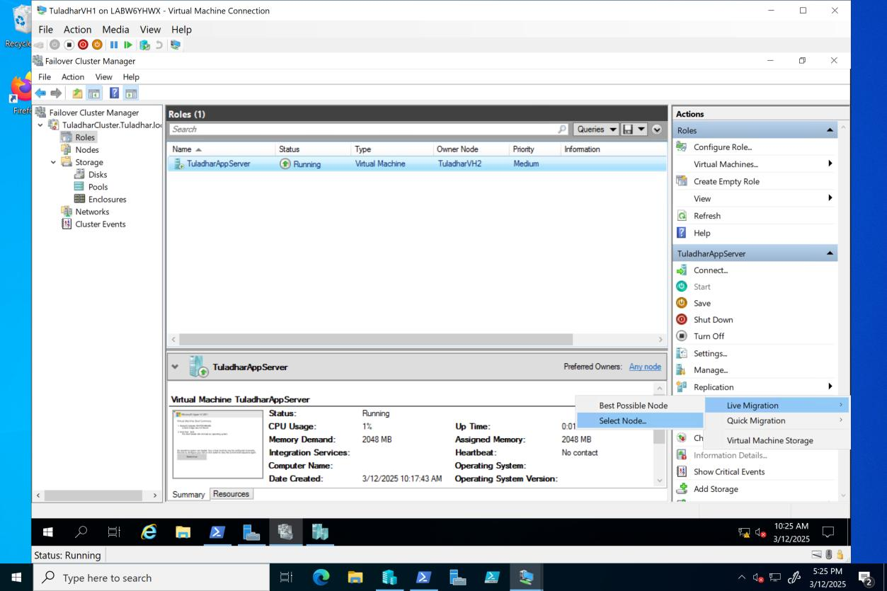

**Change request: new iSCSI virtual disk**

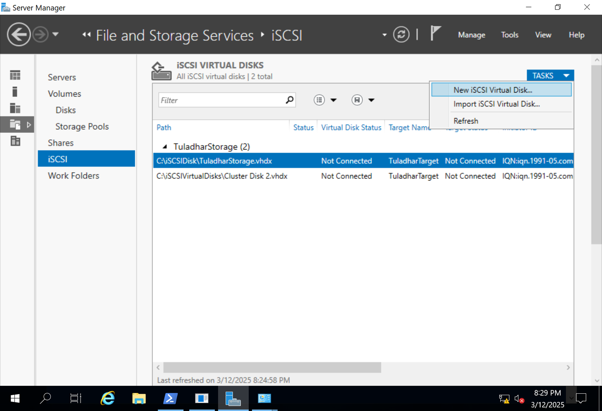

**Change request: cluster node renamed**

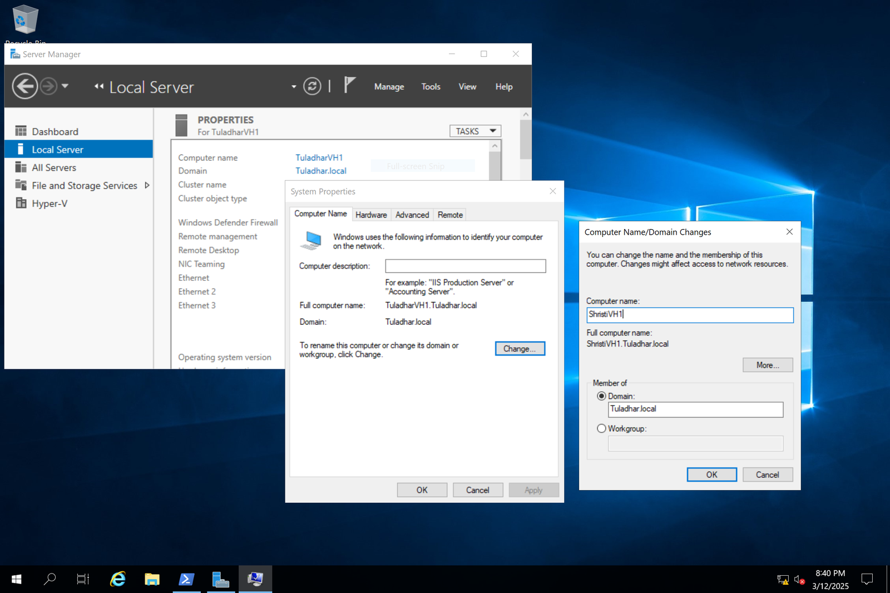

**Change request: ping on the new storage subnet**

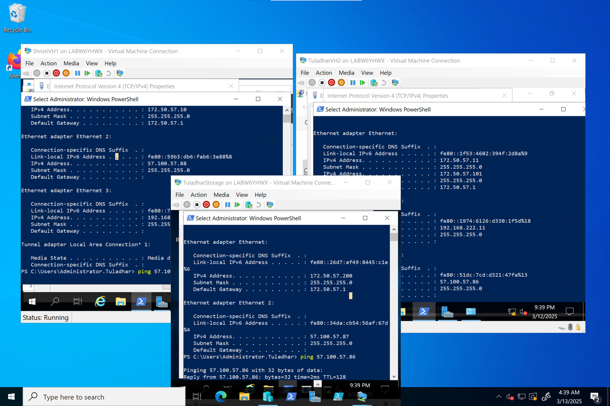

**Change request: cluster renamed**

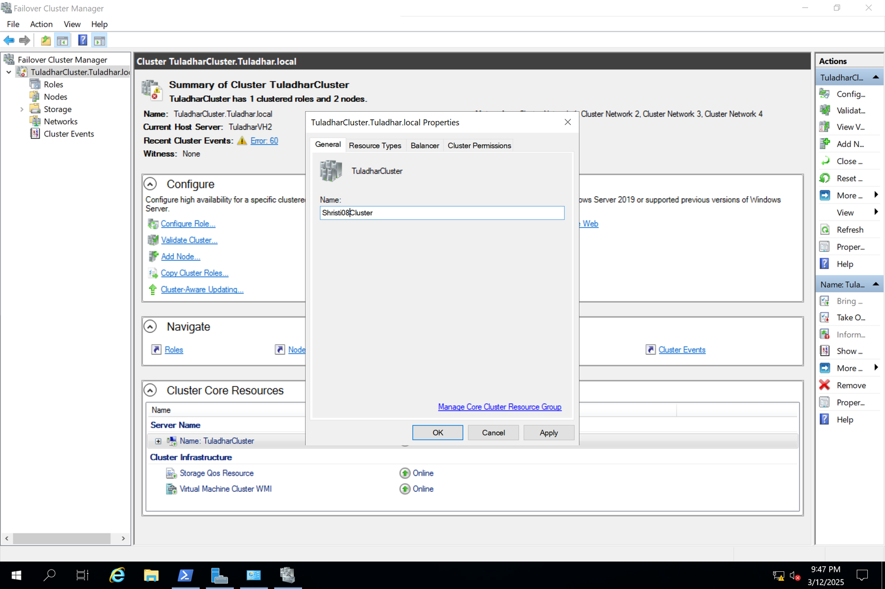

**Change request: updated architecture**


---

## 3. Docker WordPress on the cluster

### Scenario
Run a web application (WordPress with a MySQL database) as containers on the highly available app server.

### What I did
1. Installed Docker Desktop and the Windows Containers feature, then switched Docker to Linux containers
2. Wrote a [docker-compose.yml](scripts/docker-compose.yml) with MySQL, WordPress and XAMPP on one bridge network
3. Added a Windows NAT for the lab subnet so the containers could be reached
4. Started the stack and checked each service
5. Committed the customised WordPress container to an image, pushed it to Docker Hub, and pulled it back to redeploy

### Commands
```powershell
New-NetNat -Name DockerNAT -InternalIPInterfaceAddressPrefix 172.20.57.0/24
docker-compose up -d
docker ps
docker exec -it db-container mysql -uroot -p -e "SHOW DATABASES;"
docker commit wordpress-container <dockerhub-user>/wordpress:v1
docker push <dockerhub-user>/wordpress:v1
docker pull <dockerhub-user>/wordpress:v1
```

### How I checked it worked
- `docker ps` showed all three containers running
- The `wordpress` database existed in MySQL
- The XAMPP dashboard and the WordPress site both loaded in the browser

### Screenshots
**docker-compose up**

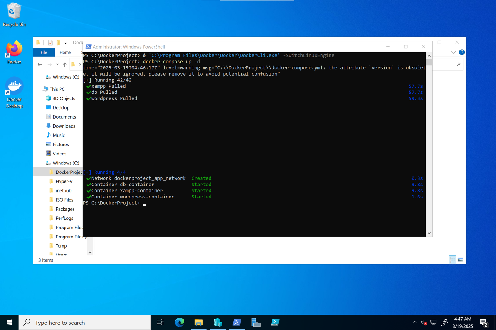

**Containers running and MySQL check**

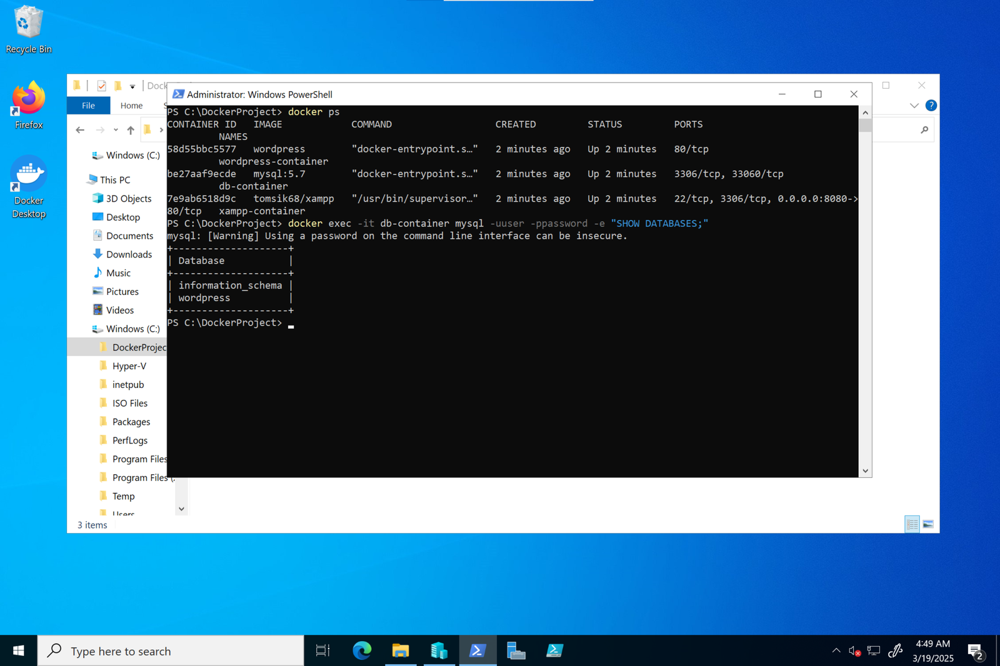

**WordPress site running**

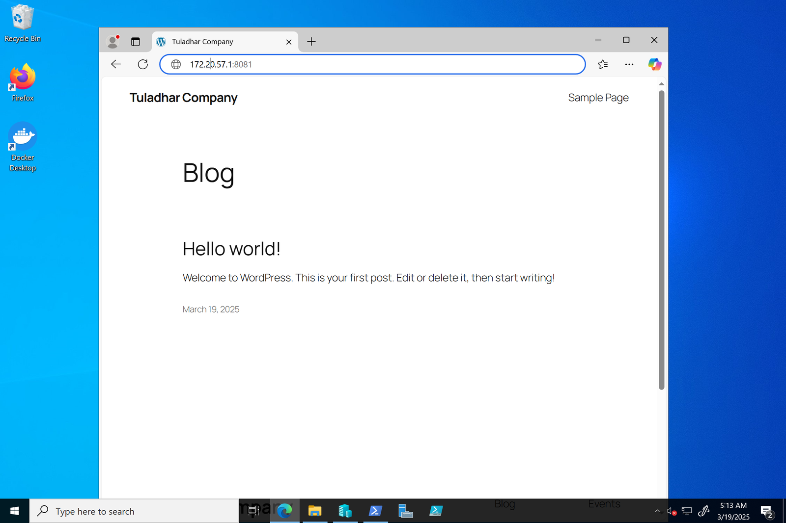
